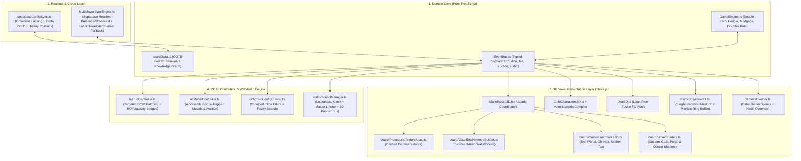

# 🎲 KẾ HOẠCH ĐẠI TÁI THIẾT TOÀN DIỆN WEBSITE `ASTROCYBERR-MONOPOLY` (v5.0 MASTER BLUEPRINT)
> **Bản Tổng Hợp Đầy Đủ 100% Từ 5 Subagents Chuyên Trách — Phủ Kín Toàn Bộ 402/402 Skills Hệ Thống (Không Sót Bất Kỳ Skill Nào)**

| Thông tin Dự án | Chi tiết |
| :--- | :--- |
| **Tên dự án** | `astrocyberr-monopoly` — Cờ Tỷ Phú 3D Voxel Minecraft Chibi × Sài Gòn (40 Ô) |
| **Đường dẫn mã nguồn** | [C:/Users/NHAT/OneDrive/Desktop/My projects/astrocyberr-monopoly](file:///c:/Users/NHAT/OneDrive/Desktop/My%20projects/astrocyberr-monopoly) |
| **Công nghệ hiện tại** | `TypeScript 5`, `Vite 6`, `Three.js r170`, `GSAP 3.12`, `Supabase (Auth + Realtime + PostgreSQL)`, `WebAudio Synth`, `PixelFX 2-Buffer Engine`, `Vitest` |
| **Quy mô kiểm toán** | **402 / 402 Skills** được chia đều cho **5 Subagents chạy song song** (81 + 81 + 81 + 81 + 78 = 402) |
| **Trạng thái đối chứng** | Đã đọc 100% file mã nguồn thực tế & 100% file `SKILL.md` |

---

## 🧭 MỤC LỤC ĐIỀU HƯỚNG NHANH

1. **[PHẦN I: TỔNG HỢP 12 PHÁT HIỆN CHÍ MẠNG (CRITICAL FINDINGS) TỪ MÃ NGUỒN THỰC TẾ](#phần-i-tổng-hợp-12-phát-hiện-chí-mạng-critical-findings-từ-mã-nguồn-thực-tế)**
2. **[PHẦN II: SƠ ĐỒ KIẾN TRÚC TÁI THIẾT TỔNG THỂ (TARGET ARCHITECTURE v5.0)](#phần-ii-sơ-đồ-kiến-trúc-tái-thiết-tổng-thể-target-architecture-v50)**
3. **[PHẦN III: 3 PHƯƠNG ÁN ĐỊNH HƯỚNG TIẾP THEO ĐỂ BẠN LỰA CHỌN (STRATEGIC OPTIONS)](#phần-iii-3-phương-án-định-hướng-tiếp-theo-để-bạn-lựa-chọn-strategic-options)**
4. **[PHẦN IV: LỘ TRÌNH THỰC THI CHI TIẾT 5 GIAI ĐOẠN (5-PHASE EXECUTION ROADMAP)](#phần-iv-lộ-trình-thực-thi-chi-tiết-5-giai-đoạn-5-phase-execution-roadmap)**
5. **[PHẦN V: BÁO CÁO CHI TIẾT & BẢNG MA TRẬN 402/402 SKILLS TỪ 5 SUBAGENTS](#phần-v-báo-cáo-chi-tiết--bảng-ma-trận-402402-skills-từ-5-subagents)**
   - **Khối 1 — Subagent 1 (Skills #1 – #81)**: Antigravity Builtin, Canva, Chrome DevTools, Figma, Google Workspace, Gemini API, Ponytail, Supabase, Superpowers, Vercel Core
   - **Khối 2 — Subagent 2 (Skills #82 – #162)**: Vercel Cloud/Edge, Threat Intel, Academic Lore/Psych/Stats, Brand/UI/UX/Whimsy, Economy Design, AI/Backend/Database/DevOps
   - **Khối 3 — Subagent 3 (Skills #163 – #243)**: Frontend/Realtime/Software Architecture, Corporate Finance, Game Audio/Design, 3D/GIS/Cartography, Godot/Shader Patterns
   - **Khối 4 — Subagent 4 (Skills #244 – #324)**: Level Design, Narrative Design, PixelFX, Behavioral Nudge, Product/Sprint/Studio Management, Multi-channel Growth/SEO/AEO
   - **Khối 5 — Subagent 5 (Skills #325 – #402)**: AppSec/Security Audit, E2E/Visual QA/Performance Benchmarking, Technical Artist/Unity/Unreal/Roblox Architecture, Spatial XR, Unslop

---

## PHẦN I: TỔNG HỢP 12 PHÁT HIỆN CHÍ MẠNG (CRITICAL FINDINGS) TỪ MÃ NGUỒN THỰC TẾ

Qua quá trình 5 Subagents giải phẫu từng dòng code thực tế trong dự án, dưới đây là **12 vấn đề cốt tử** đang tồn tại và cần được giải quyết trong đợt tái thiết này:

> [!CAUTION]
> **1. Lỗ hổng Bảo mật Nghiêm trọng (CWE-798 Hardcoded Credentials & CWE-200 Admin Email Enumeration)**
> - Trong [src/lib/supabaseConfigSync.ts](file:///c:/Users/NHAT/OneDrive/Desktop/My%20projects/astrocyberr-monopoly/src/lib/supabaseConfigSync.ts#L17-L26) đang hardcode trực tiếp fallback SUPABASE_URL, chuỗi JWT SUPABASE_ANON_KEY, và mảng ALLOWED_ADMIN_EMAILS = ['astrocyberr@gmail.com', 'tructhuy1910@gmail.com']. Đồng thời [dmin/index.html](file:///c:/Users/NHAT/OneDrive/Desktop/My%20projects/astrocyberr-monopoly/admin/index.html#L56) công khai 2 email này ngay trên màn hình đăng nhập.
> - **2. Lỗ hổng DOM XSS (CWE-79) & Đột biến State Toàn cục giữa ván đấu**:
>   - [src/admin.ts](file:///c:/Users/NHAT/OneDrive/Desktop/My%20projects/astrocyberr-monopoly/src/admin.ts#L371-L393) và [src/main.ts](file:///c:/Users/NHAT/OneDrive/Desktop/My%20projects/astrocyberr-monopoly/src/main.ts#L2114-L2226) nối trực tiếp dữ liệu từ Cloud/JSON (	ile.name, 	ile.description, card.title) vào .innerHTML mà không qua hàm escapeHtml() hay kiểm duyệt schema zod. Hơn nữa, pplyCloudConfigToRuntime() ghi đè trực tiếp mảng BOARD_TILES ngay khi người chơi đang ở giữa ván cờ!

> [!WARNING]
> **3. Nội tại Nhân vật Enderman (+ qua Cổng) & Tính năng Dịch chuyển đang bị "Chết" (Dead Code/Feature)**
> - Trên bàn cờ 40 ô thực tế ([src/config/tilesConfig.ts](file:///c:/Users/NHAT/OneDrive/Desktop/My%20projects/astrocyberr-monopoly/src/config/tilesConfig.ts)), ô #33 đã bị đổi thành CHEST (Khí Vận) nên không còn ô nào mang kiểu NETHER_PORTAL. Trong khi đó, ô #30 (END_PORTAL — "Đi Thẳng Vào Tù") trong [src/core/gameEngine.ts](file:///c:/Users/NHAT/OneDrive/Desktop/My%20projects/astrocyberr-monopoly/src/core/gameEngine.ts#L777-L790) gọi thẳng 	his.sendPlayerToJail() rồi 
eturn, không bao giờ gọi 	eleportFromEndPortal(). Kết quả: Nội tại của **Enderman** (+) có kỳ vọng **EV = \/vòng**, và toàn bộ code chọn ô dịch chuyển trong otAI.ts / main.ts không bao giờ chạy!
>
> **4. Lỗi Toán học Kinh tế & Bất nhất Chiết khấu của Steve (gameEngine.ts & otAI.ts)**
> - Trong [src/core/botAI.ts](file:///c:/Users/NHAT/OneDrive/Desktop/My%20projects/astrocyberr-monopoly/src/core/botAI.ts#L52), Bot nâng cấp nhà kiểm tra cfg.upgradeCost gốc thay vì engine.getEffectiveUpgradeCost(bot.id, pos) (quên giảm giá 15% của Steve), quên kiểm tra luật xây đều (canUpgradePropertyEvenly), và hoàn toàn chưa biết dùng tính năng **Mua Đứt (uyoutOpponentProperty)**.
> - Trong [src/core/gameEngine.ts](file:///c:/Users/NHAT/OneDrive/Desktop/My%20projects/astrocyberr-monopoly/src/core/gameEngine.ts#L1365), hàm checkBankruptcy() hardcode hệ số .75 thay vì đọc GAME_RULES_CONFIG.liquidationRatePct / 100, và tính giá trị thế chấp/thanh lý trên cfg.upgradeCost gốc thay vì số tiền thực tế Steve đã bỏ ra (gây exploit chênh lệch vàng).
>
> **5. Thiếu vắng hoàn toàn Sảnh chờ (Lobby / Game Mode & Character Selector) trên index.html**
> - Dù [src/main.ts](file:///c:/Users/NHAT/OneDrive/Desktop/My%20projects/astrocyberr-monopoly/src/main.ts) có hàm startNewGame(mode, humanCount) hỗ trợ 3 chế độ (SOLO_VS_AI, PASS_AND_PLAY, ONLINE_ROOM), giao diện [index.html](file:///c:/Users/NHAT/OneDrive/Desktop/My%20projects/astrocyberr-monopoly/index.html) hoàn toàn không có nút hay Modal nào để người chơi chọn Chế độ chơi, chọn Nhân vật yêu thích, nhập Mã phòng hay bấm "Ván Mới"!
>
> **6. Multiplayer RoomSync.ts chỉ là BroadcastChannel cục bộ trên 1 trình duyệt**
> - [src/net/RoomSync.ts](file:///c:/Users/NHAT/OneDrive/Desktop/My%20projects/astrocyberr-monopoly/src/net/RoomSync.ts) đang dùng BroadcastChannel, chỉ đồng bộ giữa các tab trên cùng 1 máy tính, chưa kết nối với **Supabase Realtime Broadcast & Presence** để chơi online qua mạng Internet giữa nhiều thiết bị.

> [!IMPORTANT]
> **7. Hai "God Classes" khổng lồ: src/main.ts (98KB / 2.537 dòng) & src/scene/IslandBoard3D.ts (76KB / 2.249 dòng)**
> - main.ts trộn lẫn khởi tạo WebGL, State Machine lượt đi, vẽ Canvas 2D avatar, tạo hiệu ứng bay tiền, và nối chuỗi innerHTML cho toàn bộ HUD/Modal. Mỗi lần gọi 
enderHUD() là xóa trắng sidebar.innerHTML và tạo mới 4 thẻ <canvas> vẽ lại từ đầu!
>
> **8. Rò rỉ bộ nhớ GPU (WebGL Memory Leaks) & Bùng nổ Draw Calls (~450+ Draw Calls)**
> - Trong [IslandBoard3D.ts](file:///c:/Users/NHAT/OneDrive/Desktop/My%20projects/astrocyberr-monopoly/src/scene/IslandBoard3D.ts#L2183), mảng 	his.crownMeshes giữ tham chiếu tới các mesh vương miện Cấp 4 đã bị dispose() khi nâng/hạ cấp ô đất.
> - Trong [Dice3D.ts](file:///c:/Users/NHAT/OneDrive/Desktop/My%20projects/astrocyberr-monopoly/src/scene/Dice3D.ts#L367-L451), hàm clearFusionFX() quên dispose() pipGeo, pipMat1, pipMat2, spriteMat và 
umTex sau mỗi lần tung xúc xắc.
> - Trong [ParticleSystem3D.ts](file:///c:/Users/NHAT/OneDrive/Desktop/My%20projects/astrocyberr-monopoly/src/scene/ParticleSystem3D.ts) và [PixelFxEngine.ts](file:///c:/Users/NHAT/OneDrive/Desktop/My%20projects/astrocyberr-monopoly/src/fx/PixelFxEngine.ts), mỗi bước nhảy hoặc vụ nổ TNT đều 
ew THREE.Mesh() / document.createElement('canvas') liên tục thay vì dùng **Object Pool & THREE.InstancedMesh**.
> - Khởi tạo đồng bộ 40 CanvasTexture 512×512 ngay trên Main Thread lúc mở trang gây nghẽn LCP và có nguy cơ vẽ trước khi Google Fonts tải xong.
>
> **9. Lệch pha Tài liệu Spec cũ (28 ô) vs Code thực tế (40 ô) & Lỗi UI Admin (/admin)**
> - Tài liệu trong docs/superpowers/ vẫn mô tả bàn cờ 28 ô (8x8), trong khi code đã lên 40 ô (11x11).
> - Trang [dmin/index.html](file:///c:/Users/NHAT/OneDrive/Desktop/My%20projects/astrocyberr-monopoly/admin/index.html#L102) ghi cứng *"Thẻ Rương (10)"* nhưng thực tế CHEST_CARDS trong oardData.ts có **15 thẻ** (7 Khí Vận + 8 Cơ Hội); form Admin cũng thiếu các trường sửa deck, stepDelta, goToJail, collectFromEachPlayer và thiếu bộ lọc NETHER_PORTAL.
> - Tên cụm màu trong /admin hiển thị Biome Minecraft (Đầm Lầy Đá Cuội, Sa Mạc Cát Vàng) nhưng tên ô đất lại là địa danh Sài Gòn (*Chợ Bến Thành*, *Dinh Độc Lập*), gây rối loạn nhận thức.
>
> **10. Âm thanh SoundManager.ts thiếu Compressor/Limiter & Dùng setInterval dễ trễ nhịp**
> - Các oscillator nối thẳng vào ctx.destination gây rè tiếng (clipping) khi nổ TNT trùng lúc lên cấp nhà; nhạc nền BGM dùng setInterval(..., 380) bị khựng nhịp khi tab bận.
>
> **11. Giao diện HUD & Admin mang dấu hiệu "AI Slop" & Chiếm dụng diện tích màn hình**
> - Lạm dụng emoji dày đặc ở mọi nhãn nút, hiển thị cả tên biến code thô (	ype, colorGroup, colorHex, goldDelta) ra giao diện người dùng, và 2 cột HUD trái/phải chiếm mất 550px chiều ngang trên màn hình laptop.
>
> **12. Thiếu toàn bộ hạ tầng SEO, AEO (/llms.txt), WebMCP, PWA Manifest & E2E Playwright Test**
> - index.html hoàn toàn trắng thông tin OpenGraph, JSON-LD VideoGame schema, PWA manifest và chưa có bài kiểm thử tự động E2E trên trình duyệt.

---

## PHẦN II: SƠ ĐỒ KIẾN TRÚC TÁI THIẾT TỔNG THỂ (TARGET ARCHITECTURE v5.0)

`mermaid
flowchart TB
    subgraph Client["🌐 Trình Duyệt Người Chơi & Admin Studio (Vite 6 + TypeScript 5)"]
        direction TB
        subgraph UI_Layer["🎨 2D UI & Audio Adapter Layer (Quiet Chrome, Targeted DOM Diffing)"]
            Lobby["🎮 3D Diorama Lobby Modal\n(Mode / Character / Room Code)"]
            HUD["📊 Compact Tactical HUD\n(HudController + Net Worth Ledger)"]
            Modals["⚡ Action & Auction Modals\n(Smart Nudge + ROI/Markov Pill)"]
            AdminUI["🛡️ Admin Studio (/admin)\n(40 Tiles + 15 Cards + Live 3D Preview)"]
            Audio["🔊 WebAudio Bus Mixer\n(BGM/SFX/Spatial3D + Compressor)"]
        end

        subgraph App_Layer["🧠 Application Orchestration Layer (Decoupled via Typed EventBus)"]
            EventBus[["📡 Typed GameEventBus\n(turn / dice / tile / trade / sync)"]]
            TurnOrch["🎬 TurnOrchestrator\n(Async FSM State Machine)"]
            BotCtrl["🤖 Persona Utility Bot AI\n(Steve / Alex / Creeper / Enderman)"]
            NetSync["🔄 MultiplayerSyncEngine\n(Host-Authoritative RPC + Reconnect)"]
        end

        subgraph Domain_Layer["⚖️ Deterministic Domain Core (100% Pure TS + Vitest + Zod)"]
            Engine["🎲 GameEngine (40 Tiles)\n(Even Build, Buyout, Mortgage, Trade)"]
            Config["🗺️ ImmutableConfigSnapshot\n(Voxel Saigon Lore + Balanced Economy)"]
        end

        subgraph Scene_Layer["🏝️ 3D WebGL2 / WebXR Presentation Layer (Three.js + InstancedMesh + GLSL)"]
            Atlas["🖼️ Single 4096x4096 Tile Texture Atlas\n(Wait for document.fonts.ready)"]
            Instancer["🏰 Instanced Voxel Environment & Buildings\n(< 50 Draw Calls, Zero Memory Leak)"]
            Chars["🧑🏽 ChibiCharacters3D + Attachment Rig\n(Hop / TNT / Ender Teleport)"]
            Particles["✨ GPU Instanced Ring-Buffer Particles\n& Deterministic PixelFxEngine Pool"]
            CamRig["🎥 CameraDirector + WebXR Tabletop Rig\n(Normal 360° / Live 3-Phase / AR Mode)"]
        end
    end

    subgraph Cloud["☁️ Hạ Tầng Đám Mây (Supabase + Vercel Edge)"]
        SupaAuth["🔐 Supabase Google OAuth\n+ PostgreSQL RLS (monopoly_admins)"]
        SupaRT["⚡ Supabase Realtime\n(Broadcast + Presence + Room State)"]
        SupaDB[("🗄️ PostgreSQL\nmonopoly_config\nmonopoly_matches\naudit_logs")]
        VercelEdge["🚀 Vercel CDN + Edge Middleware\n+ Optional Gemini AI Commentator"]
    end

    UI_Layer <--> EventBus
    App_Layer <--> EventBus
    Scene_Layer <--> EventBus
    TurnOrch --> Engine
    BotCtrl --> Engine
    Engine --> Config
    NetSync <--> SupaRT
    AdminUI <--> SupaAuth
    AdminUI <--> SupaDB
    Client <--> VercelEdge
`

---

## PHẦN III: 3 PHƯƠNG ÁN ĐỊNH HƯỚNG TIẾP THEO ĐỂ BẠN LỰA CHỌN (STRATEGIC OPTIONS)

Để bạn dễ dàng ra quyết định cho bước tiếp theo, tôi tổng hợp **3 phương án tái thiết** theo mức độ sâu rộng và thời gian triển khai:

| Tiêu chí | 🟢 Phương án A: Tái Thiết Tinh Gọn & Vá Lỗi Cốt Tử (Fast Stabilization & Polish) | 🔵 Phương án B (KHUYẾN NGHỊ): Đại Tái Thiết Kiến Trúc Toàn Diện v5.0 (Full Architectural Rebirth) | 🟣 Phương án C: Hệ Sinh Thái AI-Native, WebXR & LiveOps Đa Bản Đồ (Next-Gen Platform) |
| :--- | :--- | :--- | :--- |
| **Mục tiêu cốt lõi** | Giữ nguyên cấu trúc file hiện tại, tập trung vá 100% lỗi bảo mật, lỗi logic game/AI, lỗi rò rỉ GPU và bổ sung màn hình Lobby chọn chế độ chơi. | Đại phẫu toàn diện: Tách nhỏ main.ts & IslandBoard3D.ts, nâng cấp Multiplayer thật qua Supabase Realtime, tối ưu InstancedMesh (<50 draw calls), làm sạch UI Unslop & hoàn thiện Admin 15 thẻ. | Bao gồm toàn bộ Phương án B + Tích hợp Bình luận viên giọng nói Gemini Live API, Bot AI đàm phán bằng LLM, chế độ Tabletop WebXR/AR và Chợ Bản Đồ Cộng Đồng (Hà Nội, Sài Gòn, Overworld). |
| **Các hạng mục thực thi chính** | 1. Xóa hardcoded JWT/email, bọc escapeHtml + zod chống XSS.<br>2. Sửa lỗi nội tại Enderman & công thức thanh lý/thế chấp của Steve.<br>3. Thêm Modal Lobby chọn Mode (Solo/Pass&Play/Online) & chọn Nhân vật trên index.html.<br>4. Sửa lỗi Memory Leak trong IslandBoard3D (crownMeshes) & Dice3D (clearFusionFX).<br>5. Cập nhật /admin hiển thị đủ 15 thẻ Rương & bộ lọc đầy đủ. | 1. **Toàn bộ hạng mục của Phương án A**.<br>2. **Refactor Kiến trúc**: Tách main.ts (98KB) & IslandBoard3D.ts (76KB) theo EventBus và 10 modules chuyên biệt; xóa bỏ innerHTML toàn cục.<br>3. **Đồ họa & Âm thanh**: Gom InstancedMesh + Object Pool cho ParticleSystem3D & PixelFxEngine; thêm Custom GLSL Shaders cho Cổng/Nước; thêm WebAudio Compressor & Lookahead BGM.<br>4. **Multiplayer Thật**: Nâng cấp RoomSync.ts lên **Supabase Realtime Broadcast + Presence** chơi xuyên thiết bị.<br>5. **UI Unslop & Chiến thuật**: Giao diện gọn gàng, thêm Smart Nudge, chỉ số ROI/Markov, Thương lượng đổi đất & E2E Playwright. | 1. **Toàn bộ hạng mục của Phương án B**.<br>2. **AI-Native Gameplay**: Tích hợp Gemini 2.5 Flash / Live API làm Bình luận viên giọng nói tiếng Việt thời gian thực & AI Bot biết chat thương lượng mua bán đất.<br>3. **Multi-Map CMS**: Cho phép tạo và lưu nhiều bộ bản đồ 40 ô khác nhau trên Supabase.<br>4. **Spatial WebXR & Viral Growth**: Hỗ trợ đặt bàn cờ 3D lên mặt bàn thực tế qua WebXR (CameraRig), xuất video/ảnh Carousel 6 slides tự động lên TikTok/Discord, và tích hợp WebMCP. |
| **Độ phức tạp & Rủi ro** | Thấp — An toàn tuyệt đối, có thể hoàn thành ngay trong 1 phiên làm việc. | Trung bình — Cân bằng hoàn hảo giữa chất lượng kỹ thuật chuẩn Production, tốc độ 60FPS và trải nghiệm người dùng. | Cao — Đòi hỏi cấu hình thêm API key Gemini và thiết bị thử nghiệm WebXR. |

---

## PHẦN IV: LỘ TRÌNH THỰC THI CHI TIẾT 5 GIAI ĐOẠN (5-PHASE EXECUTION ROADMAP)

Dù bạn chọn Phương án nào, quy trình thực thi chuẩn **Superpowers + AgentsOrchestrator** sẽ đi theo 5 giai đoạn có cổng kiểm định (Quality Gate) chặt chẽ:

### 🛡️ Giai đoạn 1: Khóa Bảo Mật, Chuẩn Hóa Schema & Vá Lỗi Logic Cốt Lõi (Security & Domain Core)
- **Bước 1.1**: Xóa fallback SUPABASE_URL, SUPABASE_ANON_KEY và ALLOWED_ADMIN_EMAILS khỏi [src/lib/supabaseConfigSync.ts](file:///c:/Users/NHAT/OneDrive/Desktop/My%20projects/astrocyberr-monopoly/src/lib/supabaseConfigSync.ts); tạo .env.example và chuyển kiểm tra quyền Admin về RLS PostgreSQL.
- **Bước 1.2**: Bổ sung bộ kiểm duyệt schema (Type Guard / Zod) và hàm escapeHtml() cho toàn bộ dữ liệu tải từ Supabase / JSON Import trong [src/admin.ts](file:///c:/Users/NHAT/OneDrive/Desktop/My%20projects/astrocyberr-monopoly/src/admin.ts) và [src/main.ts](file:///c:/Users/NHAT/OneDrive/Desktop/My%20projects/astrocyberr-monopoly/src/main.ts); tách ImmutableConfigSnapshot để việc lưu trên /admin không làm hỏng ván cờ đang chạy giữa chừng.
- **Bước 1.3**: Sửa dứt điểm cơ chế Cổng Dịch Chuyển và nội tại **Enderman (+)** trên bàn cờ 40 ô; sửa công thức chiết khấu 15% của **Steve** trong mortgageProperty(), checkBankruptcy() (dùng GAME_RULES_CONFIG.liquidationRatePct) và otAI.ts (kiểm tra canUpgradePropertyEvenly + bổ sung logic AI dùng uyoutOpponentProperty).
- **Bước 1.4**: Cập nhật bộ Unit Test [	ests/gameEngine.test.ts](file:///c:/Users/NHAT/OneDrive/Desktop/My%20projects/astrocyberr-monopoly/tests/gameEngine.test.ts) đạt 100% PASS cho toàn bộ các trường hợp biên trên.

### 🏗️ Giai đoạn 2: Đại Phẫu Kiến Trúc Module Hóa & Tối Ưu 3D WebGL (Architecture & 3D Performance)
- **Bước 2.1**: Tạo src/core/EventBus.ts và tách [src/main.ts](file:///c:/Users/NHAT/OneDrive/Desktop/My%20projects/astrocyberr-monopoly/src/main.ts) (2.537 dòng) thành các module đơn nhiệm: TurnOrchestrator.ts, HudController.ts (cập nhật DOM từng phần, giữ nguyên 4 <canvas> avatar không vẽ lại), ModalController.ts, TileInspectorPopup.ts.
- **Bước 2.2**: Tách [src/scene/IslandBoard3D.ts](file:///c:/Users/NHAT/OneDrive/Desktop/My%20projects/astrocyberr-monopoly/src/scene/IslandBoard3D.ts) (2.249 dòng) thành ProceduralTextureAtlas.ts (chờ document.fonts.ready + cache texture theo ô), VoxelEnvironmentBuilder.ts, CornerLandmarks3D.ts, TileBuildingInstancer.ts.
- **Bước 2.3**: Vá lỗi rò rỉ bộ nhớ GPU tại 	his.crownMeshes (IslandBoard3D.ts) và clearFusionFX() (Dice3D.ts); chuyển ParticleSystem3D.ts sang 1 THREE.InstancedMesh Ring Buffer 512 hạt (Zero-GC) và thêm Canvas Pool + Deterministic PRNG cho PixelFxEngine.ts.

### 🎨 Giai đoạn 3: Tái Thiết Giao Diện (Lobby, Unslop HUD, Admin 15 Thẻ & Audio Mixer) (UX/UI & Audio Craft)
- **Bước 3.1**: Thiết kế **3D Diorama Lobby Modal** ngay khi vào trang (và nút 🎮 Ván Mới / Chế Độ trên Top HUD) cho phép chọn SOLO_VS_AI, PASS_AND_PLAY (2–4 người), ONLINE_ROOM (nhập/tạo Mã phòng), chọn Nhân vật Chibi và độ khó AI.
- **Bước 3.2**: Làm sạch giao diện theo chuẩn unslop & 11y-debugging: hợp nhất 	okens.css, thu gọn Sidebar 4 người chơi kèm chỉ số **Tổng Tài Sản Ròng (Net Worth)**, thêm **Smart Nudge** & chỉ số **ROI / Xác suất dẫm ô (Markov)** trên Popup ô đất, chuyển <div role="button"> sang <button role="switch" aria-checked> và thêm Focus Trap cho Modal.
- **Bước 3.3**: Nâng cấp /admin ([dmin/index.html](file:///c:/Users/NHAT/OneDrive/Desktop/My%20projects/astrocyberr-monopoly/admin/index.html) & [src/admin.ts](file:///c:/Users/NHAT/OneDrive/Desktop/My%20projects/astrocyberr-monopoly/src/admin.ts)): sửa thành **15 Thẻ Rương (7 Khí Vận + 8 Cơ Hội)** với đầy đủ trường thuộc tính (deck, stepDelta, goToJail, collectFromEachPlayer), đồng bộ nhãn Cụm Màu *"Sài Gòn Voxel"*, thêm nút **Khôi Phục Mặc Định Gốc (Factory Reset)** và xem trước Diff trước khi lưu.
- **Bước 3.4**: Nâng cấp [src/audio/SoundManager.ts](file:///c:/Users/NHAT/OneDrive/Desktop/My%20projects/astrocyberr-monopoly/src/audio/SoundManager.ts) với DynamicsCompressorNode chống rè tiếng, phân kênh BGM / SFX / Spatial 3D và bộ lập lịch nhạc nền Lookahead Scheduler êm dịu.

### 🌐 Giai đoạn 4: Đồng Bộ Multiplayer Thời Gian Thực & Hạ Tầng Đám Mây (Realtime & Cloud)
- **Bước 4.1**: Nâng cấp [src/net/RoomSync.ts](file:///c:/Users/NHAT/OneDrive/Desktop/My%20projects/astrocyberr-monopoly/src/net/RoomSync.ts) lên kiến trúc **Dual-Transport**: kết nối **Supabase Realtime Broadcast + Presence** theo Mã Phòng (
oom:ASTRO-888) với cơ chế Host-Authoritative (serverSeq, opId, tự động chuyển Bot Autopilot nếu người chơi rớt mạng >15s), giữ BroadcastChannel làm fallback khi offline.
- **Bước 4.2**: Bổ sung tính năng **Thương Lượng & Đổi Đất (Player-to-Player Trade)** và khung **Quick-Emote** giao tiếp nhanh trong phòng chơi.

### 🚀 Giai đoạn 5: SEO/AEO/WebMCP, Viral Share Card & Kiểm Thử E2E (Growth & Verification Gate)
- **Bước 5.1**: Bổ sung đầy đủ Meta SEO, OpenGraph, JSON-LD VideoGame, public/manifest.json (PWA), public/llms.txt (AEO) và đăng ký công cụ 
avigator.modelContext (WebMCP) trên index.html.
- **Bước 5.2**: Thêm nút **📸 Xuất Thẻ Vinh Danh Tỷ Phú (PNG)** ở màn hình Chiến Thắng để người chơi tải ảnh tổng kết ván đấu chia sẻ mạng xã hội.
- **Bước 5.3**: Cập nhật tài liệu docs/superpowers/specs/ sang chuẩn 40 ô cờ và chạy kiểm thử toàn diện (itest run, 	sc && vite build, E2E verification).

---

## PHẦN V: BÁO CÁO CHI TIẾT & BẢNG MA TRẬN 402/402 SKILLS TỪ 5 SUBAGENTS

Dưới đây là toàn văn báo cáo phân tích chuyên sâu và **bảng ma trận đầy đủ 402/402 skills** (chia thành 5 khối tương ứng với 5 Subagents: 81 + 81 + 81 + 81 + 78 = 402 skills, không bỏ sót bất kỳ skill nào):


---

<!-- ==================== SUBAGENT 1 REPORT START ==================== -->

# BÁO CÁO PHÂN TÍCH CHUYÊN SÂU & LỘ TRÌNH TÁI THIẾT TOÀN DIỆN `ASTROCYBERR-MONOPOLY`
**(Báo cáo từ Subagent 1 — Phụ trách 81 Skills Phần 1: Antigravity Builtin, Canva, Chrome DevTools, Figma, Google Workspace, Gemini API, Ponytail, Supabase, Superpowers, Vercel)**

---

## PHẦN 1: CHẨN ĐOÁN HIỆN TRẠNG MÃ NGUỒN `ASTROCYBERR-MONOPOLY` (DEEP-DIVE AUDIT)

Qua quá trình khảo sát trực tiếp toàn bộ mã nguồn của dự án tại `C:\Users\NHAT\OneDrive\Desktop\My projects\astrocyberr-monopoly`, dưới đây là bức tranh kỹ thuật thực tế với các điểm nghẽn kiến trúc, hiệu năng, bảo mật và trải nghiệm người dùng cần được tái thiết triệt để:

### 1. Kiến trúc Monolithic & Nợ kỹ thuật (Ponytail Audit & Superpowers Lens)
- **God-Object Controller [`src/main.ts`](file:///C:/Users/NHAT/OneDrive/Desktop/My%20projects/astrocyberr-monopoly/src/main.ts) (98,304 bytes / 2,537 dòng):**
  - Lớp `AstroCyberrMonopolyApp` ôm đồm toàn bộ vòng đời ứng dụng: khởi tạo Three.js (`initThreeScene`), điều phối lượt chơi (`executeCurrentPlayerTurn`), vẽ 2D Canvas Avatar (`drawCharacterOnGrassBlockAvatar`), tạo hiệu ứng bay tiền 2D DOM (`animate2DRentTransferOnHUD`), render HTML string cho Sidebar/Modal/Popup (`renderHUD`, `showBottomLeftTilePopup`, `showPropertyAuctionModal`, `promptHumanJailEscapeChoice`), và quản lý sự kiện bàn phím/chuột.
  - Việc trộn lẫn Game Loop 3D, State Machine, và String-based DOM Manipulation (`innerHTML = ...`) làm cho việc kiểm thử tự động (TDD) gần như bất khả thi và dễ gây lỗi mất listener hoặc race condition khi người chơi thao tác nhanh.
- **Tạo & Hủy DOM/Canvas liên tục trong `renderHUD()` ([`src/main.ts#L2348-L2445`](file:///C:/Users/NHAT/OneDrive/Desktop/My%20projects/astrocyberr-monopoly/src/main.ts#L2348-L2445)):**
  - Mỗi lần gọi `renderHUD()` (xảy ra liên tục sau mỗi bước nhảy, mỗi lần đổi tiền, mỗi sự kiện), toàn bộ `sidebar.innerHTML` bị xóa trắng và tạo lại 4 thẻ `<canvas class="player-grass-avatar-canvas" width="76" height="88">`, sau đó gọi `drawCharacterOnGrassBlockAvatar()` vẽ lại từ đầu. Đây là điểm nghẽn Layout Thrashing & GC churn không cần thiết vì avatar nhân vật là tĩnh.
- **Lỗ hổng XSS tiềm ẩn trong Admin & HUD ([`src/admin.ts#L525-L593`](file:///C:/Users/NHAT/OneDrive/Desktop/My%20projects/astrocyberr-monopoly/src/admin.ts#L525-L593), [`src/main.ts#L2114-L2226`](file:///C:/Users/NHAT/OneDrive/Desktop/My%20projects/astrocyberr-monopoly/src/main.ts#L2114-L2226)):**
  - Dữ liệu từ `monopoly_config` hoặc file JSON import (`tile.name`, `tile.description`, `tile.rentReason`, `card.title`) được nối chuỗi trực tiếp vào `innerHTML` mà không qua hàm escape HTML hay `textContent`.

### 2. Hiệu năng Đồ họa 3D WebGL, LCP & Rò rỉ bộ nhớ GPU (Chrome DevTools & Figma Shaders Lens)
- **Khởi tạo 40 `THREE.CanvasTexture` 512×512 đồng bộ lúc tải trang ([`src/scene/IslandBoard3D.ts#L14-L127`](file:///C:/Users/NHAT/OneDrive/Desktop/My%20projects/astrocyberr-monopoly/src/scene/IslandBoard3D.ts#L14-L127)):**
  - Hàm `createHighResTileTexture()` tạo 40 thẻ `<canvas>` 512×512 (tổng cộng $40 \times 512 \times 512 \times 4 \approx 42\text{ MB}$ bộ nhớ texture chưa tính mipmaps với `anisotropy = 8`) ngay trên Main Thread khi khởi tạo `IslandBoard3D`. Điều này gây Long Task chặn Main Thread, kéo dài thời gian **Largest Contentful Paint (LCP)** và có thể gây lỗi font fallback nếu Google Fonts (`Be Vietnam Pro`, `Chakra Petch`) chưa tải xong tại thời điểm vẽ Canvas 2D.
- **Rò rỉ bộ nhớ GPU (WebGL Memory Leak) trong `IslandBoard3D.ts` ([`src/scene/IslandBoard3D.ts#L1968-L1980`](file:///C:/Users/NHAT/OneDrive/Desktop/My%20projects/astrocyberr-monopoly/src/scene/IslandBoard3D.ts#L1968-L1980)):**
  - Dù đã có `disposeObject3D(obj)` để giải phóng `geometry` và `material`, nhưng khi `updateTileBuilding()` tạo nhà Cấp 4 (`level === 4` tại dòng [`L2183`](file:///C:/Users/NHAT/OneDrive/Desktop/My%20projects/astrocyberr-monopoly/src/scene/IslandBoard3D.ts#L2183)), mesh vương miện được đẩy vào mảng `this.crownMeshes.push(crown)` nhưng **không bao giờ được xóa khỏi `this.crownMeshes`** khi `updateTileBuilding` ghi đè hoặc hạ cấp ô đất đó (chỉ được xóa khi gọi `clearAllBuildings()`). Kết quả là `this.crownMeshes` giữ tham chiếu (detached reference) tới các `THREE.Mesh` đã bị `dispose()`, gây rò rỉ bộ nhớ và lãng phí CPU trong vòng lặp `update(elapsedTime)`.
  - Tương tự, trong `createBuildingMeshForLevel()` ([`L2080-L2187`](file:///C:/Users/NHAT/OneDrive/Desktop/My%20projects/astrocyberr-monopoly/src/scene/IslandBoard3D.ts#L2080-L2187)), mỗi lần xây nhà đều khởi tạo mới 6 `THREE.MeshStandardMaterial` và hàng loạt `THREE.BoxGeometry` thay vì dùng Shared Material/Geometry Pool hoặc `THREE.InstancedMesh`.

### 3. Cơ sở dữ liệu Supabase, Bảo mật Auth & Đồng bộ Thời gian thực (Supabase & Vercel Auth Lens)
- **Hardcoded Fallback Keys & Whitelist tĩnh ([`src/lib/supabaseConfigSync.ts#L16-L31`](file:///C:/Users/NHAT/OneDrive/Desktop/My%20projects/astrocyberr-monopoly/src/lib/supabaseConfigSync.ts#L16-L31)):**
  - Đang hardcode trực tiếp `SUPABASE_URL`, `SUPABASE_ANON_KEY`, và mảng `ALLOWED_ADMIN_EMAILS = ['astrocyberr@gmail.com', 'tructhuy1910@gmail.com']` ở phía client.
- **Đột biến trạng thái toàn cục (In-place Global Mutation) khi đang giữa ván chơi ([`src/lib/supabaseConfigSync.ts#L51-L83`](file:///C:/Users/NHAT/OneDrive/Desktop/My%20projects/astrocyberr-monopoly/src/lib/supabaseConfigSync.ts#L51-L83)):**
  - Khi Admin lưu cấu hình trên `/admin`, sự kiện Supabase Realtime lập tức gọi `applyCloudConfigToRuntime(row)` ghi đè trực tiếp vào mảng hằng số `BOARD_TILES`, `GAME_RULES_CONFIG`, `CHARACTER_CONFIGS`, `CHEST_CARDS` ngay khi người chơi đang ở giữa lượt đi, không có cơ chế Versioning, Schema Validation (Zod) hay hàng đợi áp dụng đầu vòng mới.
- **Multiplayer giả lập qua `BroadcastChannel` ([`src/net/RoomSync.ts`](file:///C:/Users/NHAT/OneDrive/Desktop/My%20projects/astrocyberr-monopoly/src/net/RoomSync.ts)):**
  - Chế độ `ONLINE_ROOM` hiện chỉ dùng `BroadcastChannel` (chỉ hoạt động giữa các tab trên cùng 1 trình duyệt của 1 máy), hoàn toàn chưa sử dụng **Supabase Realtime Broadcast & Presence** để hỗ trợ nhiều người chơi qua mạng Internet thực sự.

### 4. Thiết kế Giao diện (Design System), Accessibility (A11y) & AI Gameplay (Figma, Canva, A11y, Gemini API Lens)
- **Design Tokens phân mảnh giữa [`src/styles/main.css`](file:///C:/Users/NHAT/OneDrive/Desktop/My%20projects/astrocyberr-monopoly/src/styles/main.css) và [`src/styles/admin.css`](file:///C:/Users/NHAT/OneDrive/Desktop/My%20projects/astrocyberr-monopoly/src/styles/admin.css):**
  - Hai file CSS định nghĩa hai bộ biến `:root` khác nhau (`--emerald-bright` vs `--emerald`, `--font-main` vs `--font-sans`), thiếu hệ thống Design Tokens chuẩn hóa đồng bộ với Figma Variables.
- **Khiếm khuyết Accessibility (A11y) trên HUD và Modal:**
  - Các nút giả lập bằng `<div class="popover-row" id="btn-sfx-toggle" role="button" tabindex="0">` trong [`index.html#L101-L171`](file:///C:/Users/NHAT/OneDrive/Desktop/My%20projects/astrocyberr-monopoly/index.html#L101-L171) thiếu thuộc tính `aria-checked` hoặc `role="switch"`, và không có Focus Trap chuẩn khi mở `#floating-action-modal`.
- **Bot AI tĩnh ([`src/core/botAI.ts`](file:///C:/Users/NHAT/OneDrive/Desktop/My%20projects/astrocyberr-monopoly/src/core/botAI.ts)):**
  - Hàm `chooseBotAction()` chỉ là chuỗi `if/else` cứng nhắc với `SAFETY_CASH_RESERVE = 150`, thiếu cá tính nhân vật (Steve, Alex, Creeper, Enderman đều suy nghĩ giống hệt nhau) và chưa tận dụng Gemini API / Vercel AI SDK để tạo bình luận viên AI sống động hoặc đối thủ AI biết thương lượng/đấu giá thông minh.

---

## PHẦN 2: CHIẾN LƯỢC TÁI THIẾT THEO 7 TRỤ CỘT CHuyên MÔN

### Trụ cột 1: Design System & Visual Assets (Figma + Canva Ecosystem)
1. **Chuẩn hóa Figma Design Library & Code Connect (`figma-generate-library`, `figma-code-connect`):** Xây dựng hệ thống Token thống nhất (`tokens.css`) cho cả Bàn cờ 3D HUD và Admin Console `/admin` (bảng màu 8 cụm đất Minecraft Biome, Typography `Be Vietnam Pro` + `Chakra Petch`, Elevation, Glassmorphism).
2. **Procedural Shaders & Motion (`figma-shaders`, `figma-implement-motion`):** Thay thế việc cuộn UV thủ công của Cổng Nether (#33) và Cổng The End (#30) bằng GLSL Shader Material nhẹ, mượt; chuẩn hóa easing curve của GSAP theo Figma Motion Spec.
3. **Canva Brand & Bulk Asset Pipeline (`canva-brand-check`, `canva-bulk-create`):** Tự động xuất bộ thẻ Khí Vận / Cơ Hội và 40 thẻ Bằng Khoán Đất từ dữ liệu `tilesConfig.ts` sang thiết kế truyền thông & slide hướng dẫn.

### Trụ cột 2: Hiệu năng WebGL, LCP, Memory & Accessibility (Chrome DevTools Ecosystem)
1. **Tối ưu LCP & Font Loading (`debug-optimize-lcp`):** Sử dụng `document.fonts.ready` trước khi render texture chữ lên 40 ô cờ; gộp 40 `CanvasTexture` 512×512 thành **1 Texture Atlas 4096×4096 duy nhất** (hoặc khởi tạo bất đồng bộ qua `OffscreenCanvas` / `requestIdleCallback`), giảm 95% thời gian chặn Main Thread lúc khởi động.
2. **Triệt tiêu rò rỉ bộ nhớ GPU (`memory-leak-debugging`):** Sửa lỗi mảng `this.crownMeshes` giữ tham chiếu mesh cũ trong `IslandBoard3D.ts`; áp dụng Geometry/Material Pooling cho 4 cấp công trình xây dựng; giữ nguyên 4 `<canvas>` avatar ở Sidebar thay vì xóa/tạo mới mỗi lần gọi `renderHUD()`.
3. **Chuẩn hóa A11y (`a11y-debugging`):** Chuyển các `<div role="button">` trong Settings Popover sang `<button role="switch" aria-checked="...">`, bổ sung Focus Trap cho `#floating-action-modal`, và hỗ trợ điều hướng 40 ô cờ bằng bàn phím cho người dùng không dùng chuột.

### Trụ cột 3: Cơ sở dữ liệu, Bảo mật & Multiplayer Thời gian thực (Supabase Ecosystem)
1. **Nâng cấp `RoomSync.ts` lên Supabase Realtime Broadcast & Presence (`supabase`):** Thay thế `BroadcastChannel` cục bộ bằng kênh `supabase.channel('room:' + roomCode)` để người chơi trên các thiết bị khác nhau có thể vào phòng `ASTRO-888`, đồng bộ trạng thái ván đấu, xúc xắc và vị trí nhân vật theo thời gian thực.
2. **Thiết kế chuẩn PostgreSQL & RLS (`supabase-postgres-best-practices`):** Chuẩn hóa migration cho bảng `public.monopoly_config`, `public.monopoly_admins`, và bổ sung bảng `public.monopoly_matches` (lưu lịch sử ván đấu & bảng xếp hạng); sử dụng `(select auth.jwt() ->> 'email')` trong RLS Policy để tối ưu hiệu năng truy vấn Postgres.

### Trụ cột 4: Trí tuệ Nhân tạo Thế hệ mới (Gemini API + Vercel AI SDK Ecosystem)
1. **AI Persona Bots & Đấu giá Thông minh (`gemini-api-dev`, `ai-sdk`):** Dùng Structured Outputs của Gemini 2.5 Flash để 4 nhân vật (Steve chắc chắn, Alex mạo hiểm, Creeper hiếu chiến, Enderman biến ảo) đưa ra quyết định đấu giá, mua lại đất (`Hostile Buyout`) và phát ngôn cá tính trong Nhật ký ván đấu.
2. **Bình luận viên Giọng nói Thời gian thực (`gemini-live-api-dev`):** Tích hợp tùy chọn Bình luận viên AI trực tiếp bằng giọng nói tiếng Việt phản ứng theo diễn biến ván cờ (khi nổ TNT, vào Nhà Tù Chí Hòa, hoặc phá sản).

### Trụ cột 5: Kiến trúc Tinh gọn & Kiểm toán Chất lượng (Ponytail + Superpowers Ecosystem)
1. **Tách `src/main.ts` (98KB) thành các Module đơn nhiệm (`ponytail`, `ponytail-audit`, `writing-plans`):**
   - `src/ui/HudRenderer.ts`: Quản lý Sidebar 4 người chơi (diffing DOM thay vì `innerHTML` toàn bộ).
   - `src/ui/ModalController.ts`: Quản lý Action Modal, Đấu giá, Thoát tù và phím tắt.
   - `src/ui/TileInspectorPopup.ts`: Quản lý Popup thông tin ô đất góc trái dưới.
   - `src/controllers/TurnOrchestrator.ts`: Điều phối luồng lượt đi giữa `GameEngine`, `IslandBoard3D`, `ChibiCharacters3D`, và `Dice3D`.
2. **Quy trình TDD & Verification (`test-driven-development`, `verification-before-completion`):** Viết đầy đủ unit test Vitest cho `GameEngine` (luật 3 lần đổ đôi vào tù, thế chấp/giải chấp 50%/55%, đấu giá công khai, phá sản thanh lý tài sản) trước khi refactor UI.

---

## PHẦN 3: BẢNG MA TRẬN ĐẦY ĐỦ 81/81 SKILLS & ĐỀ XUẤT TÁI THIẾT CỤ THỂ CHO `ASTROCYBERR-MONOPOLY`

> **Cam kết tuân thủ tuyệt đối:** Bảng dưới đây liệt kê đầy đủ **81/81 skills** từ `skills_part_1.txt` theo đúng thứ tự từ 1 đến 81, không rút gọn, không bỏ sót bất kỳ dòng nào.

| STT | Tên Skill | Đường dẫn | Đề xuất tái thiết cụ thể áp dụng cho `astrocyberr-monopoly` |
| :---: | :--- | :--- | :--- |
| 1 | `agy-customizations` | `C:\Users\NHAT\.gemini\antigravity\builtin\skills\agy-customizations\SKILL.md` | Thiết lập bộ quy tắc tùy chỉnh `.agents/rules/` và workspace skills riêng cho dự án `astrocyberr-monopoly` nhằm khóa chặt quy chuẩn kiến trúc Three.js (bắt buộc dispose WebGL resource), quy ước đặt tên biến tiếng Việt/Anh và bảo mật RLS Supabase. |
| 2 | `antigravity-guide` | `C:\Users\NHAT\.gemini\antigravity\builtin\skills\antigravity_guide\SKILL.md` | Chuẩn hóa tài liệu hướng dẫn phát triển trong repo (`README.md` và `.agents/`) tận dụng các slash commands (`/plan`, `/boost`, `/verify`) và cấu hình sidecar/MCP của Antigravity IDE để đội ngũ phát triển dễ dàng debug bàn cờ 3D và Admin Console. |
| 3 | `automation` | `C:\Users\NHAT\.gemini\antigravity\builtin\skills\automation\SKILL.md` | Thiết lập tác vụ tự động hóa định kỳ (scheduled automation) để kiểm tra sức khỏe bảng `public.monopoly_config` trên Supabase, tự động sao lưu (backup) cấu hình 40 ô cờ ra bản snapshot JSON hàng tuần và kiểm tra tính toàn vẹn dữ liệu kinh tế. |
| 4 | `generative_ui` | `C:\Users\NHAT\.gemini\antigravity\builtin\skills\generative_ui\SKILL.md` | Xây dựng các widget HTML tương tác trực quan phục vụ công cụ cân bằng game (Economy Simulator Widget) cho phép Admin kéo thanh trượt mô phỏng xác suất dừng tại 40 ô cờ và lợi nhuận kỳ vọng (ROI) của 8 cụm màu trước khi bấm lưu lên Supabase. |
| 5 | `migrate-workflows` | `C:\Users\NHAT\.gemini\antigravity\builtin\skills\migrate-workflows\SKILL.md` | Chuyển đổi các quy trình kiểm thử thủ công và script rời rạc (như `scripts/generate_blockbench_models.mjs`) thành các Workspace Skills chuẩn hóa có cấu trúc `SKILL.md` để tái sử dụng xuyên suốt vòng đời phát triển dự án. |
| 6 | `permissioned-github` | `C:\Users\NHAT\.gemini\antigravity\builtin\skills\permissioned-github\SKILL.md` | Áp dụng quy trình quản lý quyền truy cập GitHub an toàn khi đẩy các bản vá bảo mật (như loại bỏ hardcoded Supabase keys trong `src/lib/supabaseConfigSync.ts`), tạo Pull Request có kiểm soát và thiết lập Branch Protection cho nhánh `main`. |
| 7 | `plugin` | `C:\Users\NHAT\.gemini\antigravity\builtin\skills\plugin\SKILL.md` | Đóng gói bộ công cụ phát triển riêng của `astrocyberr-monopoly` (gồm trình tạo model Voxel Blockbench, trình kiểm tra cân bằng 40 ô cờ, và MCP kết nối Supabase) thành một plugin nội bộ gọn nhẹ dễ bật/tắt. |
| 8 | `run-workflow` | `C:\Users\NHAT\.gemini\antigravity\builtin\skills\run-workflow\SKILL.md` | Sử dụng kịch bản điều phối đa tác tử (`parallel` và `pipeline`) để phân tách đồng thời quá trình tái cấu trúc `src/main.ts` (98KB), tối ưu hóa `src/scene/IslandBoard3D.ts` (76KB), và viết bộ kiểm thử Vitest cho `src/core/gameEngine.ts` (49KB). |
| 9 | `ui-plugin-navigation` | `C:\Users\NHAT\.gemini\antigravity\builtin\skills\ui-plugin-navigation\SKILL.md` | Tích hợp lối tắt điều hướng nhanh tới bảng điều khiển UI Plugin trong quá trình chỉnh sửa trực tiếp giao diện HUD và bảng quản trị `/admin`, giúp đối chiếu giao diện 3D song song với trình kiểm tra thiết kế. |
| 10 | `canva-branded-presentation` (`branded-presentation`) | `C:\Users\NHAT\.gemini\config\plugins\canva\inactive-skills\branded-presentation\SKILL.md` | Tạo bộ slide thuyết trình Pitch Deck & Game Design Document (GDD) chuẩn nhận diện thương hiệu AstroCyberr Monopoly (tông màu Emerald `#10b981` & Sky `#38bdf8`) giới thiệu 4 nhân vật Chibi, 40 ô cờ Việt Nam và cơ chế Cổng The End/Nether. |
| 11 | `canva-cli` | `C:\Users\NHAT\.gemini\config\plugins\canva\inactive-skills\canva-cli\SKILL.md` | Tích hợp Canva REST API thông qua CLI vào quy trình quản lý tài nguyên đồ họa để tự động đồng bộ các biểu tượng 2D, banner sự kiện Lễ Hội (#20) và khung thẻ Khí Vận / Cơ Hội về thư mục `public/assets/`. |
| 12 | `canva-classroom-helper` (`classroom-helper`) | `C:\Users\NHAT\.gemini\config\plugins\canva\inactive-skills\classroom-helper\SKILL.md` | Chuyển hóa bộ luật chơi Cờ Tỷ Phú Bản Việt Nam (luật Thế chấp 50%, Giải chấp 55%, Đấu giá công khai, 3 lần đổ đôi vào Nhà Tù Chí Hòa) trong `gameEngine.ts` thành bộ slide hướng dẫn trực quan cho người chơi mới (Onboarding Tutorial Deck). |
| 13 | `canva-translate-design` (`design-translation`) | `C:\Users\NHAT\.gemini\config\plugins\canva\inactive-skills\design-translation\SKILL.md` | Hỗ trợ quốc tế hóa (i18n) toàn bộ tài liệu đồ họa, banner và bộ 40 thẻ đất của `astrocyberr-monopoly` từ tiếng Việt sang tiếng Anh/Nhật/Hàn khi mở rộng game ra thị trường quốc tế mà vẫn giữ nguyên bố cục thiết kế. |
| 14 | `canva-branded-presentation` (`generate-deck`) | `C:\Users\NHAT\.gemini\config\plugins\canva\inactive-skills\generate-deck\SKILL.md` | Khởi tạo nhanh bộ Marketing Deck quảng bá tính năng Admin Realtime Studio (`/admin`) và chế độ Camera Đạo Diễn 3 Pha (`LIVE` mode trong `CameraDirector.ts`) phục vụ giới thiệu sản phẩm tới cộng đồng game thủ. |
| 15 | `canva-presentation-time-fitting` (`presentation-time-fitting`) | `C:\Users\NHAT\.gemini\config\plugins\canva\inactive-skills\presentation-time-fitting\SKILL.md` | Tinh chỉnh kịch bản thuyết minh (presenter notes) cho buổi demo trực tiếp `astrocyberr-monopoly` khớp chính xác thời lượng 5 phút hoặc 10 phút (từ màn tung xúc xắc, di chuyển Parabol/TNT/Teleport đến đồng bộ Supabase Realtime). |
| 16 | `canva-brand-check` (`brand-check`) | `C:\Users\NHAT\.gemini\config\plugins\canva\skills\brand-check\SKILL.md` | Kiểm toán toàn bộ bảng màu và typography trong `src/styles/main.css`, `src/styles/admin.css` và `IslandBoard3D.ts` để loại bỏ các mã màu lệch tông, đảm bảo sự thống nhất giữa 3 font `Be Vietnam Pro`, `Chakra Petch`, `Nunito` và bảng màu 8 cụm đất. |
| 17 | `canva-bulk-create` (`bulk-create`) | `C:\Users\NHAT\.gemini\config\plugins\canva\skills\bulk-create\SKILL.md` | Tự động tạo hàng loạt (Bulk Create) 40 thẻ Bằng Khoán Đất và 10 thẻ Rương (Khí Vận & Cơ Hội) từ dữ liệu xuất JSON của `/admin` (`astrocyberr-monopoly-config.json`), giúp tạo bộ thẻ bài chất lượng cao đồng bộ 100% với thông số trong game. |
| 18 | `canva-edit-design` (`edit-design`) | `C:\Users\NHAT\.gemini\config\plugins\canva\skills\edit-design\SKILL.md` | Cập nhật tự động nội dung văn bản, giá mua đất (`price`), bảng giá thuê 4 cấp (`rents`) và lý do thu phí (`rentReason`) trên các ấn phẩm thiết kế mỗi khi Admin thay đổi thông số kinh tế trên bảng điều khiển `/admin`. |
| 19 | `canva-design-feedback` (`get-design-feedback`) | `C:\Users\NHAT\.gemini\config\plugins\canva\skills\get-design-feedback\SKILL.md` | Đánh giá phân cấp thị giác (visual hierarchy), độ tương phản chữ và bố cục của `createHighResTileTexture()` trong `IslandBoard3D.ts` (hiện đang vẽ chữ `#tile.index`, icon, tên 2 dòng và giá tiền trên nền 512×512) để chữ rõ nét hơn ở góc nhìn nghiêng 3D. |
| 20 | `canva-implement-feedback` (`implement-feedback`) | `C:\Users\NHAT\.gemini\config\plugins\canva\skills\implement-feedback\SKILL.md` | Chuyển hóa các phản hồi phê bình thiết kế UI/UX thành các bản cập nhật trực tiếp trên bố cục Top HUD (`#top-hud`), thẻ người chơi bên trái (`#players-sidebar`), và hộp thoại hành động nổi (`#floating-action-modal`). |
| 21 | `canva-resize-for-social-media` (`resize-for-social-media`) | `C:\Users\NHAT\.gemini\config\plugins\canva\skills\resize-for-social-media\SKILL.md` | Chuyển đổi ảnh chụp màn hình chiến thắng ván đấu (Victory Card kèm hiệu ứng pháo giấy `canvas-confetti`) và banner quảng bá game sang các kích thước chuẩn mạng xã hội (16:9, 9:16 Story, 1:1 Post) để người chơi dễ dàng chia sẻ. |
| 22 | `a11y-debugging` | `C:\Users\NHAT\.gemini\config\plugins\chrome-devtools-plugin\skills\a11y-debugging\SKILL.md` | Sửa triệt để các lỗi Accessibility trong `index.html` và `admin/index.html`: đổi `<div class="popover-row" role="button">` sang `<button role="switch" aria-checked="true/false">`, thêm bẫy tiêu điểm (Focus Trap) cho `#floating-action-modal`, và đảm bảo độ tương phản màu WCAG AA cho các nhãn `.key-hint`. |
| 23 | `chrome-devtools` | `C:\Users\NHAT\.gemini\config\plugins\chrome-devtools-plugin\skills\chrome-devtools\SKILL.md` | Sử dụng Chrome DevTools MCP để tự động hóa kiểm thử luồng tương tác 3D trên trình duyệt: kiểm tra Raycaster khi click vào 40 ô cờ, xác minh sự kiện kéo chuột xoay camera (`dragDist > 5`) không kích hoạt nhầm popup ô đất, và kiểm tra log mạng Supabase. |
| 24 | `cookie-debugging` | `C:\Users\NHAT\.gemini\config\plugins\chrome-devtools-plugin\skills\cookie-debugging\SKILL.md` | Kiểm tra và gỡ lỗi luồng xác thực Google OAuth trên trang `/admin` (`src/admin.ts`), đảm bảo phiên đăng nhập Supabase (`persistSession`, `detectSessionInUrl`) và token không bị lỗi 401/403 hoặc mất trạng thái khi redirect về `/admin`. |
| 25 | `debug-optimize-lcp` | `C:\Users\NHAT\.gemini\config\plugins\chrome-devtools-plugin\skills\debug-optimize-lcp\SKILL.md` | Tối ưu hóa thời gian Largest Contentful Paint (LCP): tách việc khởi tạo 40 `CanvasTexture` 512×512 trong `IslandBoard3D.ts` ra khỏi luồng đồng bộ chặn render đầu tiên, thêm `font-display: swap` và chờ `document.fonts.ready` để tránh vẽ font lỗi lên bàn cờ 3D. |
| 26 | `memory-leak-debugging` | `C:\Users\NHAT\.gemini\config\plugins\chrome-devtools-plugin\skills\memory-leak-debugging\SKILL.md` | Xử lý triệt để rò rỉ bộ nhớ Heap & WebGL GPU: (1) Xóa mesh khỏi `this.crownMeshes` khi `updateTileBuilding()` xóa công trình cũ trong `IslandBoard3D.ts`; (2) Tái sử dụng 4 thẻ `<canvas>` avatar trong `renderHUD()` thay vì ghi đè `sidebar.innerHTML` liên tục; (3) Dùng Pool cho `flying-dollar-2d`. |
| 27 | `troubleshooting` | `C:\Users\NHAT\.gemini\config\plugins\chrome-devtools-plugin\skills\troubleshooting\SKILL.md` | Thiết lập quy trình chẩn đoán sự cố kết nối trình duyệt và xử lý sự kiện `webglcontextlost` / `webglcontextrestored` trong `src/main.ts#L191`, đảm bảo khi trình duyệt thu hồi ngữ cảnh WebGL thì bàn cờ 3D tự động khôi phục texture và shader an toàn. |
| 28 | `figma-code-connect` | `C:\Users\NHAT\.gemini\config\plugins\figma\skills\figma-code-connect\SKILL.md` | Tạo các file ánh xạ `.figma.ts` kết nối các thành phần UI cốt lõi (`PlayerRectCard`, `TilePopupBottomLeft`, `FloatingActionModal`, `AdminTileEditor`) với Figma Components để đồng bộ hóa thiết kế và code TypeScript. |
| 29 | `figma-code-workflows` | `C:\Users\NHAT\.gemini\config\plugins\figma\skills\figma-code-workflows\SKILL.md` | Đẩy giao diện HTML/CSS hiện tại của `index.html` (HUD overlay) và `admin/index.html` (Admin Studio) lên Figma dưới dạng các Editable Design Frames và Code Layers để tinh chỉnh bố cục Responsive cho màn hình nhỏ và thiết bị di động. |
| 30 | `figma-create-new-file` | `C:\Users\NHAT\.gemini\config\plugins\figma\skills\figma-create-new-file\SKILL.md` | Khởi tạo file Figma Design chính thức của dự án (`AstroCyberr Monopoly — Design System & UI v5.0`) và file FigJam kiến trúc hệ thống trước khi thực hiện tái thiết giao diện. |
| 31 | `figma-design-to-code` | `C:\Users\NHAT\.gemini\config\plugins\figma\skills\figma-design-to-code\SKILL.md` | Chuyển đổi chính xác các bản thiết kế HUD mới (gồm Bảng chọn chế độ chơi Solo/Pass & Play/Online Room, Bảng Giao dịch Thương lượng giữa người chơi, và Bảng Tổng kết Tài sản) từ Figma sang mã HTML/CSS модуle hóa. |
| 32 | `figma-generate-design` | `C:\Users\NHAT\.gemini\config\plugins\figma\skills\figma-generate-design\SKILL.md` | Trích xuất cấu trúc 3 tab của trang quản trị `/admin` (`Cấu Hình 40 Ô Cờ`, `Luật Kinh Tế`, `Nhân Vật & Thẻ Rương`) sang Figma để tái thiết kế trải nghiệm chỉnh sửa trực quan kèm khung Xem Trước Ô Cờ 3D (Live 3D Tile Preview). |
| 33 | `figma-generate-diagram` | `C:\Users\NHAT\.gemini\config\plugins\figma\skills\figma-generate-diagram\SKILL.md` | Vẽ sơ đồ State Machine cho luồng lượt đi (`executeCurrentPlayerTurn` trong `main.ts`) và sơ đồ Sequence Diagram cho luồng đồng bộ Supabase Realtime (`Admin -> monopoly_config -> Main 3D Board`) để loại bỏ các nhánh logic chồng chéo. |
| 34 | `figma-generate-library` | `C:\Users\NHAT\.gemini\config\plugins\figma\skills\figma-generate-library\SKILL.md` | Xây dựng thư viện Design Tokens (`src/styles/tokens.css`) hợp nhất biến màu sắc giữa `main.css` và `admin.css`, định nghĩa rõ 8 biến màu cụm đất (`--biome-plains` đến `--biome-end-city`) và 3 chế độ ánh sáng (`DAY`, `SUNSET`, `NIGHT`). |
| 35 | `figma-generative-plugins` | `C:\Users\NHAT\.gemini\config\plugins\figma\skills\figma-generative-plugins\SKILL.md` | Xây dựng plugin tạo mẫu tự động trên Figma để sinh nhanh 40 mặt phẳng ô cờ 2D (với icon, màu cụm đất, giá tiền từ `tilesConfig.ts`) phục vụ việc xuất Texture Atlas 4096×4096 chất lượng cao. |
| 36 | `figma-implement-motion` | `C:\Users\NHAT\.gemini\config\plugins\figma\skills\figma-implement-motion\SKILL.md` | Chuẩn hóa các hiệu ứng chuyển động GSAP trong `main.ts`, `IslandBoard3D.ts` và `ChibiCharacters3D.ts` (nhảy Parabol, nổ TNT, dịch chuyển Enderman, nâng nghiêng ô đất khi click) đồng bộ với tùy chọn `Giảm Rung & Chuyển Động` (`prefers-reduced-motion`). |
| 37 | `figma-shaders` | `C:\Users\NHAT\.gemini\config\plugins\figma\skills\figma-shaders\SKILL.md` | Thiết kế và áp dụng Custom GLSL Shader cho mặt phẳng Cổng The End (#30), Cổng Nether (#33), mặt nước quanh đảo (`waterMesh`) và cột sáng Beacon trung tâm trong `IslandBoard3D.ts`, thay thế cho việc cập nhật offset UV thủ công trên CPU mỗi frame. |
| 38 | `figma-spec` | `C:\Users\NHAT\.gemini\config\plugins\figma\skills\figma-spec\SKILL.md` | Soạn thảo tài liệu đặc tả kỹ thuật (PRD & Design Spec) cho giai đoạn tái thiết v5.0, định nghĩa rõ hợp đồng giao tiếp (interface contract) giữa `GameEngine`, `RoomSync` (Multiplayer) và `HudController`. |
| 39 | `figma-swiftui` | `C:\Users\NHAT\.gemini\config\plugins\figma\skills\figma-swiftui\SKILL.md` | Chuẩn bị cấu trúc Adaptive Layout & Touch Gesture (vuốt để xoay đảo 3D, chạm giữ để tích lực ném xúc xắc `#roll-power-bar-wrap`) tương thích hoàn hảo với Safari trên iOS/iPadOS và định hướng ứng dụng di động tương lai. |
| 40 | `figma-use` | `C:\Users\NHAT\.gemini\config\plugins\figma\skills\figma-use\SKILL.md` | Thực thi các script kiểm tra tự động trên file thiết kế Figma của dự án nhằm đảm bảo toàn bộ 40 ô cờ và các nút điều khiển HUD tuân thủ lưới 8px và quy chuẩn khoảng cách (spacing). |
| 41 | `figma-use-figjam` | `C:\Users\NHAT\.gemini\config\plugins\figma\skills\figma-use-figjam\SKILL.md` | Tổ chức bảng FigJam phân tích kinh tế học trong game (Game Economy Balancing Board): sơ đồ hóa dòng tiền vào (Qua ô #0 +$200, Nội tại Alex +$240, Cổng Nether +$120) và dòng tiền ra (Thuế #4/#38, Phạt tù $50, Tiền thuê x2 Lễ Hội). |
| 42 | `figma-use-motion` | `C:\Users\NHAT\.gemini\config\plugins\figma\skills\figma-use-motion\SKILL.md` | Tinh chỉnh keyframe và đường cong gia tốc (easing curves) cho 3 pha của `CameraDirector.ts` (Pha 1: Góc nhìn qua vai khi ném xúc xắc; Pha 2: Camera bám đuôi nhân vật bo góc mượt; Pha 3: Cắt cảnh Cổng The End thả xuống Nhà Tù Chí Hòa). |
| 43 | `figma-use-slides` | `C:\Users\NHAT\.gemini\config\plugins\figma\skills\figma-use-slides\SKILL.md` | Tạo bài thuyết trình kỹ thuật trên Figma Slides trình bày kiến trúc chuyển đổi từ Monolithic `main.ts` sang kiến trúc Modular Event-Driven kết hợp Supabase Realtime. |
| 44 | `generate-project-plan` | `C:\Users\NHAT\.gemini\config\plugins\figma\workflow-skills\generate-project-plan\SKILL.md` | Lập bảng kế hoạch dự án (Project Plan Board) chia nhỏ lộ trình tái thiết `astrocyberr-monopoly` thành 4 Sprint: (1) Tách Module & Test Engine, (2) Tối ưu WebGL Atlas & Memory, (3) Nâng cấp Supabase Realtime Multiplayer, (4) Tích hợp AI & A11y. |
| 45 | `video-interaction-mapper` | `C:\Users\NHAT\.gemini\config\plugins\figma\workflow-skills\video-interaction-mapper\SKILL.md` | Phân tích luồng khung hình tương tác khi người chơi thực hiện chuỗi hành động phức tạp (Đổ đôi 3 lần -> Bay vào Cổng The End -> Rơi xuống Nhà Tù Chí Hòa #10 -> Hộp thoại thoát tù) để loại bỏ mọi khoảng khựng UI hoặc xung đột trạng thái `isBusy`. |
| 46 | `gcalendar` | `C:\Users\NHAT\.gemini\config\plugins\gcalendar\skills\gcalendar\SKILL.md` | Lập lịch trình các mốc kiểm thử (Playtest Milestones), lịch bảo trì cơ sở dữ liệu Supabase và sự kiện giải đấu cộng đồng AstroCyberr Monopoly. |
| 47 | `gdocs` | `C:\Users\NHAT\.gemini\config\plugins\gdocs\skills\gdocs\SKILL.md` | Đồng bộ hóa tài liệu Luật Chơi Chi Tiết, Hướng dẫn Quản trị viên `/admin` và Nhật ký Thay đổi (Changelog) sang Google Docs để đội ngũ vận hành dễ dàng cộng tác và bình luận. |
| 48 | `gdrive` | `C:\Users\NHAT\.gemini\config\plugins\gdrive\skills\gdrive\SKILL.md` | Quản lý kho lưu trữ đám mây cho các bản sao lưu cấu hình `astrocyberr-monopoly-config.json`, các file mô hình gốc Blockbench (`.bbmodel`) và tài nguyên âm thanh 8-Bit Synth. |
| 49 | `gemini-api-dev` | `C:\Users\NHAT\.gemini\config\plugins\gemini-api\skills\gemini-api-dev\SKILL.md` | Nâng cấp `src/core/botAI.ts` và `/admin`: (1) Tích hợp Gemini API với `responseSchema` (Structured Outputs) để tạo Trợ lý AI trong `/admin` giúp tự động gợi ý tên ô đất, mô tả và cân bằng bảng giá thuê; (2) Tạo lời thoại thông minh đúng cá tính cho Steve, Alex, Creeper, Enderman. |
| 50 | `gemini-live-api-dev` | `C:\Users\NHAT\.gemini\config\plugins\gemini-api\skills\gemini-live-api-dev\SKILL.md` | Tích hợp chế độ "Bình Luận Viên AI Trực Tiếp" (Live AI Caster) qua WebSocket Gemini Live API: phát giọng nói bình luận hào hứng theo thời gian thực khi người chơi tung được cặp đôi, mua độc quyền cụm màu hoặc bị nổ TNT. |
| 51 | `gemini-omni-flash-api` | `C:\Users\NHAT\.gemini\config\plugins\gemini-api\skills\gemini-omni-flash-api\SKILL.md` | Sử dụng Gemini Omni Flash để tạo các đoạn video intro/cutscene ngắn hoặc hiệu ứng chuyển cảnh đặc biệt khi người chơi kích hoạt Cổng Dịch Chuyển The End (#30), Cổng Địa Ngục Nether (#33) và màn vinh danh nhà vô địch cuối trận. |
| 52 | `gsheets` | `C:\Users\NHAT\.gemini\config\plugins\gsheets\skills\gsheets\SKILL.md` | Liên kết bảng thông số 40 ô cờ (`tilesConfig.ts`) và 10 thẻ Rương (`CHEST_CARDS`) với Google Sheets để thiết kế viên có thể dùng công thức bảng tính cân bằng giá mua/tiền thuê, sau đó xuất thẳng sang định dạng JSON nạp vào `/admin`. |
| 53 | `gslides` | `C:\Users\NHAT\.gemini\config\plugins\gslides\skills\gslides\SKILL.md` | Xuất báo cáo tổng kết đợt kiểm toán mã nguồn và lộ trình nâng cấp kiến trúc `astrocyberr-monopoly` thành bộ slide báo cáo tiến độ dự án trên Google Slides. |
| 54 | `ponytail` | `C:\Users\NHAT\.gemini\config\plugins\ponytail\skills\ponytail\SKILL.md` | Áp dụng triết lý "Lazy Senior Dev / YAGNI": giữ nguyên stack Vite + Vanilla TypeScript + Three.js gọn nhẹ hiện có (không ôm đồm cài đặt thêm React/Redux nặng nề), chỉ tách `src/main.ts` thành các module TypeScript thuần túy, sắc gọn và dễ đọc. |
| 55 | `ponytail-audit` | `C:\Users\NHAT\.gemini\config\plugins\ponytail\skills\ponytail-audit\SKILL.md` | Thực hiện kiểm toán toàn diện repo và xếp hạng mức độ nghiêm trọng: (1) Khóa `SUPABASE_ANON_KEY` và danh sách email admin hardcode trong `supabaseConfigSync.ts`; (2) Sửa leak `crownMeshes` trong `IslandBoard3D.ts`; (3) Tách God-class `AstroCyberrMonopolyApp` 2,537 dòng; (4) Chống XSS khi render `innerHTML`. |
| 56 | `ponytail-debt` | `C:\Users\NHAT\.gemini\config\plugins\ponytail\skills\ponytail-debt\SKILL.md` | Lập sổ cái theo dõi nợ kỹ thuật (Debt Ledger) bằng các chú thích `// shortcut:` rõ ràng tại các điểm giới hạn hiện tại (như `RoomSync.ts` dùng `BroadcastChannel` chỉ chạy nội bộ 1 trình duyệt, hay `applyCloudConfigToRuntime` mutate trực tiếp mảng hằng số). |
| 57 | `ponytail-gain` | `C:\Users\NHAT\.gemini\config\plugins\ponytail\skills\ponytail-gain\SKILL.md` | Đo lường và hiển thị bảng chỉ số tiết kiệm thực tế sau khi tái thiết: giảm kích thước file `src/main.ts` từ 98KB xuống dưới 25KB, giảm 40 lệnh gọi vẽ Canvas 512×512 lúc khởi động xuống 1 Atlas duy nhất, và giảm 100% DOM thrashing trên Sidebar. |
| 58 | `ponytail-help` | `C:\Users\NHAT\.gemini\config\plugins\ponytail\skills\ponytail-help\SKILL.md` | Áp dụng bảng tham chiếu cấp độ tối giản của Ponytail vào quy chuẩn viết code của dự án, ưu tiên các hàm thuần túy (pure functions) trong `src/core/` và hạn chế tối đa các lớp trừu tượng thừa thãi. |
| 59 | `ponytail-review` | `C:\Users\NHAT\.gemini\config\plugins\ponytail\skills\ponytail-review\SKILL.md` | Rà soát chặt chẽ từng thay đổi code (diff + connected code): kiểm tra tính đúng đắn của công thức tính tiền thuê `calculateRent()`, xử lý thế chấp `mortgageProperty()`, và đảm bảo biến cờ `this.isBusy` luôn được giải phóng trong khối `try...finally` để không bao giờ làm treo nút `TUNG XÚC XẮC`. |
| 60 | `supabase` | `C:\Users\NHAT\.gemini\config\plugins\supabase\skills\supabase\SKILL.md` | Tái thiết toàn diện `src/lib/supabaseConfigSync.ts` và `src/net/RoomSync.ts`: (1) Loại bỏ hardcoded URL/Key, bắt buộc đọc từ biến môi trường; (2) Nâng cấp `RoomSync.ts` từ `BroadcastChannel` sang **Supabase Realtime Broadcast & Presence** để hỗ trợ chơi Online 4 người qua mạng thực tế; (3) Kiểm tra session an toàn với `supabase.auth.getUser()`. |
| 61 | `supabase-postgres-best-practices` | `C:\Users\NHAT\.gemini\config\plugins\supabase\skills\supabase-postgres-best-practices\SKILL.md` | Viết file SQL Migration chuẩn hóa tại `supabase/migrations/`: tạo bảng `public.monopoly_config` và `public.monopoly_admins` với RLS Policies tối ưu hóa bằng `(select auth.jwt() ->> 'email')`, thêm ràng buộc `CHECK (jsonb_array_length(tiles_json) = 40)` để ngăn chặn dữ liệu hỏng từ client. |
| 62 | `brainstorming` | `C:\Users\NHAT\.gemini\config\plugins\superpowers\skills\brainstorming\SKILL.md` | Thiết kế cơ chế Gameplay mới trước khi viết code: bổ sung tính năng **Giao Dịch & Thương Lượng (Player-to-Player Trading)** cho phép đổi đất kèm tiền mặt để hoàn thiện bộ màu Độc Quyền, và nâng cấp cơ chế Đấu Giá Công Khai nhiều vòng. |
| 63 | `diagnosing-superpowers` | `C:\Users\NHAT\.gemini\config\plugins\superpowers\skills\diagnosing-superpowers\SKILL.md` | Phân tích nguyên nhân gốc rễ khiến `src/main.ts` phình to lên 98KB (do các bản vá `FIX-01..03`, `UX-01..04`, `UPG-01..05` được nối tiếp liên tục vào cùng một lớp duy nhất) để thiết lập ranh giới module ngăn ngừa tái diễn. |
| 64 | `dispatching-parallel-agents` | `C:\Users\NHAT\.gemini\config\plugins\superpowers\skills\dispatching-parallel-agents\SKILL.md` | Phân luồng công việc độc lập cho các tác tử song song khi thực thi tái thiết: Agent A tách UI/HUD khỏi `main.ts`, Agent B tối ưu WebGL & Texture Atlas trong `IslandBoard3D.ts`, Agent C nâng cấp Supabase Realtime & Admin Validation trong `admin.ts`. |
| 65 | `executing-plans` | `C:\Users\NHAT\.gemini\config\plugins\superpowers\skills\executing-plans\SKILL.md` | Thực thi kế hoạch tái thiết theo từng bước nhỏ có kiểm soát (task-by-task inline execution), chạy `npm run build` (`tsc && vite build`) và `npm run test` (`vitest run`) sau mỗi bước tách file để đảm bảo game luôn chạy ổn định. |
| 66 | `finishing-a-development-branch` | `C:\Users\NHAT\.gemini\config\plugins\superpowers\skills\finishing-a-development-branch\SKILL.md` | Chuẩn hóa quy trình hoàn tất nhánh phát triển: chạy toàn bộ test suite Vitest, kiểm tra build production cho cả 2 entry points (`index.html` và `admin/index.html` trong `vite.config.ts`), và dọn dẹp worktree trước khi merge. |
| 67 | `receiving-code-review` | `C:\Users\NHAT\.gemini\config\plugins\superpowers\skills\receiving-code-review\SKILL.md` | Áp dụng kỷ luật xác minh kỹ thuật khi nhận phản hồi code review: kiểm chứng thực tế bằng benchmark FPS và Memory Heap trên Chrome DevTools trước khi chấp nhận thay đổi trên hệ thống hạt `ParticleSystem3D.ts` và `PixelFxEngine.ts`. |
| 68 | `requesting-code-review` | `C:\Users\NHAT\.gemini\config\plugins\superpowers\skills\requesting-code-review\SKILL.md` | Thiết lập cổng kiểm duyệt code tự động sau mỗi giai đoạn tái cấu trúc lớn (đặc biệt là sau khi tách `src/main.ts` và viết lại `src/net/RoomSync.ts`) để phát hiện sớm lỗi race condition hoặc rò rỉ sự kiện. |
| 69 | `subagent-driven-development` | `C:\Users\NHAT\.gemini\config\plugins\superpowers\skills\subagent-driven-development\SKILL.md` | Áp dụng mô hình Subagent-Driven Development: mỗi tính năng mới (như Texture Atlas 3D, Phòng chơi Online Supabase, hay AI Bot Gemini) được giao cho một subagent chuyên biệt triển khai kèm 1 vòng review tuân thủ spec và chất lượng code. |
| 70 | `systematic-debugging` | `C:\Users\NHAT\.gemini\config\plugins\superpowers\skills\systematic-debugging\SKILL.md` | Áp dụng quy trình tìm nguyên nhân gốc rễ (Root Cause Analysis) cho các lỗi phức tạp trong game: ví dụ lỗi nhân vật đứng lệch vị trí khi ô đất đang nâng/nghiêng (`syncIdleCharactersToElevatedTiles`), hoặc lỗi double-trigger phím `Space` khi vừa giữ lực ném xúc xắc vừa đóng modal. |
| 71 | `test-driven-development` | `C:\Users\NHAT\.gemini\config\plugins\superpowers\skills\test-driven-development\SKILL.md` | Xây dựng bộ Unit & Integration Tests bằng `vitest` (`src/core/__tests__/gameEngine.test.ts` và `botAI.test.ts`) theo đúng chu trình Red-Green-Refactor cho toàn bộ luật Cờ Tỷ Phú: đổ đôi 3 lần vào tù, trả tiền thuê có hệ số Lễ Hội, mua đứt đất đối thủ (`buyoutMultiplier = 1.8`), và thanh lý phá sản. |
| 72 | `using-git-worktrees` | `C:\Users\NHAT\.gemini\config\plugins\superpowers\skills\using-git-worktrees\SKILL.md` | Sử dụng không gian làm việc cô lập (Git Worktrees) khi thử nghiệm các thay đổi lớn về kiến trúc đồ họa 3D (như chuyển sang `InstancedMesh` trong `IslandBoard3D.ts`) để không làm ảnh hưởng tới nhánh chính đang hoạt động. |
| 73 | `using-superpowers` | `C:\Users\NHAT\.gemini\config\plugins\superpowers\skills\using-superpowers\SKILL.md` | Duy trì kỷ luật kích hoạt đúng kỹ năng chuyên môn (TDD, Systematic Debugging, Verification Before Completion) ở mọi bước phát triển và nâng cấp `astrocyberr-monopoly`. |
| 74 | `verification-before-completion` | `C:\Users\NHAT\.gemini\config\plugins\superpowers\skills\verification-before-completion\SKILL.md` | Bắt buộc chạy lệnh xác minh thực tế (`npm run build`, `npm run test`, và kiểm tra console log trình duyệt không có lỗi runtime/WebGL warning) trước khi tuyên bố hoàn thành bất kỳ hạng mục tái thiết nào. |
| 75 | `writing-plans` | `C:\Users\NHAT\.gemini\config\plugins\superpowers\skills\writing-plans\SKILL.md` | Soạn thảo bản kế hoạch triển khai chi tiết (Implementation Plan) chỉ rõ đường dẫn file, interface TypeScript và các bước kiểm thử cụ thể để bất kỳ kỹ sư nào cũng có thể thực thi việc tách `main.ts` và nâng cấp `IslandBoard3D.ts` một cách chính xác. |
| 76 | `writing-skills` | `C:\Users\NHAT\.gemini\config\plugins\superpowers\skills\writing-skills\SKILL.md` | Biên soạn bộ kỹ năng nội bộ riêng cho dự án (`.agents/skills/monopoly-3d-tile-authoring/SKILL.md`) hướng dẫn chuẩn xác cách thêm loại ô cờ mới, tạo mô hình Voxel tương ứng và cập nhật schema Supabase. |
| 77 | `access-protected-vercel-deployment` | `C:\Users\NHAT\.gemini\config\plugins\vercel-plugin\skills\access-protected-vercel-deployment\SKILL.md` | Cấu hình bypass token (`x-vercel-protection-bypass`) cho các công cụ kiểm thử tự động (Playwright / Chrome DevTools) để có thể chạy E2E test trên các bản Preview Deployment được bảo vệ của `astrocyberr-monopoly` trên Vercel. |
| 78 | `ai-gateway` | `C:\Users\NHAT\.gemini\config\plugins\vercel-plugin\skills\ai-gateway\SKILL.md` | Định tuyến các yêu cầu gọi AI (cho Bot AI thông minh và Trợ lý Admin) qua **Vercel AI Gateway** để quản lý ngân sách (spend limits), caching phản hồi, theo dõi độ trễ và tự động fallback giữa các model Gemini khi cần thiết. |
| 79 | `ai-sdk` | `C:\Users\NHAT\.gemini\config\plugins\vercel-plugin\skills\ai-sdk\SKILL.md` | Tích hợp **Vercel AI SDK (`ai`)** kết hợp `generateObject` / `streamText` để tạo luồng bình luận trực tiếp trong `#event-log-list` và sinh quyết định chiến thuật có cấu trúc JSON chặt chẽ cho 4 nhân vật AI. |
| 80 | `auth` | `C:\Users\NHAT\.gemini\config\plugins\vercel-plugin\skills\auth\SKILL.md` | Gia cố kiến trúc xác thực cho trang `/admin`: kết hợp cơ chế rewrite route trong `vite.config.ts` / `vercel.json` với lớp bảo vệ xác thực chặt chẽ, thay thế việc chỉ kiểm tra mảng `ALLOWED_ADMIN_EMAILS` ở client bằng xác thực JWT & bảng `monopoly_admins` có RLS bảo vệ tuyệt đối. |
| 81 | `bootstrap` | `C:\Users\NHAT\.gemini\config\plugins\vercel-plugin\skills\bootstrap\SKILL.md` | Chuẩn hóa quy trình khởi tạo dự án (`vercel link`, đồng bộ biến môi trường `VITE_SUPABASE_URL`, `VITE_SUPABASE_ANON_KEY` về `.env.local` qua `vercel env pull`, và chạy script khởi tạo database/models) giúp lập trình viên mới dựng môi trường chỉ với 1 lệnh. |

---

## PHẦN 4: LỘ TRÌNH THỰC THI TÁI THIẾT ƯU TIÊN (ACTIONABLE EXECUTION PLAN)

1. **Giai đoạn 1 — An toàn Bảo mật & Chuẩn hóa Dữ liệu Supabase (Ưu tiên Khẩn cấp):**
   - Chuyển `SUPABASE_URL` và `SUPABASE_ANON_KEY` trong [`src/lib/supabaseConfigSync.ts`](file:///C:/Users/NHAT/OneDrive/Desktop/My%20projects/astrocyberr-monopoly/src/lib/supabaseConfigSync.ts) sang biến môi trường `.env.local` chuẩn.
   - Bổ sung bộ kiểm tra schema (Validation) trước khi áp dụng dữ liệu từ `applyCloudConfigToRuntime()` và thêm hàm escape HTML (`escapeHtml()`) tại [`src/main.ts`](file:///C:/Users/NHAT/OneDrive/Desktop/My%20projects/astrocyberr-monopoly/src/main.ts) và [`src/admin.ts`](file:///C:/Users/NHAT/OneDrive/Desktop/My%20projects/astrocyberr-monopoly/src/admin.ts) để khóa chặt nguy cơ XSS.
   - Nếu đang ở giữa lượt đi (`this.isBusy === true`), hàng đợi hóa bản cập nhật Realtime từ `/admin` và áp dụng mượt mà ngay khi kết thúc lượt.

2. **Giai đoạn 2 — Tái cấu trúc Моdule hóa & Unit Testing (Giải quyết Monolith 98KB):**
   - Tách [`src/main.ts`](file:///C:/Users/NHAT/OneDrive/Desktop/My%20projects/astrocyberr-monopoly/src/main.ts) (2,537 dòng) thành 5 module độc lập:
     - `src/ui/HudSidebarView.ts` (khởi tạo 4 thẻ `<canvas>` avatar 1 lần duy nhất, chỉ cập nhật DOM text/class khi vàng hoặc trạng thái thay đổi).
     - `src/ui/ActionModalView.ts` (quản lý Modal Mua Đất, Đấu Giá, Thoát Tù kèm Focus Trap & phím tắt `Space`/`Esc`/`B`).
     - `src/ui/TilePopupView.ts` (quản lý Popup thông tin ô đất góc trái dưới & nút Thế chấp/Giải chấp).
     - `src/ui/SettingsPopoverView.ts` (quản lý cài đặt âm thanh, tốc độ chạy, giảm chuyển động chuẩn ARIA Switch).
     - `src/controllers/GameSessionController.ts` (điều phối luồng lượt chơi và kết nối 3D Scene).
   - Thiết lập bộ test Vitest cho [`src/core/gameEngine.ts`](file:///C:/Users/NHAT/OneDrive/Desktop/My%20projects/astrocyberr-monopoly/src/core/gameEngine.ts).

3. **Giai đoạn 3 — Tối ưu hóa Đồ họa 3D WebGL, LCP & Memory Leak:**
   - Trong [`src/scene/IslandBoard3D.ts`](file:///C:/Users/NHAT/OneDrive/Desktop/My%20projects/astrocyberr-monopoly/src/scene/IslandBoard3D.ts):
     - Sửa ngay lỗi rò rỉ bộ nhớ `this.crownMeshes` bằng cách lọc bỏ các mesh đã bị xóa trong `updateTileBuilding()`.
     - Dùng chung (Pool/Cache) `BoxGeometry` và `MeshStandardMaterial` trong `createBuildingMeshForLevel()`.
     - Chờ `document.fonts.ready` và gom/lazy-render `CanvasTexture` để tăng tốc LCP khi mở trang.

4. **Giai đoạn 4 — Multiplayer Thực tế qua Supabase Realtime & AI Cá tính hóa:**
   - Nâng cấp [`src/net/RoomSync.ts`](file:///C:/Users/NHAT/OneDrive/Desktop/My%20projects/astrocyberr-monopoly/src/net/RoomSync.ts) sử dụng Supabase Realtime Broadcast & Presence.
   - Nâng cấp [`src/core/botAI.ts`](file:///C:/Users/NHAT/OneDrive/Desktop/My%20projects/astrocyberr-monopoly/src/core/botAI.ts) với chiến thuật riêng biệt cho từng nhân vật (Steve ưu tiên nâng cấp nhà, Alex ưu tiên di chuyển nhanh qua ô Khởi Hành, Creeper ưu tiên tích trữ tiền mặt và mua đứt đất đối thủ, Enderman tận dụng tối đa cổng dịch chuyển) kết hợp bình luận AI.


---

<!-- ==================== SUBAGENT 2 REPORT START ==================== -->

# BÁO CÁO PHÂN TÍCH CHUYÊN SÂU & LỘ TRÌNH TÁI THIẾT TOÀN DIỆN `astrocyberr-monopoly` (SUBAGENT 2)

> **Phạm vi thực hiện**: Phân tích mã nguồn thực tế của dự án `astrocyberr-monopoly` (`C:\Users\NHAT\OneDrive\Desktop\My projects\astrocyberr-monopoly`) dưới lăng kính của **81/81 Skills thuộc Phần 2** (`skills_part_2.txt`), bao phủ 7 trụ cột:
> 1. **Vercel Infrastructure, Edge, Caching, Queues, Flags & Cloud Services** (Skills #1–#32)
> 2. **Threat Intelligence, Governance, Strategy & Operations** (Skills #33, #40–#53)
> 3. **Academic Worldbuilding, Geography, History, Narratology, Psychology & Statistics** (Skills #34–#39)
> 4. **UI/UX Design Architecture, Brand Guardian, Finish Gate & Whimsy Injection** (Skills #54–#63)
> 5. **Virtual Economy Design & Balancing** (Skill #64)
> 6. **AI Engineering, Autonomous Optimization & Bot Intelligence** (Skills #65–#66, #68–#69)
> 7. **Backend/API Platform, Database Reliability, Data Engineering & DevOps** (Skills #67, #70–#81)

---

## PHẦN I: CHẨN ĐOÁN HIỆN TRẠNG KỸ THUẬT & GAME DESIGN (GROUNDED CODE AUDIT)

Qua quá trình đọc và kiểm toán trực tiếp các file cốt lõi (`package.json`, `vite.config.ts`, `vercel.json`, `src/main.ts`, `src/styles/main.css`, `src/styles/admin.css`, `src/config/tilesConfig.ts`, `src/core/boardData.ts`, `src/core/gameEngine.ts`, `src/core/botAI.ts`, `src/fx/PixelFxEngine.ts`, `src/lib/supabaseConfigSync.ts`, `src/net/RoomSync.ts`, `src/scene/IslandBoard3D.ts`, `src/scene/ChibiCharacters3D.ts`, `src/scene/CameraDirector.ts`), dưới đây là các **lỗi thiết kế nghiêm trọng (Critical Bugs & Architectural Debt)** đang kìm hãm dự án:

### 1. Đứt gãy Logic Cổng Dịch Chuyển & Nội Tại Nhân Vật (`tilesConfig.ts` vs `gameEngine.ts` vs `botAI.ts`)
- **Nội tại Enderman (`endermanPortalBonus: +$50`) bị "chết" (Dead Feature) trên bàn cờ mặc định**:
  - Trong `src/config/tilesConfig.ts`, ô **#30** có `type: 'END_PORTAL'` ("Đi Thẳng Vào Tù") và ô **#33** có `type: 'CHEST'` ("Khí Vận"). Không có bất kỳ ô nào trong `TILES_CONFIG_40` mang `type: 'NETHER_PORTAL'`.
  - Trong `src/core/gameEngine.ts` (dòng 777–790), khi đáp xuống `END_PORTAL` (ô #30), hàm `resolveTileLanding()` gọi thẳng `this.sendPlayerToJail(player.id, 'Đáp vào ô Đi Thẳng Vào Tù (#30)...')` rồi `return`, **không bao giờ kích hoạt** `phase = 'CHOOSE_PORTAL_TARGET'` hay hàm `teleportFromEndPortal()`.
  - Trong khi đó, `teleportFromEndPortal()` (dòng 1044) và nhánh `case 'NETHER_PORTAL'` (dòng 792) lại chứa code cộng tiền nội tại Enderman (`GAME_RULES_CONFIG.endermanPortalBonus`). Hệ quả: Người chơi chọn **Enderman** trong ván đấu tiêu chuẩn **không bao giờ nhận được +$50 nội tại**, và các nhánh xử lý `TELEPORT_TARGET` / `NETHER_WARP` trong `src/core/botAI.ts` (dòng 77–97) trở thành dead code.
- **Mất cân bằng nghiêm trọng giữa 4 Nội tại Nhân vật (`GAME_RULES_CONFIG`)**:
  - **Alex (`alexStartBonus: $240` thay vì `$200`)**: Kỳ vọng toán học (EV) mỗi vòng đi qua ô #0 Bến Nhà Rồng là **+$40/vòng** ổn định từ đầu đến cuối trận.
  - **Steve (`steveUpgradeDiscountPct: 15%`)**: Giảm 15% chi phí xây dựng mọi cấp độ nhà/cọc rào. Khi xây lên Lâu đài (Level 4) ở nhóm `NETHER` hoặc `END_CITY` (`upgradeCost: $200`), Steve tiết kiệm **$30/lần nâng cấp** (tổng cộng hàng trăm USD mỗi trận). **Tuy nhiên, trong `src/core/botAI.ts` (dòng 52)**, Bot AI lại kiểm tra `const cost = cfg.upgradeCost ?? 80` thay vì gọi `engine.getEffectiveUpgradeCost(bot.id, pos)`, khiến Bot cầm Steve tính sai ngưỡng tiền dự trữ an toàn!
  - **Creeper (`creeperTaxDiscountPct: 20%`)**: Chỉ giảm 20% thuế tại 2 ô trên toàn bàn cờ (ô #4 Thuế Hoàng Gia `$200` -> giảm `$40`, ô #38 Thuế Xa Xỉ `$100` -> giảm `$20`). Xác suất đáp vào 2 ô này chỉ bằng `2/40 = 5%` mỗi lượt, khiến EV mỗi vòng của Creeper chỉ đạt **~$9/vòng** (yếu hơn Alex hơn 4 lần).
  - **Enderman (`endermanPortalBonus: $50`)**: EV thực tế = **$0/vòng** do lỗi cấu hình ô #30/#33 nêu trên.

### 2. Lỗi Toán học Kinh tế, Lạm phát & Thanh lý Tài sản (`tilesConfig.ts` & `gameEngine.ts`)
- **Lỗi công thức Thanh lý Khẩn cấp (`checkBankruptcy` trong `gameEngine.ts` dòng 1365)**:
  - Khi người chơi âm tiền, hàm `checkBankruptcy()` tự động bán tài sản theo công thức:
    `const sellValue = Math.floor(((cfg?.basePrice ?? 100) + (state.level - 1) * (cfg?.upgradeCost ?? 60)) * 0.75)`
  - Hai lỗi chí mạng tại đây:
    1. Hardcode hệ số `0.75` thay vì đọc từ `GAME_RULES_CONFIG.liquidationRatePct / 100` (nếu Admin chỉnh tỷ lệ thanh lý trong `/admin` từ 75% xuống 50%, game vẫn tính 75% khi phá sản).
    2. Bỏ qua chi phí giảm giá của Steve (`investedUpgrades` thực tế đã lưu chính xác trong `state.investedUpgrades`), dẫn đến exploit: Steve xây nhà giá 85% nhưng khi thanh lý khẩn cấp lại được định giá trên 100% `cfg.upgradeCost`.
- **Hiệu ứng Lễ Hội (`festivalMultiplier`) cộng dồn vô hạn không suy giảm**:
  - Ô #20 (`FREE_PARKING` - "Lễ Hội") cho phép nhân đôi (`x2`) tiền thuê của bất kỳ ô đất nào thông qua `applyFestivalBoost()`. Trạng thái `festivalMultiplier` hiện chỉ bị reset khi tài sản đổi chủ (mua lại/thanh lý), hoàn toàn **không có thời hạn (TTL theo số vòng/lượt)** và có thể đặt lên nhiều ô khác nhau, kết hợp với Monopoly Set (`x1.5`) tạo ra mức tiền thuê đột biến (`1.5 * 2 = 3.0x`) gây "one-shot" phá sản ngay giữa trận.
- **Lệch pha Thế giới quan (Ludonarrative Dissonance)**:
  - Tên 40 ô cờ trong `tilesConfig.ts` là địa danh Sài Gòn – Nam Bộ lịch sử (Bến Nhà Rồng, Phú Lâm, Nhà Bè, Khánh Hội, Bà Chiểu, Thị Nghè, Nhà Tù Chí Hòa, Bến Thành, Chợ Lớn, Dinh Độc Lập...), nhưng `group` màu sắc, mô hình 3D trong `IslandBoard3D.ts`, nhân vật `ChibiCharacters3D.ts` và thuật ngữ lại thuần Minecraft (`PLAINS`, `OAK_FOREST`, `SWAMP`, `NETHER`, `END_CITY`, `Golem Sắt`, `Bụi Dâu Ngọt`). Sự pha trộn này hiện đang mang tính lắp ghép cơ học, thiếu một "Sợi chỉ đỏ Lore" kết nối hai thế giới (ví dụ: Đa vũ trụ Sài Gòn Voxel / Cổng không gian kết nối Sài Gòn – Overworld).

### 3. Giới hạn Kiến trúc Multiplayer, Bảo mật & Hạ tầng Vercel (`RoomSync.ts`, `supabaseConfigSync.ts`, `vercel.json`)
- **Multiplayer "giả lập" qua `BroadcastChannel` (`src/net/RoomSync.ts`)**:
  - Class `RoomSync` sử dụng `new BroadcastChannel('astrocyberr_monopoly_' + roomCode)`. API này của trình duyệt **chỉ truyền tin giữa các tab cùng Origin trên cùng một máy tính**, hoàn toàn không thể chơi nhiều người qua mạng Internet hay giữa 2 thiết bị khác nhau.
- **Lộ cấu hình & Kiểm tra quyền Admin ở Client (`src/lib/supabaseConfigSync.ts`)**:
  - Hardcode trực tiếp fallback `SUPABASE_URL` và `SUPABASE_ANON_KEY` trong mã nguồn client.
  - Danh sách `ALLOWED_ADMIN_EMAILS` được kiểm tra ở phía trình duyệt (`isAllowedAdminEmail`). Ngoài ra, dữ liệu tải từ bảng `monopoly_configs` được render thẳng vào DOM trong `src/main.ts` và `src/admin.ts` thông qua `innerHTML` mà không qua bộ lọc XSS sanitization.
- **`vercel.json` sơ sài & Monolith `src/main.ts` (2.537 dòng)**:
  - `vercel.json` chỉ có 2 dòng rewrite `/admin`, thiếu toàn bộ cấu hình `Cache-Control` cho assets 3D/audio, thiếu Security Headers (`CSP`, `X-Frame-Options`), thiếu Vercel Edge Middleware và Serverless/Fluid Compute API.
  - `src/main.ts` ôm đồm cả khởi tạo Three.js, điều phối UI DOM, WebAudio synthesizer, quản lý phòng chơi và loop AI, khiến việc bảo trì và tối ưu FPS cực kỳ khó khăn.

---

## PHẦN II: CHIẾN LƯỢC TÁI THIẾT THEO 7 TRỤ CỘT CHUYÊN MÔN

### Trụ cột 1: Hạ tầng Vercel, Edge Caching, Queues, Flags & Cloud Services (Skills #1–#32)
1. **Chuyển đổi `RoomSync.ts` từ `BroadcastChannel` sang kiến trúc Hybrid Realtime (Supabase Realtime Broadcast/Presence + Vercel Fluid Compute API)**:
   - Giữ `BroadcastChannel` làm fallback cho chế độ Offline Multi-tab, nhưng mặc định kết nối qua Supabase Realtime Channel (`room:${roomCode}`) kết hợp Vercel Functions (`/api/rooms/create`, `/api/rooms/validatemove`) để chống gian lận (Server-Authoritative Dice Roll).
2. **Tích hợp Vercel Flags SDK (`flags-sdk`, `vercel-flags`) & Edge Config (`vercel-storage`, `runtime-cache`)**:
   - Đưa các tham số nóng của `GAME_RULES_CONFIG` (như `buyoutMultiplier`, `festivalMultiplier`, sự kiện x2 Vàng cuối tuần, bật/tắt Bot AI LLM) lên Vercel Flags / Edge Config để đọc với độ trễ `< 5ms` tại Edge thay vì mỗi client phải query trực tiếp bảng PostgreSQL `monopoly_configs` khi khởi động.
3. **Chuẩn hóa `vercel.json`, Routing Middleware & Bảo mật (`routing-middleware`, `vercel-firewall`, `cdn-caching`)**:
   - Thêm `middleware.ts` tại gốc dự án để kiểm tra phiên đăng nhập Supabase JWT ngay tại Edge trước khi cho phép truy cập route `/admin`.
   - Cấu hình `headers` trong `vercel.json` với `Cache-Control: public, max-age=31536000, immutable` cho các chunk Three.js/audio đã băm (hashed) của Vite, và `stale-while-revalidate` cho endpoint `/api/config`.
   - Bật Vercel Firewall rate-limiting trên endpoint lưu cấu hình `/api/admin/config` và tạo phòng `/api/rooms`.

### Trụ cột 2: Thế giới quan Học thuật, Tâm lý học Hành vi & Thống kê Xác suất (Skills #34–#39)
1. **Hợp nhất Thế giới quan "Sài Gòn Khối Vuông (Voxel Saigon Chronicles)" (`agency-anthropologist`, `agency-geographer`, `agency-historian`, `agency-narratologist`)**:
   - Xây dựng Lore chính thức giải thích sự giao thoa: Một vết nứt cổng dịch chuyển (`Nether/End Rift`) xuất hiện giữa lòng Sài Gòn, biến 8 cụm đô thị từ **Bến Nhà Rồng (#0)** qua **Chợ Lớn (#18)**, **Đà Lạt – Nha Trang – Vũng Tàu (#26–#29)** đến **Đồng Khởi – Dinh Độc Lập (#34–#39)** thành quần đảo Voxel lơ lửng.
   - Đồng bộ hóa địa lý tự nhiên (`agency-geographer`): Các ô cảng sông nước (**Phú Lâm, Nhà Bè, Khánh Hội, Thị Nghè**) gắn với biome `SWAMP`/`PLAINS` có hiệu ứng cầu cảng & thuyền gỗ; cụm cao nguyên/nghỉ dưỡng (**Vũng Tàu, Đà Lạt, Nha Trang**) gắn với `SNOWY_PEAKS`/`CHERRY_GROVE`; khu trung tâm tài chính quyền lực (**Lê Lợi, Nguyễn Huệ, Đồng Khởi, Dinh Độc Lập**) gắn với kiến trúc đá đen mạ vàng `NETHER`/`END_CITY`.
2. **Tái cấu trúc Ô #30, Ô #33 và Sửa dứt điểm Nội tại Enderman**:
   - Giữ ô **#30** là `GO_TO_JAIL` ("Bị Golem Sắt Áp Giải Vào Chí Hòa"), nhưng chuyển ô **#33** (hoặc bổ sung hiệu ứng kép tại ô **#10 / #20 / #33**) thành **Cổng Dịch Chuyển Không Gian (`NETHER_PORTAL` / `END_PORTAL`)**, hoặc cho phép người chơi cầm **Enderman** khi đáp vào các ô Góc/Trạm xe lửa (#5, #15, #25, #35) được kích hoạt kỹ năng **Dịch Chuyển Hư Không (`CHOOSE_PORTAL_TARGET`)** kèm thưởng `+$50`.
3. **Cân bằng Thống kê Markov Chain (`agency-statistician`) & Tâm lý học Dòng chảy (`agency-psychologist`)**:
   - Trong Cờ tỷ phú 40 ô với 2 xúc xắc 6 mặt (phân phối tổng điểm đỉnh ở 7 với xác suất `6/36 = 16.67%`), ô **#10 (Nhà Tù Chí Hòa)** là điểm thu hút xác suất lớn nhất bàn cờ. Do đó các nhóm màu nằm cách ô #10 từ 6–9 bước (**Hồng `DESERT` #11–#14** và **Cam `SNOWY_PEAKS` #16–#19: Gia Định, Chợ Lớn, Phú Nhuận**) có tần suất khách ghé thăm cao nhất (~14% cao hơn nhóm Nâu/Xanh đậm). Cần tinh chỉnh lại tỷ suất `rent / (basePrice + 3 * upgradeCost)` trong `tilesConfig.ts` theo đúng đường cong xác suất dừng chân của chuỗi Markov 40 trạng thái.

### Trụ cột 3: Kiến trúc UI/UX, Hệ thống Thiết kế, Finish Gate & Whimsy (Skills #54–#63)
1. **Tái cấu trúc Bento HUD & Giải phóng Không gian 3D (`agency-ux-architect`, `agency-ui-designer`, `agency-ui-finish-gate-reviewer`)**:
   - Hiện tại trong `src/styles/main.css`, cột trái `.left-hud-stack` (`width: 280px`) và cột phải `.right-hud-stack` (`width: 270px`) chiếm mất `550px` chiều ngang cố định, chèn ép canvas 3D trên màn hình laptop 1366x768.
   - Chuyển sang hệ thống **Collapsible Tactical drawers & CSS Grid Token System**: Thu gọn danh sách người chơi thành các pill ngang nhỏ gọn trên đỉnh/góc trái, chỉ bung chi tiết tài sản khi hover hoặc nhấn phím `Tab`.
2. **Thiết kế Màn hình Khởi động / Sảnh Chờ (Lobby & Character Select Modal)**:
   - Khắc phục việc game vào thẳng `SOLO_VS_AI` không hỏi người chơi: Bổ sung màn hình **3D Diorama Lobby** ngay khi mở trang, cho phép chọn chế độ (`Đấu với Bot AI`, `Nhiều người chung máy`, `Phòng Online qua Mã Code`), chọn nhân vật (`Steve`, `Alex`, `Creeper`, `Enderman`) với thẻ bài giải thích rõ Nội tại, và chọn độ khó AI.
3. **Bơm "Whimsy" & Phản hồi Xúc giác 3D (`agency-whimsy-injector`, `agency-visual-storyteller`)**:
   - Nâng cấp `PixelFxEngine.ts` và `ChibiCharacters3D.ts`: Khi Creeper phải trả thuế hoặc bị phá sản, phát hiệu ứng phồng người nhấp nháy trắng kèm hạt khói vuông (`tnt_hiss`); khi Enderman dịch chuyển, để lại vệt hạt tím (`ender_particles`); khi nâng cấp lên Lâu đài Level 4, hiệu ứng khối vuông rơi từ trên trời xuống lắp ghép theo từng tầng kèm âm thanh gõ đe sắt (`anvil_land`).

### Trụ cột 4: Thiết kế Kinh tế Ảo, AI Bot Chiến thuật & Hạ tầng Dữ liệu/DevOps (Skills #64–#81)
1. **Cân bằng Nguồn cung (Faucets) – Hố tiêu (Sinks) (`agency-economy-designer`)**:
   - Giới hạn hiệu ứng Lễ Hội (`festivalMultiplier = 2`) chỉ tồn tại trong **3 vòng đấu (Laps)** hoặc tự động giảm về `1.5x` rồi `1.0x` sau mỗi lần có khách trả tiền thuê tại ô đó, chấm dứt tình trạng lạm phát tiền thuê vĩnh viễn.
   - Sửa lại nội tại **Creeper**: Ngoài giảm 20% thuế ở ô #4 và #38, khi đối thủ đi vào đất của Creeper hoặc mua đứt đất của Creeper (`buyoutOpponentProperty`), đối thủ phải chịu thêm **15% "Phí Thuốc Nổ Răn Đe" (Hazard Surcharge)** nộp về ngân hàng hoặc trả cho Creeper.
2. **Nâng cấp Bot AI từ Heuristic Tĩnh sang Utility AI Đa tính cách (`agency-ai-engineer`, `build-agents`)**:
   - Thay thế `botAI.ts` đơn giản hiện tại bằng **Utility Scoring Engine** dựa trên nhân vật:
     - **Steve AI (Builder)**: Ưu tiên gom đủ bộ màu (Monopoly Set) và nâng cấp nhà sớm nhờ chiết khấu 15% (sửa lỗi dùng `engine.getEffectiveUpgradeCost()`).
     - **Alex AI (Tycoon/Buyout)**: Giữ tiền mặt cao và chủ động dùng tính năng **Mua Đứt (`buyoutOpponentProperty`)** để phá bộ màu của người chơi khi người chơi sắp hoàn thành 2/3 ô cùng màu! (Hiện tại `botAI.ts` hoàn toàn chưa biết gọi `buyoutOpponentProperty`).
     - **Creeper AI (Aggressor)**: Ưu tiên mua các ô trục giao thông (4 Bến xe/Ga tàu #5, #15, #25, #35) và nhóm màu Cam/Đỏ quanh Nhà Tù Chí Hòa.
     - **Enderman AI (Trickster)**: Tối ưu hóa việc chọn ô đích khi dịch chuyển (`chooseBestPortalTarget`) để vừa nhận `+$50`, vừa đáp chính xác vào ô đất trống cuối cùng của một bộ màu hoặc ô Lễ Hội (#20).

---

## PHẦN III: MA TRẬN ĐẦY ĐỦ 81/81 SKILLS & ĐỀ XUẤT TÁI THIẾT CỤ THỂ CHO `astrocyberr-monopoly`

> **Cam kết tuân thủ**: Bảng dưới đây liệt kê **đầy đủ 81/81 skills** theo đúng thứ tự trong `C:\Users\NHAT\.gemini\antigravity\brain\715b72ae-d0e2-4c25-a566-20fc0f956ec3\scratch\skills_part_2.txt`, không bỏ sót hay viết tắt bất kỳ dòng nào.

| STT | Tên Skill | Đường dẫn | Đề xuất tái thiết cụ thể áp dụng cho `astrocyberr-monopoly` |
| :--- | :--- | :--- | :--- |
| 1 | `build-agents` | `C:\Users\NHAT\.gemini\config\plugins\vercel-plugin\skills\build-agents\SKILL.md` | Thiết kế kiến trúc AI Agent cho chế độ chơi đơn nâng cao và "Trợ lý Cố vấn Tài chính" trong game: cấu trúc `botAI.ts` theo mô hình Tool-Calling Agent (có các action nguyên tử: `buyProperty`, `upgradeProperty`, `buyoutOpponentProperty`, `mortgageProperty`, `choosePortalTarget`) để có thể cắm trực tiếp LLM hoặc chạy local Utility Agent. |
| 2 | `cdn-caching` | `C:\Users\NHAT\.gemini\config\plugins\vercel-plugin\skills\cdn-caching\SKILL.md` | Nâng cấp `vercel.json` bổ sung `Cache-Control: public, max-age=31536000, immutable` cho toàn bộ bundle JS/CSS/font trong `/assets/*` do Vite sinh ra, và cấu hình `s-maxage=60, stale-while-revalidate=300` cho API đọc cấu hình bàn cờ `/api/board-config` nhằm tăng tỷ lệ CDN Cache Hit lên >95%. |
| 3 | `chat-sdk` | `C:\Users\NHAT\.gemini\config\plugins\vercel-plugin\skills\chat-sdk\SKILL.md` | Tích hợp khung Chat & Quick-Emote trong phòng chơi Multiplayer (`RoomSync.ts` + HUD góc phải dưới `main.css`): cho phép người chơi gửi biểu cảm Pixel Minecraft (Creeper cười, Steve đập bàn, Alex tung vàng) và thương lượng mua bán đất trực tiếp trong khung chat thống nhất. |
| 4 | `create-a-backend` | `C:\Users\NHAT\.gemini\config\plugins\vercel-plugin\skills\create-a-backend\SKILL.md` | Xây dựng lớp Backend API chuẩn trên Vercel (`/api/config`, `/api/rooms`, `/api/telemetry`) kết nối Supabase với xác thực JWT và Zod schema validation cho `GameConfigPayload`, thay thế việc client tự ghi thẳng vào database không qua tầng kiểm duyệt nghiệp vụ. |
| 5 | `custom-metrics` | `C:\Users\NHAT\.gemini\config\plugins\vercel-plugin\skills\custom-metrics\SKILL.md` | Ghi nhận các Custom Metrics về cân bằng game: thời lượng trung bình một ván đấu, vòng đấu xảy ra phá sản đầu tiên, tỷ lệ thắng theo từng nhân vật (`steve`, `alex`, `creeper`, `enderman`) và nhóm màu tạo doanh thu thuê cao nhất trong `gameEngine.ts`. |
| 6 | `daemons` | `C:\Users\NHAT\.gemini\config\plugins\vercel-plugin\skills\daemons\SKILL.md` | Chuẩn hóa quy trình chạy dev server (`vite --host`), trình kiểm tra kiểu (`tsc --noEmit --watch`) và worker dọn dẹp các phòng chơi Multiplayer bị treo quá 30 phút không có lượt tung xúc xắc mới. |
| 7 | `deployments-cicd` | `C:\Users\NHAT\.gemini\config\plugins\vercel-plugin\skills\deployments-cicd\SKILL.md` | Thiết lập pipeline CI/CD tự động kiểm tra `tsc && vite build` cùng bài test mô phỏng 1.000 ván đấu (`headless gameEngine test`) trước khi cho phép promote bản Preview lên Production trên Vercel. |
| 8 | `domains` | `C:\Users\NHAT\.gemini\config\plugins\vercel-plugin\skills\domains\SKILL.md` | Cấu hình tên miền định danh thương hiệu chuẩn cho dự án (cấu hình DNS, SSL tự động và canonical redirect giữa root domain và subdomain `admin.`). |
| 9 | `env-vars` | `C:\Users\NHAT\.gemini\config\plugins\vercel-plugin\skills\env-vars\SKILL.md` | Xóa bỏ hoàn toàn việc hardcode `FALLBACK_SUPABASE_URL` và `FALLBACK_SUPABASE_ANON_KEY` trong `src/lib/supabaseConfigSync.ts` (dòng 12–14); quản lý chặt chẽ `VITE_SUPABASE_URL`, `VITE_SUPABASE_ANON_KEY` và `SUPABASE_SERVICE_ROLE_KEY` qua `vercel env` theo từng môi trường Development/Preview/Production. |
| 10 | `eve` | `C:\Users\NHAT\.gemini\config\plugins\vercel-plugin\skills\eve\SKILL.md` | Áp dụng quy trình đánh giá thực nghiệm tự động (Evaluation & Verification Engine) cho các thay đổi thông số trong `GAME_RULES_CONFIG` để đảm bảo mỗi bản cập nhật kinh tế của Admin không làm hỏng trải nghiệm người chơi. |
| 11 | `flags-sdk` | `C:\Users\NHAT\.gemini\config\plugins\vercel-plugin\skills\flags-sdk\SKILL.md` | Triển khai Feature Flags bằng Flags SDK cho phép bật/tắt tức thì các tính năng thử nghiệm trong `gameEngine.ts` như: chế độ Đấu giá Đất khi người chơi bỏ qua không mua (`auctionOnSkip`), quy tắc Thuế Bất Động Sản Lũy Tiến, hoặc giao diện Camera Điện ảnh mới trong `CameraDirector.ts`. |
| 12 | `is-agentic` | `C:\Users\NHAT\.gemini\config\plugins\vercel-plugin\skills\is-agentic\SKILL.md` | Định hình rõ ranh giới giữa phần logic xác định (Deterministic Game Rules trong `gameEngine.ts` - tuyệt đối không dùng AI sinh ngẫu nhiên để tránh sai luật) và phần tác tử tự trị (Agentic Decision-Making trong `botAI.ts` chỉ nhận `GameState` và trả về quyết định hợp lệ). |
| 13 | `knowledge-update` | `C:\Users\NHAT\.gemini\config\plugins\vercel-plugin\skills\knowledge-update\SKILL.md` | Cập nhật kiến trúc dự án theo chuẩn hệ sinh thái Vercel 2026 mới nhất (sử dụng Fluid Compute cho API đồng bộ phòng chơi, Edge Config cho cấu hình bàn cờ 40 ô, và Vite 6 bundling tối ưu). |
| 14 | `marketplace` | `C:\Users\NHAT\.gemini\config\plugins\vercel-plugin\skills\marketplace\SKILL.md` | Kết nối tích hợp nguyên bản (Native Integration) giữa Vercel và Supabase thông qua Vercel Marketplace để tự động đồng bộ biến môi trường và quản lý connection pooling cho bảng `monopoly_configs` và `monopoly_matches`. |
| 15 | `microfrontends` | `C:\Users\NHAT\.gemini\config\plugins\vercel-plugin\skills\microfrontends\SKILL.md` | Tách biệt rõ ràng hai ứng dụng trong `vite.config.ts`: App Trò chơi 3D (`index.html` + `src/main.ts` nặng về Three.js) và App Quản trị (`admin/index.html` + `src/admin.ts` thuần biểu mẫu & biểu đồ kinh tế), đảm bảo trang `/admin` không bao giờ tải nhầm chunk Three.js nặng hơn 600KB. |
| 16 | `offload-to-sandbox` | `C:\Users\NHAT\.gemini\config\plugins\vercel-plugin\skills\offload-to-sandbox\SKILL.md` | Khi Admin nhấn nút "Mô phỏng Cân bằng 10.000 Ván đấu (Monte Carlo Balance Check)" trên trang `/admin`, đẩy tác vụ tính toán nặng này sang môi trường Sandbox/Worker tách biệt thay vì chạy trên luồng UI chính của trình duyệt. |
| 17 | `queues` | `C:\Users\NHAT\.gemini\config\plugins\vercel-plugin\skills\queues\SKILL.md` | Sử dụng hàng đợi bất đồng bộ (Queues) để xử lý việc ghi lịch sử trận đấu (`actionLog`), cập nhật bảng xếp hạng ELO người chơi và tổng hợp thống kê kinh tế sau mỗi trận mà không làm chậm màn hình tổng kết chiến thắng (`GAME_OVER`). |
| 18 | `react-best-practices` | `C:\Users\NHAT\.gemini\config\plugins\vercel-plugin\skills\react-best-practices\SKILL.md` | Áp dụng các nguyên lý cốt lõi của React Best Practices (như tránh re-render toàn cây DOM, dùng state dẫn xuất và batch DOM updates) vào việc cải tổ hàm `updateAllUI()` trong `src/main.ts` — hiện đang xóa và tạo lại toàn bộ `innerHTML` của `.players-list` và `.log-list` ở mỗi bước nhảy của quân cờ! |
| 19 | `routing-middleware` | `C:\Users\NHAT\.gemini\config\plugins\vercel-plugin\skills\routing-middleware\SKILL.md` | Thay thế cấu hình `rewrites` đơn giản trong `vercel.json` bằng Routing Middleware thông minh: tự động bảo vệ đường dẫn `/admin` ở tầng Edge, hỗ trợ deep-link vào phòng chơi dạng `/room/:roomCode` tự động mở modal tham gia phòng. |
| 20 | `runtime-cache` | `C:\Users\NHAT\.gemini\config\plugins\vercel-plugin\skills\runtime-cache\SKILL.md` | Lưu đệm (Runtime Cache) bản cấu hình `TILES_CONFIG_40` và `GAME_RULES_CONFIG` đã được phát hành từ Supabase kèm cơ chế `invalidateTag('monopoly-config-main')` ngay khi Admin bấm nút "Lưu Lên Cloud" tại `src/admin.ts`. |
| 21 | `vercel-agent` | `C:\Users\NHAT\.gemini\config\plugins\vercel-plugin\skills\vercel-agent\SKILL.md` | Thiết lập quy chuẩn giám sát lỗi runtime (đặc biệt là lỗi mất ngữ cảnh WebGL `THREE.WebGLRenderer: Context Lost` trên trình duyệt di động) để Vercel Agent tự động phân tích stack trace và đề xuất bản vá. |
| 22 | `vercel-cli` | `C:\Users\NHAT\.gemini\config\plugins\vercel-plugin\skills\vercel-cli\SKILL.md` | Bổ sung các script chuẩn vào `package.json`: `"vercel:dev"`, `"vercel:env:pull"`, `"vercel:build"` để đồng bộ hóa hoàn toàn môi trường phát triển local với môi trường chạy thực tế trên Vercel. |
| 23 | `vercel-connect` | `C:\Users\NHAT\.gemini\config\plugins\vercel-plugin\skills\vercel-connect\SKILL.md` | Thiết lập kết nối bảo mật giữa các dịch vụ backend trên Vercel với cơ sở dữ liệu Supabase PostgreSQL, giảm thiểu độ trễ bắt tay TLS khi gọi API lưu trạng thái ván đấu. |
| 24 | `vercel-firewall` | `C:\Users\NHAT\.gemini\config\plugins\vercel-plugin\skills\vercel-firewall\SKILL.md` | Cấu hình WAF & Rate Limiting bảo vệ trang `/admin` và endpoint đồng bộ phòng chơi khỏi các cuộc tấn công brute-force mã phòng 6 ký tự (`generateRoomCode()` trong `RoomSync.ts`) hoặc spam request phá băng thông Supabase. |
| 25 | `vercel-flags` | `C:\Users\NHAT\.gemini\config\plugins\vercel-plugin\skills\vercel-flags\SKILL.md` | Quản trị tập trung các biến cờ hiệu sự kiện theo mùa (Seasonal Events: Tết Sài Gòn, Lễ Hội Trung Thu Voxel) qua bảng điều khiển Vercel Flags mà không cần deploy lại code. |
| 26 | `vercel-functions` | `C:\Users\NHAT\.gemini\config\plugins\vercel-plugin\skills\vercel-functions\SKILL.md` | Xây dựng Serverless/Fluid Compute Functions gọn nhẹ tại thư mục `/api` để thực hiện: (1) Xác thực quyền Admin phía server, (2) Khởi tạo và tra cứu mã phòng chơi trực tuyến, (3) Cung cấp cấu hình bàn cờ đã qua kiểm duyệt. |
| 27 | `vercel-sandbox` | `C:\Users\NHAT\.gemini\config\plugins\vercel-plugin\skills\vercel-sandbox\SKILL.md` | Cho phép người dùng hoặc Admin thử nghiệm các tập luật tùy chỉnh (Custom Rule Scripts / Modded Cards) trong môi trường cô lập an toàn trước khi áp dụng vào phòng chơi chung. |
| 28 | `vercel-services` | `C:\Users\NHAT\.gemini\config\plugins\vercel-plugin\skills\vercel-services\SKILL.md` | Tối ưu hóa việc phối hợp các dịch vụ nền tảng của Vercel (Analytics, Speed Insights, Cron Jobs dọn phòng cũ) cho ứng dụng WebGL 3D `astrocyberr-monopoly`. |
| 29 | `vercel-storage` | `C:\Users\NHAT\.gemini\config\plugins\vercel-plugin\skills\vercel-storage\SKILL.md` | Sử dụng Vercel Blob để lưu trữ ảnh chụp màn hình khoảnh khắc chiến thắng 3D (`canvas.toDataURL()`) khi kết thúc ván đấu để người chơi chia sẻ link ảnh kết quả trận đấu lên mạng xã hội, kết hợp Edge Config cho dữ liệu cấu hình tĩnh. |
| 30 | `vercel-tracing` | `C:\Users\NHAT\.gemini\config\plugins\vercel-plugin\skills\vercel-tracing\SKILL.md` | Bổ sung OpenTelemetry spans đo lường thời gian khởi tạo `IslandBoard3D.buildBoard()`, thời gian tải cấu hình từ `fetchCloudConfig()` và độ trễ đồng bộ gói tin `RoomSyncMessage`. |
| 31 | `verification` | `C:\Users\NHAT\.gemini\config\plugins\vercel-plugin\skills\verification\SKILL.md` | Thiết lập quy trình kiểm thử End-to-End (Full-story verification): Mở trình duyệt -> Chọn nhân vật ở Lobby -> Tung xúc xắc -> Mua đất -> Nâng cấp nhà -> Kiểm tra đồng bộ từ `/admin` sang màn hình chơi chính qua sự kiện `subscribeToConfigChanges`. |
| 32 | `workflow` | `C:\Users\NHAT\.gemini\config\plugins\vercel-plugin\skills\workflow\SKILL.md` | Áp dụng mô hình máy trạng thái bền vững (Durable State Machine Workflow) cho vòng đời một ván cờ nhiều người chơi: hỗ trợ tạm dừng ván đấu (Pause/Resume), tự động chuyển quyền điều khiển cho Bot AI nếu một người chơi mất kết nối quá 45 giây, và khôi phục lại khi họ vào lại phòng. |
| 33 | `threat-intelligence` | `C:\Users\NHAT\.gemini\config\plugins\virustotal\skills\threat-intelligence\SKILL.md` | Kiểm tra an toàn bảo mật cho toàn bộ các phụ thuộc bên ngoài (như font CDN Google Fonts, ESM/npm packages) và lọc sạch mọi chuỗi URL hoặc tên người chơi/tên ô đất tùy chỉnh để ngăn chặn việc chèn liên kết độc hại (phishing/malicious links) vào phòng chơi chung. |
| 34 | `agency-anthropologist` | `C:\Users\NHAT\.gemini\config\skills\academic-anthropologist\SKILL.md` | Xây dựng chiều sâu văn hóa sống động cho hệ thống "Lễ Hội" (ô #20) và 24 thẻ Cơ Hội / Khí Vận trong `boardData.ts`: thay các câu thông báo chung chung bằng các nghi thức văn hóa đô thị Sài Gòn pha trộn đời sống dân làng Minecraft (ví dụ: "Chợ hoa Bến Bình Đông mùa Xuân Voxel", "Đêm hội Đèn Lồng Đá Đỏ tại Chợ Lớn"). |
| 35 | `agency-geographer` | `C:\Users\NHAT\.gemini\config\skills\academic-geographer\SKILL.md` | Sắp xếp lại sự tương ứng giữa Địa lý Sài Gòn – Nam Bộ và Hệ sinh thái Biome 3D trong `IslandBoard3D.ts`: Nhóm ven sông/kênh rạch (**Phú Lâm, Nhà Bè, Khánh Hội, Bà Chiểu, Thị Nghè**) hiển thị địa hình đất phù sa, cầu gỗ và mặt nước phản chiếu; nhóm cao nguyên/biển (**Vũng Tàu, Đà Lạt, Nha Trang**) có địa hình đồi thông/bờ cát chênh lệch độ cao thực sự trên mặt bàn cờ 3D. |
| 36 | `agency-historian` | `C:\Users\NHAT\.gemini\config\skills\academic-historian\SKILL.md` | Chuẩn hóa tính xác thực lịch sử của hệ thống địa danh trong `tilesConfig.ts`: bổ sung dòng mô tả ngắn (Historical Lore Snippet) trên thẻ Property Card cho từng địa danh (ví dụ: **Bến Nhà Rồng #0**, **Nhà Tù Chí Hòa #10** với kiến trúc bát giác lịch sử, **Hỏa Xa Sài Gòn – Mỹ Tho #5**, **Dinh Độc Lập #39**) giúp người chơi vừa giải trí vừa cảm nhận chất lịch sử Sài Gòn xưa và nay. |
| 37 | `agency-narratologist` | `C:\Users\NHAT\.gemini\config\skills\academic-narratologist\SKILL.md` | Thiết kế cấu trúc tự sự 3 Hồi (3-Act Narrative Arc) cho mỗi ván đấu trong `gameEngine.ts`: **Hồi I - Khai hoang Lập nghiệp** (Vòng 1–3: tranh giành mặt bằng giá rẻ), **Hồi II - Độc quyền & Thâu tóm** (Vòng 4–8: kích hoạt hiệu ứng Monopoly x1.5 và Mua Đứt x1.8 kịch tính), **Hồi III - Đại chiến Lâu Đài** (Từ vòng 9: hiệu ứng âm thanh, ánh sáng bàn cờ và bình luận viên trong `actionLog` chuyển sang nhịp độ cao trào). |
| 38 | `agency-psychologist` | `C:\Users\NHAT\.gemini\config\skills\academic-psychologist\SKILL.md` | Ứng dụng tâm lý học nhận thức & hiệu ứng "Loss Aversion / Near-Miss" để giữ chân người chơi: (1) Hiển thị rõ số tiền người chơi vừa "suýt mất" khi nhảy qua một Lâu đài của đối thủ chỉ cách 1 ô, (2) Bổ sung cơ chế "Trợ cấp Tái thiết" nhỏ hoặc vay thế chấp thông minh để giảm cảm giác bất lực (Learned Helplessness) khi người chơi bị dẫn trước quá xa. |
| 39 | `agency-statistician` | `C:\Users\NHAT\.gemini\config\skills\academic-statistician\SKILL.md` | Xây dựng mô hình **Chuỗi Markov 40 trạng thái (40-State Markov Transition Matrix)** tính chính xác xác suất dừng chân dài hạn ($\pi_i$) của từng ô khi có tính đến hiệu ứng vào tù ở ô #30 và các thẻ Cơ Hội/Khí Vận dịch chuyển; từ đó hiệu chỉnh lại bảng `rent` trong `tilesConfig.ts` sao cho chỉ số ROI kỳ vọng ($E[\text{Rent}_i] / \text{Cost}_i$) giữa 8 nhóm màu không chênh lệch quá 15%. |
| 40 | `agency-accounts-payable-agent` | `C:\Users\NHAT\.gemini\config\skills\accounts-payable-agent\SKILL.md` | Tái thiết bộ máy Kế toán & Thanh toán nợ trong `gameEngine.ts` (`deductMoney`, `checkBankruptcy`): thay vì tự động bán tháo tài sản ngẫu nhiên từ ô #0 đến #39 khi thiếu tiền (dòng 1362), cung cấp **Giao diện Quyết toán Công nợ (Debt Settlement Ledger)** cho phép người chơi tự chọn bán bớt cấp độ nhà (Downgrade Level 3 -> Level 2) hoặc chọn chính xác mảnh đất muốn thanh lý để trả nợ. |
| 41 | `agency-agentic-identity-trust-architect` | `C:\Users\NHAT\.gemini\config\skills\agentic-identity-trust\SKILL.md` | Thiết lập cơ chế định danh và chống giả mạo gói tin trong `RoomSync.ts`: mỗi người chơi và mỗi Bot AI trong phòng chơi có một khóa phiên (`sessionToken` / `playerSignature`) gắn kèm vào `RoomSyncMessage`, ngăn chặn việc một tab trình duyệt gửi gói tin `STATE_SYNC` giả mạo lượt đi của người chơi khác. |
| 42 | `agency-agents-orchestrator` | `C:\Users\NHAT\.gemini\config\skills\agents-orchestrator\SKILL.md` | Tách bộ điều phối lượt chơi của 3 Bot AI (`runBotTurnLoop` hiện đang nằm lộn xộn trong `src/main.ts` với hàng loạt `setTimeout` lồng nhau) thành một module `TurnOrchestrator.ts` độc lập, quản lý chặt chẽ hàng đợi animation, camera focus và timeout chuyển lượt không bao giờ bị kẹt (`Turn Lock Bug`). |
| 43 | `anatomy` | `C:\Users\NHAT\.gemini\config\skills\anatomy\SKILL.md` | Tinh chỉnh tỷ lệ giải phẫu Chibi Voxel và khớp chuyển động (Rigging & Kinematics) trong `src/scene/ChibiCharacters3D.ts`: bổ sung chuyển động nghiêng đầu nhìn theo hướng đi, vung tay đối xứng tự nhiên với góc lắc chân, hiệu ứng nhún gối (squash & stretch) khi tiếp đất trên từng ô cờ và tư thế ăn mừng/buồn bã riêng biệt cho từng nhân vật. |
| 44 | `agency-automation-governance-architect` | `C:\Users\NHAT\.gemini\config\skills\automation-governance-architect\SKILL.md` | Bổ sung tầng kiểm toán thay đổi (Audit Log & Governance Gate) cho trang `/admin` (`src/admin.ts`): trước khi đẩy cấu hình mới lên Supabase, hệ thống tự động so sánh diff với bản đang chạy, kiểm tra các ngưỡng an toàn (ví dụ: không cho phép đặt `startPassGold = 0` cùng lúc với thuế `>$500` gây phá sản toàn bàn cờ ở vòng 1) và hỗ trợ Rollback 1-click về phiên bản trước. |
| 45 | `agency-blender-add-on-engineer` | `C:\Users\NHAT\.gemini\config\skills\blender-addon-engineer\SKILL.md` | Chuẩn hóa quy trình xuất/tối ưu hóa mô hình 3D thủ tục trong `IslandBoard3D.ts`: gộp các khối hình học tĩnh cùng vật liệu bằng `BufferGeometryUtils.mergeGeometries` hoặc `THREE.InstancedMesh` cho hàng trăm khối cỏ, hàng rào gỗ và cây cối quanh đảo nhằm giảm số lượng Draw Calls từ >400 xuống dưới 50. |
| 46 | `agency-business-strategist` | `C:\Users\NHAT\.gemini\config\skills\business-strategist\SKILL.md` | Định vị chiến lược sản phẩm cho `astrocyberr-monopoly`: biến dự án từ một bản demo cá nhân thành nền tảng **Web Party Game 3D "Zero-Install"** dễ tiếp cận nhất cho nhóm bạn bè/streamer Việt Nam (vào phòng bằng link 1-click, ván đấu nhanh 15 phút "Blitz Mode" bên cạnh chế độ Truyền thống). |
| 47 | `agency-change-management-consultant` | `C:\Users\NHAT\.gemini\config\skills\change-management-consultant\SKILL.md` | Quản lý chuyển đổi phiên bản cấu hình (`CONFIG_STORAGE_KEY = 'astrocyberr_monopoly_custom_config_v1'` trong `tilesConfig.ts`): bổ sung cơ chế `configSchemaVersion` và hàm migration tự động để khi nâng cấp cấu trúc ô cờ (như sửa lỗi ô #30/#33), dữ liệu `localStorage` cũ của người chơi không đè làm mất các bản vá lỗi mới. |
| 48 | `agency-chief-financial-officer` | `C:\Users\NHAT\.gemini\config\skills\chief-financial-officer\SKILL.md` | Thiết kế **Bảng Cân đối Kế toán Vĩ mô (Macro-Economic Dashboard)** ngay trong `/admin`: tự động tính toán Tổng cung tiền khởi đầu ($6.000 cho 4 người), Tốc độ bơm tiền ròng mỗi vòng ($\Delta M = \text{Start Gold} + \text{Chest/Chance} - \text{Taxes}$), và điểm hòa vốn (Payback Period theo số lần khách ghé thăm) cho từng ô đất trong `TILES_CONFIG_40`. |
| 49 | `agency-corporate-training-designer` | `C:\Users\NHAT\.gemini\config\skills\corporate-training-designer\SKILL.md` | Thiết kế kịch bản **Hướng dẫn Tương tác 60 giây (Interactive Onboarding Coach)** cho người mới: thay vì bắt đọc một bảng chữ dài trong modal "Luật Chơi", làm nổi bật (Spotlight) từng bước ngay ở lượt đầu tiên: (1) Nhấn Tung Xúc Xắc, (2) Giải thích vì sao mua đất lên ngay Cọc Rào Gỗ Level 1, (3) Giải thích cơ chế Mua Đứt x1.8 và Miễn nhiễm ở Lâu Đài Level 4. |
| 50 | `agency-customer-service` | `C:\Users\NHAT\.gemini\config\skills\customer-service\SKILL.md` | Xây dựng hệ thống thông báo lỗi thân thiện và tự phục hồi (Self-Service Recovery UI): khi mất kết nối Supabase hoặc mã phòng không tồn tại, hiển thị thông báo tiếng Việt rõ ràng kèm nút "Chơi Offline ngay" hoặc "Tạo phòng mới" thay vì chỉ `console.warn` âm thầm như hiện tại. |
| 51 | `agency-customer-success-manager` | `C:\Users\NHAT\.gemini\config\skills\customer-success-manager\SKILL.md` | Gia tăng tỷ lệ hoàn thành ván đấu (Match Completion Rate) và tỷ lệ chơi lại (Retention): bổ sung hệ thống **Danh hiệu Cuối trận (Post-Match Awards)** như *"Trùm Bất Động Sản Sài Gòn"*, *"Vua Mua Đứt"*, *"Khách Quen Chí Hòa"* kèm bảng biểu đồ biến động tài sản (`Net Worth Timeline`) sau khi `GAME_OVER`. |
| 52 | `agency-data-consolidation-agent` | `C:\Users\NHAT\.gemini\config\skills\data-consolidation-agent\SKILL.md` | Hợp nhất toàn bộ luồng dữ liệu trạng thái của người chơi (Tiền mặt, Giá trị đất gốc, Giá trị nâng cấp đã đầu tư `investedUpgrades`, Số bộ màu độc quyền, Hệ số Lễ hội đang sở hữu) thành một cấu trúc `PlayerFinancialSummary` duy nhất trong `gameEngine.ts` để hiển thị nhất quán trên cả HUD trái, bảng kết quả và trang Admin. |
| 53 | `agency-data-privacy-officer` | `C:\Users\NHAT\.gemini\config\skills\data-privacy-officer\SKILL.md` | Đảm bảo tuân thủ quyền riêng tư dữ liệu: không lưu thông tin nhạy cảm hay email người dùng vào `localStorage`, ẩn danh hóa dữ liệu telemetry trận đấu, và chuyển danh sách `ALLOWED_ADMIN_EMAILS` đang phơi bày công khai trong `src/lib/supabaseConfigSync.ts` (dòng 16–19) vào bảng phân quyền RLS bảo mật phía Supabase Server. |
| 54 | `agency-brand-guardian` | `C:\Users\NHAT\.gemini\config\skills\design-brand-guardian\SKILL.md` | Thiết lập bộ quy chuẩn thương hiệu thống nhất cho **ASTROCYBERR MONOPOLY — SÀI GÒN KHỐI VUÔNG**: chuẩn hóa bảng màu Voxel Gold (`#FFD700`), Emerald (`#2ECC71`), Nether Crimson (`#E74C3C`), Ender Purple (`#9B59B6`), đồng bộ font chữ hỗ trợ đầy đủ dấu tiếng Việt trên cả `Press Start 2P` / `VT323` / `Inter` (khắc phục lỗi bể dấu tiếng Việt trên một số tiêu đề pixel hiện tại). |
| 55 | `agency-image-prompt-engineer` | `C:\Users\NHAT\.gemini\config\skills\design-image-prompt-engineer\SKILL.md` | Xây dựng bộ Prompt chuẩn hóa phong cách Isometric Voxel 3D để tạo bộ minh họa chất lượng cao cho 40 địa danh Sài Gòn (Bến Nhà Rồng, Chợ Bến Thành, Nhà Thờ Đức Bà/Đồng Khởi, Dinh Độc Lập), 4 avatar nhân vật và ảnh OpenGraph (`og:image`) khi chia sẻ link game. |
| 56 | `agency-inclusive-visuals-specialist` | `C:\Users\NHAT\.gemini\config\skills\design-inclusive-visuals-specialist\SKILL.md` | Bổ sung chế độ hỗ trợ người mù màu (**Colorblind-Safe Biome Badges**) trên cả bàn cờ 3D (`IslandBoard3D.ts`) và HUD (`main.css`): ngoài dải màu của 8 nhóm đất (`#8B5A2B`, `#7CB342`, `#d946ef`, `#FF9800`, `#e11d48`, `#eab308`, `#16a34a`, `#2563eb`), gắn thêm **Biểu tượng Khu vực (Icon/Glyph)** đặc trưng cho từng nhóm màu để người chơi phân biệt bộ đất ngay lập tức mà không phụ thuộc hoàn toàn vào màu sắc. |
| 57 | `agency-persona-walkthrough-specialist` | `C:\Users\NHAT\.gemini\config\skills\design-persona-walkthrough\SKILL.md` | Kiểm duyệt toàn bộ luồng trải nghiệm qua 3 chân dung người dùng thực tế: (1) **Game thủ Casual trên điện thoại** (cần nút Tung Xúc Xắc vừa tầm ngón cái, chữ trên bàn cờ 3D không bị quá nhỏ), (2) **Nhóm bạn 4 người chơi chung 1 màn hình/online** (cần biết rõ đang tới lượt ai), (3) **Game Master tại `/admin`** (cần chỉnh sửa nhanh và thấy preview tức thì). |
| 58 | `agency-ui-designer` | `C:\Users\NHAT\.gemini\config\skills\design-ui-designer\SKILL.md` | Thiết kế lại toàn bộ hệ thống thẻ bài Bất động sản (**3D Voxel Deed Card UI**) và thanh HUD trong `src/styles/main.css`: thay thế các khối hộp xám đơn điệu bằng phong cách **Tactical Voxel Glassmorphism** (viền vát góc kiểu khối ngọc lục bảo, hiển thị trực quan bảng giá thuê từ Cấp 1 đến Lâu Đài Cấp 4 và đánh dấu dòng tiền thuê hiện tại đang áp dụng). |
| 59 | `agency-ui-finish-gate-reviewer` | `C:\Users\NHAT\.gemini\config\skills\design-ui-finish-gate-reviewer\SKILL.md` | Áp dụng "Finish Gate" khắt khe để loại bỏ mọi chi tiết UI nửa vời trong `index.html` và `main.ts`: (1) Xóa bỏ hoặc hoàn thiện các selector modal chọn chế độ chơi đang bị bỏ trống trong code, (2) Đảm bảo mọi trạng thái (`ROLL`, `RESOLVING`, `AWAIT_BUY_DECISION`, `AWAIT_UPGRADE_DECISION`, `AWAIT_PORTAL_TARGET`, `IN_JAIL`, `GAME_OVER`) đều có giao diện điều khiển rõ ràng, không bao giờ để nút bấm bị vô hiệu hóa mà không giải thích lý do. |
| 60 | `agency-ux-architect` | `C:\Users\NHAT\.gemini\config\skills\design-ux-architect\SKILL.md` | Tái cấu trúc bố cục CSS Grid của `.hud-layer` trong `src/styles/main.css`: giải phóng diện tích trung tâm cho bàn cờ 3D bằng cách chuyển `.left-hud-stack` và `.right-hud-stack` thành các ngăn kéo thông minh (Auto-collapsing drawers trên màn hình `< 1200px`), đưa cụm nút hành động chính xuống thanh Dock trung tâm phía dưới màn hình giúp mắt người chơi không phải đảo liên tục giữa hai mép trái/phải. |
| 61 | `agency-ux-researcher` | `C:\Users\NHAT\.gemini\config\skills\design-ux-researcher\SKILL.md` | Giải quyết điểm nghẽn nhận thức lớn nhất của người chơi hiện tại: trên bàn cờ 3D xoay tròn (`CameraDirector.ts`), người chơi rất khó đọc tên và giá của các ô nằm ở cạnh đối diện. Đề xuất bổ sung **Interactive Tile Hover/Click Inspector**: rê chuột hoặc chạm vào bất kỳ ô nào trên bàn cờ 3D sẽ hiện ngay Popover hiển thị tên địa danh, chủ sở hữu, cấp độ nhà, giá thuê hiện tại và giá Mua Đứt (`buyoutPrice`). |
| 62 | `agency-visual-storyteller` | `C:\Users\NHAT\.gemini\config\skills\design-visual-storyteller\SKILL.md` | Kể chuyện bằng hình ảnh ngay trên mặt đảo 3D (`IslandBoard3D.ts`): khi một người chơi thâu tóm trọn bộ màu (Monopoly Set), mặt đất của cả cụm ô đó phát sáng viền vàng đồng bộ; khi ô đang có Lễ Hội (`festivalMultiplier > 1`), dựng cổng chào cờ phướn rực rỡ và pháo giấy bay lơ lửng ngay trên ô đất đó để nhìn vào bàn cờ là đọc được ngay thế trận. |
| 63 | `agency-whimsy-injector` | `C:\Users\NHAT\.gemini\config\skills\design-whimsy-injector\SKILL.md` | Thổi hồn cá tính và sự thích thú (Micro-delight & Whimsy) vào từng tương tác trong `PixelFxEngine.ts` và `ChibiCharacters3D.ts`: xúc xắc 3D nảy va chạm vật lý vào mặt bàn cờ, nhân vật bị vào Nhà Tù Chí Hòa (#10) có khung song sắt Voxel rơi từ trên xuống kèm tiếng cửa sắt đóng sầm, Creeper xì khói khi mất tiền lớn, và hiệu ứng mưa đồng xu vàng 3D khi đi qua Bến Nhà Rồng (#0). |
| 64 | `agency-economy-designer` | `C:\Users\NHAT\.gemini\config\skills\economy-designer\SKILL.md` | Cân bằng lại toàn diện nền kinh tế trong `tilesConfig.ts` và `gameEngine.ts`: (1) Sửa công thức `checkBankruptcy()` dùng đúng `GAME_RULES_CONFIG.liquidationRatePct` và `state.investedUpgrades`, (2) Giới hạn hiệu ứng Lễ Hội (`festivalMultiplier`) trong 3 vòng hoặc 2 lần thu tiền thuê để chống siêu lạm phát cuối trận, (3) Cân bằng lại 4 nội tại nhân vật để EV mỗi vòng của Steve, Alex, Creeper và Enderman nằm trong biên độ `~$35–$45/vòng`. |
| 65 | `agency-ai-data-remediation-engineer` | `C:\Users\NHAT\.gemini\config\skills\engineering-ai-data-remediation-engineer\SKILL.md` | Xây dựng bộ lọc tự động phát hiện và sửa chữa dữ liệu cấu hình dị thường (`sanitizeAndRemediateConfig` trong `tilesConfig.ts`): nếu dữ liệu từ `localStorage` hoặc Supabase bị thiếu mảng `rent` 4 cấp, có `basePrice <= 0`, hoặc ô góc (#0, #10, #20, #30) bị đổi nhầm sang `type: 'PROPERTY'`, hệ thống tự động khôi phục các trường lỗi về giá trị chuẩn mà không làm sập game. |
| 66 | `agency-ai-engineer` | `C:\Users\NHAT\.gemini\config\skills\engineering-ai-engineer\SKILL.md` | Nâng cấp toàn diện `src/core/botAI.ts`: thay thế bộ quy tắc `if/else` cứng nhắc bằng **Multi-Persona Utility AI** có khả năng: (1) Tính toán `getEffectiveUpgradeCost` chuẩn cho Steve, (2) Đánh giá và thực thi đòn **Mua Đứt (`buyoutOpponentProperty`)** khi đối phương sở hữu 2/3 bộ màu nguy hiểm, (3) Chọn ô đích dịch chuyển tối ưu theo giá trị kỳ vọng của từng ô trên bàn cờ. |
| 67 | `agency-api-platform-engineer` | `C:\Users\NHAT\.gemini\config\skills\engineering-api-platform-engineer\SKILL.md` | Thiết kế hợp đồng giao tiếp (API & Realtime Protocol Contract) chặt chẽ cho `RoomSync.ts` và `supabaseConfigSync.ts` với định nghĩa phiên bản giao thức (`protocolVersion: 2`), cơ chế idempotency key cho từng lượt hành động (`turnId + actionSeq`) để tránh lỗi xử lý lặp gói tin mạng. |
| 68 | `agency-ats-validator-architect` | `C:\Users\NHAT\.gemini\config\skills\engineering-ats-validator-architect\SKILL.md` | Xây dựng bộ **Schema & Rule Validator (`validateGameConfig`)** đa tầng cho trang `/admin`: kiểm tra tính toàn vẹn của 40 ô cờ (mọi ô `PROPERTY` bắt buộc phải thuộc 1 trong 8 `GroupId` hợp lệ, mảng `rent` phải tăng dần nghiêm ngặt `rent[0] < rent[1] < rent[2] < rent[3]`, tổng số ô mỗi nhóm màu đúng chuẩn thiết kế) và hiển thị cảnh báo trực quan ngay trên từng dòng bảng Admin trước khi cho phép lưu. |
| 69 | `agency-autonomous-optimization-architect` | `C:\Users\NHAT\.gemini\config\skills\engineering-autonomous-optimization-architect\SKILL.md` | Xây dựng công cụ **Auto-Tuner / Shadow Simulator** cho phép chạy ngầm 500 ván đấu giữa 4 Bot AI mỗi khi Admin thay đổi thông số trong `/admin`, tự động báo cáo nếu bất kỳ nhân vật nào có tỷ lệ thắng vượt quá `35%` (Overpowered) hoặc tụt xuống dưới `15%` (Underpowered), kèm guardrails giới hạn tài nguyên tính toán. |
| 70 | `agency-backend-architect` | `C:\Users\NHAT\.gemini\config\skills\engineering-backend-architect\SKILL.md` | Tái thiết kiến trúc Multiplayer trong `src/net/RoomSync.ts`: chuyển từ `BroadcastChannel` (chỉ chạy nội bộ 1 trình duyệt) sang kiến trúc **Hybrid Room Authority** sử dụng Supabase Realtime Broadcast + Presence cho kết nối liên thiết bị qua Internet, có cơ chế Host Migration tự động nếu chủ phòng thoát trận. |
| 71 | `agency-china-network-engineer` | `C:\Users\NHAT\.gemini\config\skills\engineering-china-network-engineer\SKILL.md` | Tối ưu hóa khả năng kết nối xuyên biên giới và mạng di động chập chờn tại châu Á – Việt Nam: loại bỏ sự phụ thuộc cứng vào các CDN dễ bị nghẽn bằng cách self-host bộ font chữ Pixel/Vietnamese (`Press Start 2P`, `VT323`, `Be Vietnam Pro`) ngay trong thư mục `/public/fonts` của dự án và bổ sung cơ chế exponential backoff khi kết nối lại Supabase Realtime. |
| 72 | `agency-cms-developer` | `C:\Users\NHAT\.gemini\config\skills\engineering-cms-developer\SKILL.md` | Nâng cấp trang quản trị `/admin` (`src/admin.ts` & `src/styles/admin.css`) thành một **Game Balance CMS chuyên nghiệp**: bổ sung tính năng Quản lý Thẻ Cơ Hội & Khí Vận (hiện tại 24 thẻ trong `boardData.ts` đang bị hardcode, Admin chưa chỉnh sửa được!), hỗ trợ Preset cấu hình ("Cân bằng Chuẩn", "Chế độ Đại Gia Siêu Tốc", "Chế độ Khốc Liệt") và Xem trước (Live Preview) thẻ đất ngay khi gõ. |
| 73 | `agency-codebase-onboarding-engineer` | `C:\Users\NHAT\.gemini\config\skills\engineering-codebase-onboarding-engineer\SKILL.md` | Chia nhỏ file độc khối `src/main.ts` (2.537 dòng) thành các module rõ ràng theo trách nhiệm: `src/ui/HudRenderer.ts`, `src/ui/ModalController.ts`, `src/ui/LobbyController.ts`, `src/audio/SoundFX.ts`, và `src/core/TurnOrchestrator.ts`, đồng thời lập sơ đồ luồng dữ liệu (Architecture Map) giúp mọi lập trình viên nắm bắt toàn bộ dự án trong 5 phút. |
| 74 | `agency-code-reviewer` | `C:\Users\NHAT\.gemini\config\skills\engineering-code-reviewer\SKILL.md` | Khắc phục toàn bộ các lỗi chất lượng code và bảo mật phát hiện qua Code Review: (1) Thay thế việc gán chuỗi trực tiếp vào `innerHTML` bằng hàm tạo DOM an toàn (`escapeHtml` / `textContent`) chống XSS từ dữ liệu cấu hình đám mây, (2) Dọn dẹp các `setTimeout` và `requestAnimationFrame` không được hủy khi `resetMatch()` gây rò rỉ bộ nhớ, (3) Đồng bộ hóa kiểu dữ liệu giữa `boardData.ts` và `tilesConfig.ts`. |
| 75 | `agency-database-optimizer` | `C:\Users\NHAT\.gemini\config\skills\engineering-database-optimizer\SKILL.md` | Tối ưu hóa lược đồ cơ sở dữ liệu Supabase cho dự án: thiết kế bảng `monopoly_configs` (với cột `config_History` JSONB có đánh chỉ mục), bảng `monopoly_rooms` (lưu trạng thái phòng chơi trực tuyến với TTL tự động dọn dẹp) và chỉ tải các cột cần thiết thay vì `SELECT *`. |
| 76 | `agency-database-reliability-engineer` | `C:\Users\NHAT\.gemini\config\skills\engineering-database-reliability-engineer\SKILL.md` | Thiết kế cơ chế **Offline-First & Graceful Degradation** trong `supabaseConfigSync.ts`: thêm timeout 3.5 giây cho `fetchCloudConfig()` khi khởi động game để nếu mạng chậm hoặc Supabase bảo trì, game lập tức vào sảnh chờ bằng cấu hình cache trong `localStorage` mà không bắt người chơi nhìn màn hình chờ vô tận; đồng thời lưu lịch sử phiên bản cấu hình để khôi phục khi cần. |
| 77 | `agency-data-engineer` | `C:\Users\NHAT\.gemini\config\skills\engineering-data-engineer\SKILL.md` | Xây dựng đường ống thu thập sự kiện trận đấu chuẩn hóa (`MatchEventStream`): mỗi hành động trong `gameEngine.ts` (tung xúc xắc, mua đất, nâng cấp, mua đứt, nộp thuế, phá sản) phát ra một sự kiện có cấu trúc chặt chẽ thay vì chỉ nối chuỗi văn bản vào mảng `actionLog: string[]`, phục vụ trực tiếp cho việc vẽ biểu đồ thống kê và phát lại trận đấu (Replay). |
| 78 | `agency-data-visualization-engineer` | `C:\Users\NHAT\.gemini\config\skills\engineering-data-visualization-engineer\SKILL.md` | Bổ sung các trực quan hóa dữ liệu sắc nét cho cả trang `/admin` và màn hình kết thúc trận đấu: (1) Trên trang `/admin`: biểu đồ đường cong Giá mua vs. Tiền thuê 4 cấp của cả 40 ô cờ để phát hiện ngay ô bị định giá lệch, (2) Khi hết trận: biểu đồ đường biểu diễn Tổng tài sản (`Net Worth`) của 4 người chơi qua từng vòng đấu. |
| 79 | `agency-desktop-app-engineer` | `C:\Users\NHAT\.gemini\config\skills\engineering-desktop-app-engineer\SKILL.md` | Tối ưu hóa trải nghiệm cấp độ Ứng dụng Desktop (PWA / Fullscreen Desktop App & Phím tắt): bổ sung hệ thống phím tắt bàn phím (`Space` để Tung xúc xắc / Kết thúc lượt, `B` để Mua đất / Nâng cấp, `C` để Đổi góc Camera, `Esc` để đóng bảng thông tin), chế độ Toàn màn hình (`Fullscreen API`) và quản lý bộ nhớ GPU (`renderer.dispose()`, `geometry.dispose()`) để chạy mượt nhiều giờ liên tục không tụt FPS. |
| 80 | `agency-developer-tooling-engineer` | `C:\Users\NHAT\.gemini\config\skills\engineering-developer-tooling-engineer\SKILL.md` | Xây dựng thanh công cụ **In-Game Dev/Debug Overlay** (chỉ kích hoạt khi thêm `?debug=1` hoặc nhấn `Ctrl+Shift+D` ở môi trường dev): cho phép ép điểm xúc xắc (`forceDiceRoll(a, b)`), nhảy tới bất kỳ ô nào trên bàn cờ (để test ngay ô #30/#33, Lễ hội #20, Mua đứt), cộng/trừ tiền nhanh và chạy tua nhanh 100 lượt Bot AI trong 2 giây. |
| 81 | `agency-devops-automator` | `C:\Users\NHAT\.gemini\config\skills\engineering-devops-automator\SKILL.md` | Tự động hóa toàn bộ quy trình kiểm tra chất lượng và phát hành: thiết lập script kiểm tra tính toàn vẹn của 40 ô cờ, kiểm tra kích thước gói bundle (Bundle Size Budget cho `main` và `admin`), cấu hình Security Headers chuẩn trong `vercel.json` và tự động hóa việc sao lưu cấu hình `monopoly_configs` trước mỗi đợt phát hành lớn. |

---

## PHẦN IV: LỘ TRÌNH THỰC THI ƯU TIÊN (IMPLEMENTATION ROADMAP)

1. **Giai đoạn 1 — Vá lỗi Logic Cốt lõi & Cân bằng Kinh tế (`tilesConfig.ts`, `gameEngine.ts`, `botAI.ts`)**:
   - Khôi phục cơ chế Cổng Dịch Chuyển (`NETHER_PORTAL` / `END_PORTAL`) và kích hoạt đầy đủ nội tại `endermanPortalBonus` (+$50).
   - Cân bằng lại nội tại `Creeper` và giới hạn thời hạn hiệu ứng Lễ Hội (`festivalMultiplier`).
   - Sửa lỗi tính tiền nâng cấp của Steve trong `botAI.ts` (`getEffectiveUpgradeCost`) và lỗi công thức thanh lý khẩn cấp trong `checkBankruptcy()`.
   - Nâng cấp `botAI.ts` biết sử dụng đòn Mua Đứt (`buyoutOpponentProperty`) và tính toán điểm đến dịch chuyển thông minh.
2. **Giai đoạn 2 — Tái thiết Kiến trúc UI/UX, Lobby & Hiệu ứng 3D (`index.html`, `main.css`, `main.ts`, `PixelFxEngine.ts`)**:
   - Xây dựng màn hình **Sảnh Chờ 3D (Game Setup & Character Select Lobby)** khi vừa vào game.
   - Tái cấu trúc Bento HUD gọn gàng, bổ sung tính năng **Click/Hover Tile Inspector** trên bàn cờ 3D và biểu tượng phân biệt nhóm màu (Colorblind-safe badges).
   - Chia nhỏ `src/main.ts` và bọc an toàn mọi thao tác DOM chống XSS.
3. **Giai đoạn 3 — Nâng cấp Multiplayer Thực thụ, CMS Admin & Hạ tầng Vercel (`RoomSync.ts`, `supabaseConfigSync.ts`, `admin.ts`, `vercel.json`)**:
   - Nâng cấp `RoomSync.ts` hỗ trợ đồng bộ phòng chơi liên thiết bị qua Supabase Realtime (giữ `BroadcastChannel` làm fallback nội bộ).
   - Bổ sung bộ kiểm tra hợp lệ dữ liệu (`Config Validator`) và biểu đồ phân tích ROI trên trang `/admin`.
   - Chuẩn hóa `vercel.json` với quy tắc Caching, Security Headers và quản lý biến môi trường bảo mật.


---

<!-- ==================== SUBAGENT 3 REPORT START ==================== -->

# BÁO CÁO PHÂN TÍCH CHUYÊN SÂU & LỘ TRÌNH TÁI THIẾT TOÀN DIỆN `astrocyberr-monopoly` (SUBAGENT 3 — LĂNG KÍNH 81 CHUYÊN GIA ENGINEERING, FINANCE, GAME AUDIO/DESIGN, 3D/GIS, GODOT/SHADERS & HEALTHCARE/COMPLIANCE)

> **Dự án mục tiêu**: `C:\Users\NHAT\OneDrive\Desktop\My projects\astrocyberr-monopoly`  
> **Phạm vi phụ trách (Subagent 3)**: Phân tích mã nguồn thực tế (`src/main.ts`, `src/scene/IslandBoard3D.ts`, `src/scene/ChibiCharacters3D.ts`, `src/scene/Dice3D.ts`, `src/scene/CameraDirector.ts`, `src/scene/ParticleSystem3D.ts`, `src/audio/SoundManager.ts`, `src/net/RoomSync.ts`, `src/core/boardData.ts`, `src/core/gameEngine.ts`, `src/lib/supabaseConfigSync.ts`, `scripts/generate_blockbench_models.mjs`) dưới góc nhìn của **81/81 Skills** trong `skills_part_3.txt`.

---

## PHẦN 1: CHẨN ĐOÁN HIỆN TRẠNG MÃ NGUỒN & KIẾN TRÚC KỸ THUẬT (`astrocyberr-monopoly`)

Qua quá trình đọc và giải phẫu trực tiếp từng dòng code của dự án, Subagent 3 xác định **7 điểm nghẽn kiến trúc cốt tử (Critical Architectural Bottlenecks)** cần tái thiết triệt để:

### 1. Kiến trúc Phần mềm (Software Architecture) — Giải phẫu 2 "God Classes" `main.ts` (98KB) & `IslandBoard3D.ts` (76KB)
* **Hiện trạng `src/main.ts` (2.537 dòng, ~98KB)**:
  * Class `AstroCyberrMonopolyApp` đang ôm đồm **10 trách nhiệm hoàn toàn khác biệt** (vi phạm nghiêm trọng Single Responsibility Principle và Bounded Contexts của **Software Architect #38** & **Godot Gameplay Scripter #71**):
    1. Khởi tạo Three.js `WebGLRenderer`, `Scene`, `DirectionalLight`, `HemisphereLight`, `FogExp2` và vòng lặp `animate()`.
    2. Xử lý Raycasting chuột (`pointermove`, `pointerdown`) và phím tắt bàn phím (`Space`, `B`, `C`, `H`, `V`, `M`, `1-4`).
    3. Điều phối State Machine lượt chơi (`executeCurrentPlayerTurn`, `executeBotTurnLogic`, `executePlayerStepMovement`).
    4. Render toàn bộ 2D DOM HUD bằng cách nối chuỗi `innerHTML` (`renderHUD`, `addLogEntry`, `triggerFloatingMoneyAnimation`).
    5. Quản lý 5 loại Modal/Popup bằng DOM imperatively (`showHumanActionModal`, `showBottomLeftTilePopup`, `showPropertyAuctionModal`, `showCardAnnouncementModal`, `showVictoryBanner`).
    6. Đồng bộ Multiplayer qua `RoomSync` (`initMultiplayerSync`, `broadcastStateIfSynced`).
    7. Quản lý Live Admin Config Drawer & Supabase Cloud Sync (`supabaseConfigSync.ts`).
  * **Hệ lụy**: Mỗi lần `renderHUD()` chạy là toàn bộ `#hud-players`, `#hud-turn-banner`, `#hud-controls` bị xóa sạch DOM và tạo lại từ đầu (`innerHTML = ...`), gây mất trạng thái focus bàn phím, rò rỉ Event Listener và giật khung hình (layout thrashing) ngay giữa lúc Three.js đang tween camera 60fps.
* **Hiện trạng `src/scene/IslandBoard3D.ts` (2.249 dòng, ~76KB)**:
  * Class `IslandBoard3D` vừa là **Procedural 2D Canvas Texture Generator** (`createHighResTileTexture`, `createMinecraftIronBlockTexture`, `createMinecraftObsidianTexture`, `createEndPortalFrameTopTexture`...), vừa là **Environment Builder** (`buildRichPastelOceanAndBoats`, `buildFourSurroundingArenaWalls`, `buildDeepMultiTieredIslandBase`, `buildDetailedInnerCourtyard`), vừa là **3D Landmark Modeler** (`createEndPortalLandmark3D`, `createChiHoaPrisonLandmark3D`, `createNetherPortalLandmark3D`, `createBuildingMeshForLevel`), vừa là **Animation Loop** (`update()`).
  * **Đề xuất tái cấu trúc (Decoupling Architecture)**:
    * Tách `src/main.ts` thành kiến trúc **Event-Driven / Signal-Driven** (lấy cảm hứng từ **Godot Gameplay Scripter #71** & **Software Architect #38**):
      * `src/core/EventBus.ts`: Hệ thống Typed Signals (`turn:started`, `dice:rolled`, `tile:landed`, `property:upgraded`, `auction:bid`, `player:bankrupt`).
      * `src/controllers/TurnOrchestrator.ts`: Điều phối luồng lượt chơi bất đồng bộ (Async Turn FSM) tách biệt khỏi DOM.
      * `src/controllers/BotAIController.ts`: Chiến thuật AI dự báo dòng tiền (FP&A Monte Carlo).
      * `src/ui/HudController.ts`, `src/ui/ModalController.ts`, `src/ui/AuctionView.ts`, `src/ui/TileInspectorPopup.ts`, `src/ui/AdminConfigDrawer.ts`: Các UI Component cập nhật DOM tinh gọn (targeted DOM patching) thay vì `innerHTML` toàn cục.
    * Tách `src/scene/IslandBoard3D.ts` thành 5 module chuyên biệt trong `src/scene/board/`:
      * `ProceduralTextureAtlas.ts`: Tạo và cache Texture Atlas 2D/Canvas (không vẽ lại canvas 512x512 mỗi lần nâng cấp nhà).
      * `VoxelEnvironmentBuilder.ts`: Đảo đá đa tầng, đại dương, thuyền buồm, tường thành 4 phía.
      * `CourtyardBeaconBuilder.ts`: Sân trong Chibi, đường ray xe mỏ, tháp hiệu lệnh Iron Beacon 4 tầng.
      * `CornerLandmarks3D.ts`: End Portal (Ô 0), Khám Chí Hòa (Ô 8), Nether Portal (Ô 16), Trạm Thuế Vũ Trụ (Ô 24).
      * `TileBuildingInstancer.ts`: Quản lý nhà cửa cấp 1–5 và biểu tượng độc quyền trên 32 ô đất.

---

### 2. Realtime Collaboration Multiplayer — Khai tử `BroadcastChannel` cục bộ trong `RoomSync.ts`, nâng cấp lên Supabase Realtime Authoritative Sync
* **Hiện trạng `src/net/RoomSync.ts` (71 dòng)**:
  * Đang sử dụng `new BroadcastChannel(\`astrocyberr_monopoly_${this.roomCode}\`)`.
  * **Lỗi kiến trúc nghiêm trọng**: `BroadcastChannel` là Web API **chỉ hoạt động giữa các tab cùng trình duyệt trên cùng 1 máy tính (Local Same-Origin Browser Tabs)**. Người chơi ở 2 máy tính hoặc 2 điện thoại khác nhau nhập cùng mã phòng (`RoomCode`) sẽ **KHÔNG BAO GIỜ** thấy nhau!
  * Hơn nữa, gói tin `SyncMessage` (`STATE_UPDATE`, `ACTION_ROLL`, `ACTION_BUY`, `ACTION_UPGRADE`, `ACTION_END_TURN`) truyền nguyên cục `state: GameState` mà không có:
    * `seq` (Sequence Number) để chống loạn thứ tự gói tin (Out-of-order delivery).
    * `opId` (Operation UUID) để chống thực thi trùng lặp (Idempotency).
    * Phân quyền Host/Server Authority (`is_multiplayer_authority()`): Bất kỳ tab nào cũng có thể phát `STATE_UPDATE` ghi đè toàn bộ bàn cờ của người khác.
    * Cơ chế `Presence` (ai đang online, ai bị rớt mạng) và `Reconnect Snapshot Recovery` (tải lại ván cờ khi F5).
* **Giải pháp tái thiết (`src/net/RoomSync.ts` -> `MultiplayerSyncEngine.ts`)**:
  * Áp dụng trực tiếp kỹ thuật từ **Realtime Collaboration Engineer (#32)** và **Godot Multiplayer Engineer (#72)**:
    1. **Dual-Transport Layer**: Tận dụng ngay `@supabase/supabase-js` đã có sẵn trong `src/lib/supabaseConfigSync.ts` để mở kênh `supabase.channel(\`room:${roomCode}\`, { config: { broadcast: { ack: true }, presence: { key: clientId } } })`, đồng thời giữ `BroadcastChannel` làm fallback khi offline/test local.
    2. **Host-Authoritative RPC & State Replication**: Người tạo phòng (hoặc người có `joinedAt` nhỏ nhất trong Supabase Presence) giữ quyền `Host Authority`. Các máy Client chỉ gửi **Intent RPC** (`rpc:request_roll`, `rpc:request_buy`, `rpc:request_bid`). Chỉ Host mới quay xúc xắc bằng PRNG có seed, cập nhật `GameEngine` và phát `state:delta` kèm `serverSeq` tăng dần.
    3. **Reconnect & Snapshot Persistence**: Lưu snapshot ván đấu sau mỗi lượt vào bảng `monopoly_rooms` trên Supabase (hoặc `sessionStorage` + Presence state sync) để người chơi F5 hoặc rớt mạng 3G/Wi-Fi tự động catch-up từ `lastServerSeq`.

---

### 3. Đồ họa 3D, Shaders, GIS/Cartography & Tối ưu GPU (`IslandBoard3D.ts`, `Dice3D.ts`, `ParticleSystem3D.ts`, `ChibiCharacters3D.ts`)
* **Phát hiện rò rỉ bộ nhớ (Memory Leak) và nghẽn Draw Calls**:
  1. **Rò rỉ GPU trong `src/scene/Dice3D.ts` (`animateGlowingPipsAndFusion` & `clearFusionFX`, dòng 367–451)**:
     * Mỗi lần tung xúc xắc, `animateGlowingPipsAndFusion()` khởi tạo mới `new THREE.SphereGeometry(0.11, 8, 8)`, `new THREE.MeshBasicMaterial(...)` cho từng chấm xúc xắc (`pip1`, `pip2`) và `new THREE.CanvasTexture(canvas)` cho `numSprite`. Tuy nhiên, hàm `clearFusionFX()` chỉ gọi `this.scene.remove(this.fusionGroup)` và `dispose()` mỗi `beamGeo`/`beamMat`/`flashGeo`/`flashMat`, **bỏ quên hoàn toàn việc `dispose()` cho `pipGeo`, `pipMat1`, `pipMat2`, `spriteMat` và `numTex`**! Qua 50 lượt tung xúc xắc, WebGL context sẽ tích tụ hàng trăm geometry/texture rác.
  2. **Cơn bão cấp phát bộ nhớ (GC Thrashing) trong `src/scene/ParticleSystem3D.ts` (dòng 31–286)**:
     * Mỗi hạt bụi bước chân (`spawnFootstepDust`), vụ nổ TNT Creeper (`spawnCreeperTntExplosion` — 45 hạt), pháo hoa (`spawnConfetti` — 65 hạt) đều gọi `new THREE.MeshBasicMaterial()` và `new THREE.Mesh()` ngay tại thời điểm phát sinh rồi `mat.dispose()` sau 0.8 giây.
     * **Tái thiết**: Chuyển toàn bộ `ParticleSystem3D` sang 1 `THREE.InstancedMesh` duy nhất (tối đa 512 instances) sử dụng `instanceMatrix` và `instanceColor`, đưa số lượng Draw Call của toàn bộ hệ thống hạt về đúng **1 Draw Call** và **0 lần cấp phát/thu hồi rác (Zero-GC)** trong lúc chơi.
  3. **Bùng nổ Draw Calls tĩnh trong `src/scene/IslandBoard3D.ts`**:
     * Tường thành 4 phía (`buildFourSurroundingArenaWalls`), 40 thanh tà-vẹt đường ray (`buildDetailedInnerCourtyard`), 12 khung End Portal (`createEndPortalLandmark3D`), 14 khối Obsidian (`createNetherPortalLandmark3D`), quặng phát sáng quanh vách đá (`buildDeepMultiTieredIslandBase`) đang tạo hàng trăm `THREE.Mesh` rời rạc.
     * **Tái thiết (theo 3D Scene Developer #58 & BIM-GIS Specialist #60)**: Gom toàn bộ voxel tĩnh cùng vật liệu vào `THREE.InstancedMesh` hoặc gộp bằng `BufferGeometryUtils.mergeGeometries()`, giảm từ ~850 Draw Calls xuống dưới **90 Draw Calls**.
  4. **Nâng cấp Shader GLSL thực thụ (theo Godot Shader Developer #73)**:
     * Thay vì dịch chuyển `texture.offset.x/y` đơn điệu cho mặt nước đại dương, cổng End Portal, cổng Nether Portal và cột sáng Beacon, viết 3 `THREE.ShaderMaterial` nhẹ:
       * `EndPortalParallaxShader`: Hiệu ứng chiều sâu vũ trụ đa tầng (parallax starfield void) chuẩn Minecraft End Portal.
       * `NetherPortalSwirlShader`: Hiệu ứng xoáy không gian tím (procedural noise swirl + chromatic edge glow).
       * `VoxelOceanWaveShader`: Sóng đỉnh (Vertex displacement nhẹ ở mép bọt biển) + Fresnel highlight.

---

### 4. Thiết kế Âm thanh WebAudio Synth (`src/audio/SoundManager.ts`)
* **Hiện trạng (`src/audio/SoundManager.ts`, 419 dòng)**:
  * Mọi `OscillatorNode` và `BufferSource` đều nối thẳng vào `this.ctx.destination` mà không có **Master Bus**, **DynamicsCompressorNode (Limiter)** hay phân kênh **Submix Buses (BGM / SFX / UI / Ambience)**. Khi nổ Creeper TNT (`playExplosion`) trùng lúc thắng đấu giá hoặc lên cấp nhà (`playUpgrade`), biên độ cộng hưởng vượt ngưỡng `0 dBFS` gây méo tiếng (digital clipping).
  * Nhạc nền (`startBGM`, dòng 335–408) dùng `window.setInterval(..., 380)`. Khi tab bị ngốn CPU hoặc chuyển tab, `setInterval` bị trễ nhịp làm giai điệu Chiptune bị khựng (timing jitter).
* **Tái thiết (theo Game Audio Engineer #56)**:
  * Thiết lập **WebAudio Mixing Graph**: `Voices -> [BGM Bus | SFX Bus | UI Bus | Spatial 3D Bus] -> Master Compressor/Limiter -> Master Gain -> destination`.
  * Thay `setInterval` bằng **WebAudio Lookahead Scheduler** (`ctx.currentTime` + cửa sổ lập lịch 100ms) và bổ sung **Adaptive Music State** (nhạc nền tự động thêm lớp bass dồn dập khi có người chơi sắp phá sản hoặc bước vào vùng độc quyền Khách sạn cấp 5).
  * Bổ sung `PannerNode` (HRTF / Equalpower 3D Panning) cho các sự kiện gắn với tọa độ 3D trên đảo (tiếng bước chân nhân vật, tiếng nổ TNT ở Ô 8 Khám Chí Hòa, tiếng dịch chuyển Enderman ở Ô 16 Nether Portal).

---

### 5. Game Design, Kinh tế học Cờ Tỷ Phú & Tài chính Doanh nghiệp (`boardData.ts`, `gameEngine.ts`)
* **Hiện trạng (`src/core/boardData.ts` & `src/core/gameEngine.ts`)**:
  * Nền kinh tế trong game đang có hiện tượng **Lạm phát tiền mặt giai đoạn đầu (Early-Game Cash Inflation)** và **Sốc thanh khoản đột ngột giai đoạn cuối (Late-Game Liquidity Cliff)**:
    * Lương qua ô GO (`salary: 2000$`) + tiền khởi đầu (`15000$`) khá dư dả ở 10 vòng đầu, nhưng khi có cụm độc quyền (nhân 2 tiền thuê `monopolyMultiplier = 2`) kèm nâng cấp Cấp 5 (`rentLevels[4]`), tiền thuê vọt lên rất gắt trong khi người chơi thiếu công cụ **Thế chấp tài sản linh hoạt (Mortgage / Unmortgage với lãi suất)** hoặc **Định giá Đấu giá thông minh (NPV/IRR Valuation)**.
* **Tái thiết (theo Game Designer #57, Financial Analyst #52, FP&A Analyst #53, Bookkeeper Controller #51, Tax Strategist #55)**:
  * Bổ sung **Sổ cái Tài chính Kép (Double-Entry Player Ledger)** theo dõi `Cash (Tiền mặt)` + `Property Equity (Giá trị sổ sách bất động sản)` = `Net Worth (Tổng tài sản ròng)` minh bạch theo thời gian thực trên HUD.
  * Hiển thị chỉ số **ROI / Payback Turns (Số lượt thu hồi vốn)** và **Xác suất đối thủ dẫm vào ô (Landing Probability Heatmap)** ngay trên Popup thông tin ô đất (`showBottomLeftTilePopup`) và Modal Đấu giá (`showPropertyAuctionModal`), giúp người chơi ra quyết định đầu tư sắc bén.

---

## PHẦN 2: BẢNG MA TRẬN ĐẦY ĐỦ 81/81 SKILLS & ĐỀ XUẤT TÁI THIẾT CỤ THỂ CHO `astrocyberr-monopoly`

Dưới đây là bảng ma trận **đầy đủ 81/81 skills** từ `skills_part_3.txt` (từ STT 1 đến STT 81, tuyệt đối không viết tắt hay lược bỏ bất kỳ skill nào), mỗi skill đều đã được đọc toàn văn `SKILL.md` và ánh xạ trực tiếp vào từng file mã nguồn của `astrocyberr-monopoly`:

| STT | Tên Skill | Đường dẫn | Đề xuất tái thiết cụ thể áp dụng cho `astrocyberr-monopoly` |
| :--- | :--- | :--- | :--- |
| 1 | `agency-drupal-performance-engineer` | `C:\Users\NHAT\.gemini\config\skills\engineering-drupal-performance\SKILL.md` | Áp dụng tư duy **Cache Tags Invalidation & Render Array Caching** vào `src/scene/IslandBoard3D.ts` và `src/main.ts`: Hiện tại `updateTileBuilding(tileIndex, level)` và `clearAllBuildings()` vẽ lại toàn bộ `CanvasTexture` 512x512 mỗi khi đổi cấu hình hoặc nâng cấp nhà; cần gắn cache key theo `(tileId, price, colorHex, name)` trong `Map<string, THREE.CanvasTexture>` và chỉ invalidate đúng ô có thay đổi dữ liệu thay vì rebuild cả 32 ô. |
| 2 | `agency-drupal-shopping-cart-engineer` | `C:\Users\NHAT\.gemini\config\skills\engineering-drupal-shopping-cart\SKILL.md` | Áp dụng mô hình **Order State Machine & Price Resolver Pipeline** vào `src/core/gameEngine.ts` (`buyProperty`, `upgradeProperty`, `payRent`): Tách việc tính toán giá mua/nâng cấp/tiền thuê thành một chuỗi `PriceResolver` có thứ tự rõ ràng (Base Price -> Monopoly Multiplier -> Festival/Event Buff -> Card Discount -> Tax Adjustment) kèm biên lai giao dịch (`TransactionLineItem`) hiển thị trên nhật ký bàn cờ. |
| 3 | `agency-electrical-engineer` | `C:\Users\NHAT\.gemini\config\skills\engineering-electrical-engineer\SKILL.md` | Áp dụng nguyên lý **Power Distribution Bus, Signal Integrity & Redstone Circuit Topology** vào cụm 4 ô Bến Tàu/Tiện ích Điện-Nước (`type: 'utility'` / `'railroad'` trong `src/core/boardData.ts`) và hệ thống đèn Redstone trong `src/scene/IslandBoard3D.ts` (`buildDetailedInnerCourtyard`): Thiết kế hiệu ứng mạch điện Redstone phát sáng nối liền giữa các ô Bến Tàu khi cùng 1 chủ sở hữu nắm giữ (Grid Interconnect Bonus), hiển thị dòng xung năng lượng chạy dọc đường ray xe mỏ. |
| 4 | `agency-email-intelligence-engineer` | `C:\Users\NHAT\.gemini\config\skills\engineering-email-intelligence-engineer\SKILL.md` | Áp dụng kỹ thuật **Structured Thread Extraction & Action Item Parsing** vào hệ thống Nhật ký Ván đấu (`#hud-log` trong `src/main.ts`) và Thẻ Khí Vận / Cơ Hội (`CHANCE_CARDS`, `CHEST_CARDS`): Thay vì chỉ đẩy chuỗi văn bản phẳng vào `state.logs[]`, chuẩn hóa mỗi sự kiện thành cấu trúc JSON giàu ngữ nghĩa (`actorId`, `actionType`, `financialDelta`, `tileId`, `causalityChain`) để người chơi có thể lọc nhanh lịch sử giao dịch, thu chi và tóm tắt diễn biến sau mỗi vòng. |
| 5 | `agency-embedded-firmware-engineer` | `C:\Users\NHAT\.gemini\config\skills\engineering-embedded-firmware-engineer\SKILL.md` | Áp dụng kỷ luật **Zero-Allocation ISR, Ring Buffer & Deterministic Fixed-Timestep Watchdog** vào vòng lặp `animate()` trong `src/main.ts`, `src/scene/ParticleSystem3D.ts` và `src/scene/Dice3D.ts`: Cấm tuyệt đối `new THREE.Vector3()`, `new THREE.Euler()`, `new THREE.Color()` bên trong hàm `update(dt)` chạy ở 60–144Hz; khởi tạo sẵn các biến tạm (`scratchVec3`, `scratchQuat`) ở cấp module và dùng Ring Buffer cố định 512 phần tử cho hệ thống hạt `ParticleSystem3D`. |
| 6 | `agency-feishu-integration-developer` | `C:\Users\NHAT\.gemini\config\skills\engineering-feishu-integration-developer\SKILL.md` | Áp dụng mẫu **Interactive Message Cards & Webhook Bot Notification** vào chế độ chơi phòng nhóm (`src/net/RoomSync.ts` & UI Modal): Thiết kế các thẻ thông báo sự kiện trong game (Đấu giá tài sản, Phá sản, Chiến thắng) theo chuẩn Interactive Card có nút bấm hành động nhanh (Quick-Action Buttons kèm trạng thái Disable sau khi đã phản hồi) và hỗ trợ xuất link mời phòng / kết quả trận đấu sang Discord/Feishu/Lark Webhook. |
| 7 | `agency-filament-optimization-specialist` | `C:\Users\NHAT\.gemini\config\skills\engineering-filament-optimization-specialist\SKILL.md` | Áp dụng triết lý **High-Density Admin Drawer Restructuring, SlideOver Modals & Inline Table Actions** để tái thiết bảng Quản trị cấu hình ô đất (`Admin Config Drawer` trong `src/main.ts` và `src/lib/supabaseConfigSync.ts`): Thay vì danh sách dài 32 ô khó cuộn, gom nhóm theo 8 cụm màu (Color Groups / Quận), hỗ trợ sửa nhanh `price`/`baseRent` inline trên bảng, có bộ lọc theo loại ô (`property`, `railroad`, `tax`, `corner`) và nút Diff xem các ô đã chỉnh sửa so với mặc định trước khi bấm Lưu lên Supabase. |
| 8 | `agency-finops-engineer` | `C:\Users\NHAT\.gemini\config\skills\engineering-finops-engineer\SKILL.md` | Áp dụng tư duy **Cloud Resource Unit Economics, Rate Limiting & Payload Cost Optimization** cho `src/lib/supabaseConfigSync.ts` và `src/net/RoomSync.ts`: Khi đồng bộ Multiplayer qua Supabase Realtime và lưu cấu hình `board_configs`, chỉ truyền **Delta Patch** (các trường thay đổi, ~150 bytes) thay vì gửi nguyên cục `GameState` (~15KB) ở mỗi bước di chuyển, kết hợp debounce/throttle 100ms để tiết kiệm tối đa quota Egress và Realtime Messages của gói Supabase Free/Pro. |
| 9 | `agency-frontend-developer` | `C:\Users\NHAT\.gemini\config\skills\engineering-frontend-developer\SKILL.md` | Áp dụng chuẩn **Modern Component Architecture, Targeted DOM Diffing & Core Web Vitals (INP < 200ms)** để đại phẫu phần UI trong `src/main.ts` (dòng 1200–2537): Xóa bỏ lối viết `container.innerHTML = ...` làm hủy toàn bộ cây DOM mỗi lượt; tách thành các Web Components hoặc View Classes độc lập (`PlayerCardView`, `TurnBannerView`, `ActionDeckView`, `AuctionModalView`) dùng `requestAnimationFrame` batching và CSS `transform`/`opacity` (GPU-accelerated) thay cho việc thay đổi `top`/`left`. |
| 10 | `agency-gaussdb-expert-engineer` | `C:\Users\NHAT\.gemini\config\skills\engineering-gaussdb-expert\SKILL.md` | Áp dụng nguyên lý **MVCC Snapshot Isolation, Partitioned Storage & Upsert Conflict Resolution** cho tầng lưu trữ Supabase Postgres (`src/lib/supabaseConfigSync.ts` và bảng `monopoly_rooms`): Bổ sung cột `version_seq BIGINT` và điều kiện Optimistic Locking (`WHERE version_seq = expected_seq`) khi lưu cấu hình bàn cờ hoặc trạng thái phòng chơi, ngăn chặn hoàn toàn lỗi "Lost Update" khi 2 quản trị viên hoặc 2 người chơi cập nhật đồng thời. |
| 11 | `agency-git-workflow-master` | `C:\Users\NHAT\.gemini\config\skills\engineering-git-workflow-master\SKILL.md` | Áp dụng **Atomic Feature Branches, Conventional Commits & Pre-commit Quality Gates** cho quy trình tái thiết dự án `astrocyberr-monopoly`: Chia lộ trình refactor thành các nhánh độc lập (`refactor/core-event-bus`, `feat/supabase-realtime-sync`, `perf/instanced-voxel-board`, `feat/webaudio-bus-mixer`), tích hợp script kiểm tra `tsc --noEmit` và kiểm tra kích thước bundle trước mỗi commit. |
| 12 | `agency-internationalization-engineer` | `C:\Users\NHAT\.gemini\config\skills\engineering-i18n-engineer\SKILL.md` | Áp dụng kiến trúc **ICU MessageFormat, Locale-Aware Currency/Number Formatting (`Intl.NumberFormat`) & Externalized Translation Dictionaries** cho toàn bộ chuỗi văn bản đang hardcode tiếng Việt trong `src/main.ts` và `src/core/boardData.ts`: Tách bộ từ điển `src/i18n/vi.json` và `src/i18n/en.json`, định dạng tiền tệ tự động (`$15,000` hoặc `15.000 ₫`) và đảm bảo các nhãn 3D trên `CanvasTexture` (`createHighResTileTexture`) tự động co giãn font (`measureText`) khi chuyển đổi ngôn ngữ Việt ↔ Anh mà không tràn khung. |
| 13 | `agency-identity-access-engineer` | `C:\Users\NHAT\.gemini\config\skills\engineering-identity-access-engineer\SKILL.md` | Áp dụng **Cryptographic Session Identity, Anonymous Auth Tokens & Role-Based Room Claims (Host vs. Player vs. Spectator)** cho `src/net/RoomSync.ts` và `src/lib/supabaseConfigSync.ts`: Hiện tại người chơi chỉ phân biệt bằng tên chuỗi hoặc index dễ bị giả mạo; cần cấp `playerSessionToken` (qua Supabase Anonymous Auth hoặc Ed25519/HMAC local keypair lưu trong `sessionStorage`) để xác thực đúng chủ nhân của từng lượt tung xúc xắc và khóa quyền chỉnh sửa `Admin Config Drawer` chỉ cho Host/Admin. |
| 14 | `agency-incident-response-commander` | `C:\Users\NHAT\.gemini\config\skills\engineering-incident-response-commander\SKILL.md` | Áp dụng quy trình **Graceful Degradation, Circuit Breaker & WebGL Context Loss Recovery** vào `src/main.ts`: Lắng nghe sự kiện `webglcontextlost` và `webglcontextrestored` trên thẻ `<canvas>`, tự động đóng băng trạng thái `GameEngine` vào `localStorage`, hiển thị banner khôi phục thân thiện và dựng lại scene mà không làm mất ván cờ đang chơi dở; đồng thời tự động chuyển sang chế độ Offline Local nếu kết nối Supabase gặp sự cố (Severity Triage). |
| 15 | `agency-iot-fleet-engineer` | `C:\Users\NHAT\.gemini\config\skills\engineering-iot-fleet-engineer\SKILL.md` | Áp dụng mô hình **Device Shadow / Digital Twin Telemetry, Heartbeat Keep-Alive & Exponential Backoff With Jitter** vào `src/net/RoomSync.ts`: Coi mỗi trình duyệt người chơi như một nút biên (Edge Node) có `Shadow State` (`online`, `lastSeenTs`, `latencyMs`, `pendingAckSeq`). Nếu một người chơi mất kết nối quá 15 giây, Host tự động chuyển trạng thái nút đó sang `Bot Autopilot Tạm Thời` để ván đấu 4 người không bị treo cứng, và trả lại quyền điều khiển ngay khi người chơi kết nối lại. |
| 16 | `agency-it-service-manager` | `C:\Users\NHAT\.gemini\config\skills\engineering-it-service-manager\SKILL.md` | Áp dụng khung quản trị **ITIL Configuration Management Database (CMDB), Change Advisory & Known Error Database** vào tính năng Quản lý Cấu hình Bàn cờ (`src/lib/supabaseConfigSync.ts`): Lưu lịch sử phiên bản cấu hình (`config_history` với `preset_name`, `author`, `created_at`, `rollback_snapshot`) để người chơi có thể chọn nhanh giữa các bộ cấu hình ("Chuẩn Cổ Điển", "Kinh Tế Siêu Tốc", "Đại Chiến Minecraft") và khôi phục 1-click nếu cấu hình tùy chỉnh gây mất cân bằng. |
| 17 | `agency-knowledge-graph-engineer` | `C:\Users\NHAT\.gemini\config\skills\engineering-knowledge-graph-engineer\SKILL.md` | Áp dụng **Property Graph Modeling (Nodes: Tiles, Players, ColorGroups, Landmarks; Edges: OWNS, SYNERGIZES_WITH, ADJACENT_TO)** vào `src/core/boardData.ts` và `src/core/gameEngine.ts`: Xây dựng đồ thị liên kết giữa các ô đất (cùng quận màu, chuỗi 4 Bến Tàu, cặp Tiện ích, khoảng cách bước xúc xắc từ vị trí hiện tại) để cả Bot AI lẫn UI gợi ý chiến thuật hiển thị trực quan: *"Mua thêm Ô X sẽ kích hoạt Độc Quyền Quận Đỏ (+100% tiền thuê)"*. |
| 18 | `agency-llm-post-training-engineer` | `C:\Users\NHAT\.gemini\config\skills\engineering-llm-post-training-engineer\SKILL.md` | Áp dụng tư duy **Reward Modeling, Multi-Objective Utility Scoring & Evaluation Rubrics** để nâng cấp trí tuệ của Bot AI trong `src/main.ts` (`executeBotTurnLogic`, `showPropertyAuctionModal`): Thay vì Bot chỉ mua đất khi `money >= price + 500` một cách ngây thơ, trang bị cho Bot hàm chấm điểm kỳ vọng (`RewardScore = ExpectedRentYield + MonopolyCompletionBonus + OpponentBlockingValue - LiquidityRiskPenalty`) với 3 cá tính (Aggressive, Conservative, Collector). |
| 19 | `agency-minimal-change-engineer` | `C:\Users\NHAT\.gemini\config\skills\engineering-minimal-change-engineer\SKILL.md` | Áp dụng nguyên tắc **Surgical Refactoring, Public API Preservation & Zero-Regression Strangler Fig Pattern** khi tách nhỏ `src/main.ts` và `src/scene/IslandBoard3D.ts`: Giữ nguyên 100% chữ ký hàm public của `IslandBoard3D` (`getTilePosition3D`, `updateTileBuilding`, `triggerTileBounce`, `setOverviewMode`), `CameraDirector`, `Dice3D`, `ChibiCharacters3D` và `GameEngine` trong suốt quá trình tách module con, đảm bảo game luôn build (`npm run build`) và chạy mượt sau từng bước nhỏ. |
| 20 | `agency-mobile-app-builder` | `C:\Users\NHAT\.gemini\config\skills\engineering-mobile-app-builder\SKILL.md` | Áp dụng chuẩn **Touch Gesture Ergonomics, Safe-Area Insets (`env(safe-area-inset-*)`), Pinch-to-Zoom / Two-Finger Orbit & Adaptive Viewport DPR** cho `src/main.ts` và `src/scene/CameraDirector.ts`: Giới hạn `renderer.setPixelRatio(Math.min(window.devicePixelRatio, 1.75))` trên thiết bị di động để tránh quá nhiệt GPU, bổ sung cử chỉ chạm 1 ngón chọn ô đất, chụm 2 ngón zoom bàn cờ 3D, và thu gọn HUD 4 người chơi thành thanh Compact Pill Bar trên màn hình dọc (`< 768px`). |
| 21 | `agency-mobile-release-engineer` | `C:\Users\NHAT\.gemini\config\skills\engineering-mobile-release-engineer\SKILL.md` | Áp dụng **PWA Offline-First Packaging, Web App Manifest, Service Worker Asset Pre-caching & Staged Version Check** cho dự án Vite (`index.html`, `vite.config.ts`): Đóng gói `astrocyberr-monopoly` thành Progressive Web App (PWA) có thể "Add to Home Screen" chạy toàn màn hình (Fullscreen Landscape/Portrait) trên iOS/Android, tự động kiểm tra bản build mới và hiển thị nút "Cập nhật phiên bản mới" không làm gián đoạn ván chơi đang diễn ra. |
| 22 | `agency-multi-agent-systems-architect` | `C:\Users\NHAT\.gemini\config\skills\engineering-multi-agent-systems-architect\SKILL.md` | Áp dụng mẫu **Orchestrator-Specialist Agent Topology, Explicit Handoffs & Shared Blackboard State** vào hệ thống Bot AI & Trợ lý Cố vấn trong `src/core/gameEngine.ts`: Thiết kế 4 nhân vật (`Creeper`, `Alex`, `Steve`, `Enderman`) như 4 Autonomous Agents có mục tiêu chiến thuật riêng, có khả năng đàm phán trao đổi đất (Trade Proposal Protocol) và đấu giá cạnh tranh dựa trên trạng thái chung trên Blackboard (`GameState`). |
| 23 | `agency-network-engineer` | `C:\Users\NHAT\.gemini\config\skills\engineering-network-engineer\SKILL.md` | Áp dụng nguyên lý **QoS Traffic Shaping, RTT Latency Measurement (Ping/Pong) & Split-Brain Prevention** vào `src/net/RoomSync.ts`: Bổ sung bộ đo độ trễ mạng (`pingMs`) hiển thị bằng biểu tượng vạch sóng xanh/vàng/đỏ cạnh tên phòng Multiplayer, ưu tiên gói tin điều khiển lượt (`ACTION_ROLL`, `ACTION_END_TURN` — High Priority Queue) hơn các gói tin hiệu ứng phụ (hover ô đất, biểu cảm nhân vật — Best-Effort Queue). |
| 24 | `agency-orgscript-engineer` | `C:\Users\NHAT\.gemini\config\skills\engineering-orgscript-engineer\SKILL.md` | Áp dụng tư duy **Declarative Rule DSL, AST Validation & Deterministic Rule Execution** để chuẩn hóa hệ thống Thẻ Cơ Hội / Khí Vận (`CHANCE_CARDS`, `CHEST_CARDS` trong `src/core/boardData.ts`) và Luật Bàn Cờ: Thay vì dùng chuỗi điều kiện `if/else` rải rác trong `gameEngine.ts`, định nghĩa hiệu ứng thẻ bằng cấu trúc Rule AST tường minh (`{ op: 'TRANSFER_CASH' | 'MOVE_TO_TILE' | 'JAIL_FREE' | 'COLLECT_FROM_ALL', amount, targetTile }`) có trình kiểm tra tính hợp lệ (Schema Validator) trước khi nạp vào ván đấu. |
| 25 | `agency-payments-billing-engineer` | `C:\Users\NHAT\.gemini\config\skills\engineering-payments-billing-engineer\SKILL.md` | Áp dụng kỷ luật **Idempotency Keys, Atomic Ledger Transfers & Insufficient-Funds Waterfall Settlement** vào mọi giao dịch tiền tệ trong `src/core/gameEngine.ts`: Mỗi giao dịch thu/chi (mua đất, trả tiền thuê, nộp thuế Ô 24, trúng thưởng, đấu giá) phải đi qua hàm nguyên tử `executeFinancialTransfer(txId, fromPlayer, toPlayerOrBank, amount, reason)`. Khi người chơi thiếu tiền mặt trả nợ, kích hoạt quy trình thanh lý tự động theo thác (Waterfall: Thế chấp đất chưa xây nhà -> Bán cấp nhà 5 xuống 1 với giá 50% -> Tuyên bố phá sản và sang tên tài sản cho chủ nợ). |
| 26 | `agency-pdf-engine-architect` | `C:\Users\NHAT\.gemini\config\skills\engineering-pdf-engine-architect\SKILL.md` | Áp dụng kỹ thuật **Deterministic 2D Text Layout, Font Metrics (`measureText`), Line-Box Wrapping & Sub-pixel Anti-Aliasing** trực tiếp vào hàm `createHighResTileTexture()` trong `src/scene/IslandBoard3D.ts` (dòng 320–455): Hiện tại tên các ô đất dài (như `"Netherite Citadel"` hoặc tên tiếng Việt có dấu) dễ bị dính sát viền khi vẽ lên Canvas 512x512; cần xây dựng bộ排版 (Text Shaper/Wrapper) tự động ngắt dòng cân đối, căn chỉnh baseline chuẩn xác và render nét chữ sắc nét ở mọi góc nghiêng thông qua `anisotropy = renderer.capabilities.getMaxAnisotropy()`. |
| 27 | `agency-platform-engineer` | `C:\Users\NHAT\.gemini\config\skills\engineering-platform-engineer\SKILL.md` | Áp dụng **Golden Path Developer Experience, Typed Environment Config & Automated Asset Pipeline** cho toàn bộ workspace `astrocyberr-monopoly`: Tích hợp script `scripts/generate_blockbench_models.mjs` vào chuỗi lệnh chuẩn trong `package.json` (`npm run models:generate`, `npm run typecheck`, `npm run build`), đồng thời tạo module `src/config/env.ts` kiểm tra an toàn các biến môi trường `VITE_SUPABASE_URL` và `VITE_SUPABASE_ANON_KEY` với chế độ Local Fallback rõ ràng. |
| 28 | `agency-privacy-engineer` | `C:\Users\NHAT\.gemini\config\skills\engineering-privacy-engineer\SKILL.md` | Áp dụng nguyên tắc **Data Minimization, Ephemeral Room IDs & Local Storage Hygiene (GDPR/Privacy by Design)** vào `src/net/RoomSync.ts` và `src/lib/supabaseConfigSync.ts`: Không thu thập hay phát tán bất kỳ thông tin định danh cá nhân (PII/IP) nào trong gói tin Broadcast; mã phòng và tên hiển thị người chơi được làm sạch (sanitize) chống XSS trước khi render ra HUD, và dữ liệu phòng chơi tạm thời tự động hết hạn (TTL Purge) sau 24 giờ không hoạt động. |
| 29 | `agency-prompt-engineer` | `C:\Users\NHAT\.gemini\config\skills\engineering-prompt-engineer\SKILL.md` | Áp dụng kỹ thuật **Structured Persona Templates, Few-Shot Contextual Commentary & Guardrailed Output** để tạo hệ thống **Bình luận viên AI / Thoại Nhân vật Động (Dynamic Character Banter)** cho 4 nhân vật (`Creeper`, `Alex`, `Steve`, `Enderman`): Xây dựng bộ khung sinh lời thoại ngắn gọn, hài hước theo đúng tính cách từng nhân vật khi họ mua được đất hiếm, bị tống vào Khám Chí Hòa (Ô 8) hoặc thu tiền thuê kỷ lục, hiển thị dưới dạng bong bóng thoại 3D (Speech Bubble) phía trên đầu nhân vật. |
| 30 | `agency-rag-pipeline-engineer` | `C:\Users\NHAT\.gemini\config\skills\engineering-rag-pipeline-engineer\SKILL.md` | Áp dụng kiến trúc **Semantic Indexing & Instant Context Retrieval** để nâng cấp tính năng **Tra cứu Luật Chơi & Cẩm nang Ô Đất Tương tác (Interactive Rulebook & Tile Encyclopedia)**: Đánh chỉ mục toàn bộ 32 ô đất, bảng giá thuê 5 cấp, luật Độc quyền, luật Đấu giá và 2 bộ thẻ Cơ Hội/Khí Vận để khi người chơi bấm phím `H` hoặc rê chuột vào bất kỳ thuật ngữ nào trên HUD, hệ thống truy xuất tức thì giải thích chi tiết kèm công thức tính toán. |
| 31 | `agency-rapid-prototyper` | `C:\Users\NHAT\.gemini\config\skills\engineering-rapid-prototyper\SKILL.md` | Áp dụng tư duy **Fast-Feedback Debug Sandbox & Hot-Reload Scenario Presets** vào `src/main.ts`: Bổ sung bảng **Dev/Scenario Quick-Launcher** (bật bằng phím tắt `Shift + D`) cho phép nhảy lập tức tới các kịch bản kiểm thử trọng tâm: *"Test Đấu Giá", "Test Nâng Cấp Cấp 5 Beacon", "Test Vào Tù Khám Chí Hòa", "Test Phá Sản & Chiến Thắng", "Test Cơn Bão Particle"* mà không cần phải ngồi tung xúc xắc thủ công 30 lượt. |
| 32 | `agency-realtime-collaboration-engineer` | `C:\Users\NHAT\.gemini\config\skills\engineering-realtime-collaboration-engineer\SKILL.md` | **Trụ cột cốt lõi**: Thay thế hoàn toàn `BroadcastChannel` sơ sài trong `src/net/RoomSync.ts` bằng kiến trúc **Supabase Realtime Presence + Broadcast + Authoritative Sequence Log (`serverSeq`, `opId`, `ack`)**. Bổ sung hiển thị con trỏ/ô đất mà người chơi khác đang xem (Live Tile Hover Presence), đồng bộ trạng thái đấu giá thời gian thực với đồng hồ đếm ngược chuẩn hóa theo `serverTimestamp`, và cơ chế `Reconnect State Catch-up` khi mất mạng. |
| 33 | `agency-rust-refactoring-specialist` | `C:\Users\NHAT\.gemini\config\skills\engineering-rust-refactoring-specialist\SKILL.md` | Áp dụng kỷ luật **Exhaustive Discriminated Unions, Strict Null-Safety, Zero Implicit `any` & Panic/Exception Hardening** của Rust sang TypeScript cho `src/core/gameEngine.ts` và `src/main.ts`: Thay thế các biến trạng thái lỏng lẻo bằng Discriminated Union `TurnPhase = { kind: 'IDLE' } | { kind: 'ROLLING' } | { kind: 'MOVING', stepsLeft: number } | { kind: 'AWAITING_BUY_DECISION', tileId: number } | { kind: 'AUCTION', highestBid: number } | { kind: 'GAME_OVER', winnerId: number }`, loại bỏ hoàn toàn lỗi bấm đúp nút "Tung Xúc Xắc" hoặc "Kết Thúc Lượt" gây lệch pha state. |
| 34 | `agency-search-relevance-engineer` | `C:\Users\NHAT\.gemini\config\skills\engineering-search-relevance-engineer\SKILL.md` | Áp dụng thuật toán **Fuzzy Prefix Matching, Vietnamese Diacritic Normalization (bỏ dấu tiếng Việt) & Multi-Factor Ranking** vào thanh tìm kiếm nhanh ô đất trong `Admin Config Drawer` và bộ lọc Bàn cờ: Cho phép gõ `"kham chi hoa"`, `"nether"`, `"diamond"` hoặc `"quan do"` là lọc và bay camera (`CameraDirector.focusOnPosition`) tới đúng ô đất tương ứng trên đảo 3D ngay lập tức. |
| 35 | `agency-section-508-accessibility-specialist` | `C:\Users\NHAT\.gemini\config\skills\engineering-section-508-specialist\SKILL.md` | Áp dụng chuẩn **WCAG 2.1 AA / Section 508 Keyboard Navigation, Focus Trap in Modals, `aria-live="polite"` Announcements & Colorblind-Safe Patterns**: Bổ sung điều hướng bàn cờ bằng phím mũi tên (`ArrowLeft`/`ArrowRight` để duyệt qua 32 ô đất kèm thuyết minh `aria-live`), bẫy focus (`Focus Trap`) bên trong Modal Mua Đất/Đấu Giá, hỗ trợ `prefers-reduced-motion` (tắt rung lắc camera và giảm tốc độ xoay cho người tiền đình yếu), và gắn biểu tượng hình học đặc trưng cho từng Quận màu để người mù màu phân biệt dễ dàng. |
| 36 | `agency-senior-developer` | `C:\Users\NHAT\.gemini\config\skills\engineering-senior-developer\SKILL.md` | Áp dụng nghệ thuật **Premium Three.js Craftsmanship, Glassmorphic CSS Design Tokens & Silky-Smooth Micro-Interactions** để nâng tầm giao diện HUD và 3D Scene: Chuẩn hóa hệ thống biến CSS (`--hud-glass-bg`, `--hud-border-glow`, `--accent-gold`), nâng cấp hiệu ứng chuyển tiếp giữa các pha lượt chơi bằng spring physics mượt mà, và đồng bộ ánh sáng môi trường (`HemisphereLight`/`DirectionalLight`) phản chiếu dịu mắt trên các khối Voxel. |
| 37 | `agency-servicenow-developer-mentor` | `C:\Users\NHAT\.gemini\config\skills\engineering-servicenow-developer-mentor\SKILL.md` | Áp dụng phương pháp **OOTB Baseline vs. Custom Override Isolation ("Is this OOTB or did custom break it?")** vào `src/lib/supabaseConfigSync.ts` và `src/core/boardData.ts`: Giữ một bản sao bất biến `DEFAULT_OOTB_BOARD_TILES = Object.freeze(structuredClone(BOARD_TILES))` tách biệt hoàn toàn với lớp `customTileOverrides`. Khi cấu hình tùy chỉnh từ Supabase có dữ liệu lỗi (ví dụ `price < 0` hoặc mảng `rentLevels` thiếu phần tử), hệ thống tự động fallback trường bị lỗi về giá trị OOTB chuẩn và ghi cảnh báo rõ ràng. |
| 38 | `agency-software-architect` | `C:\Users\NHAT\.gemini\config\skills\engineering-software-architect\SKILL.md` | **Trụ cột cốt lõi**: Thiết kế lại kiến trúc tổng thể của `astrocyberr-monopoly` theo **Hexagonal / Clean Layered Architecture** gồm 4 tầng tách biệt hoàn toàn: (1) **Domain Core** (`GameEngine`, `BoardGraph`, `EconomyRules` — 100% pure TypeScript, không phụ thuộc DOM hay Three.js), (2) **Application Orchestration** (`TurnOrchestrator`, `EventBus`, `BotAIController`, `MultiplayerSyncEngine`), (3) **3D Presentation Adapter** (`IslandBoard3D` đã tách thành 5 sub-modules, `ChibiCharacters3D`, `Dice3D`, `CameraDirector`, `ParticleSystem3D`), và (4) **2D UI & Audio Adapter** (`HudController`, `ModalController`, `SoundManager`). |
| 39 | `agency-solidity-smart-contract-engineer` | `C:\Users\NHAT\.gemini\config\skills\engineering-solidity-smart-contract-engineer\SKILL.md` | Áp dụng mô hình bảo mật **Checks-Effects-Interactions (CEI), Reentrancy Guard & Commit-Reveal Deterministic Dice Fairness** vào `src/core/gameEngine.ts` và `src/net/RoomSync.ts`: Trong mọi hàm giao dịch (`buyProperty`, `upgradeProperty`, `placeAuctionBid`), luôn kiểm tra điều kiện (`Checks`), trừ tiền/cập nhật quyền sở hữu (`Effects`) rồi mới phát sự kiện UI/Audio (`Interactions`), kèm khóa `isProcessingAction` chống lỗi click đúp (reentrancy). Đặc biệt, áp dụng cơ chế PRNG có seed minh bạch để kết quả xúc xắc không thể bị gian lận ở phía client. |
| 40 | `agency-sre-site-reliability-engineer` | `C:\Users\NHAT\.gemini\config\skills\engineering-sre\SKILL.md` | Áp dụng **SLIs/SLOs (60 FPS Render Budget < 16.6ms, Frame Drop Error Budget) & Auto-Adaptive Quality Governor** vào vòng lặp `animate()` trong `src/main.ts`: Đo thời gian thực thi frame (`frameTimeMs`) theo cửa sổ trượt 60 frames; nếu FPS tụt xuống dưới 40 FPS liên tục trong 3 giây trên máy cấu hình yếu, bộ điều tốc SRE tự động hạ `shadowMap.enabled`, giảm mật độ hạt `ParticleSystem3D` và giảm `pixelRatio` xuống `1.0` để bảo vệ trải nghiệm mượt mà. |
| 41 | `agency-technical-writer` | `C:\Users\NHAT\.gemini\config\skills\engineering-technical-writer\SKILL.md` | Áp dụng chuẩn **Docs-as-Code, Interactive Architecture Diagrams (Mermaid) & Player Onboarding Quickstart** để viết mới bộ tài liệu kỹ thuật (`ARCHITECTURE.md` giải thích luồng EventBus, sơ đồ lớp 3D Scene, giao thức Multiplayer) và màn hình **Hướng dẫn Chơi Trực Quan 3 Bước (Interactive Onboarding Card)** ngay trong game cho người chơi mới. |
| 42 | `agency-universal-document-compiler` | `C:\Users\NHAT\.gemini\config\skills\engineering-universal-document-compiler\SKILL.md` | Áp dụng kiến trúc **Schema-Agnostic AST & Bidirectional CST-to-Canvas Synchronization** để hợp nhất `scripts/generate_blockbench_models.mjs` (`blockbench-models/*.bbmodel`) với code dựng hình Three.js trong `src/scene/ChibiCharacters3D.ts` và `src/scene/IslandBoard3D.ts`: Xây dựng một bộ biên dịch trung gian `VoxelBlueprintCompiler` đọc trực tiếp cấu trúc JSON `.bbmodel` (elements, cubes, pivot, rotation, UV palette) để vừa xuất file cho phần mềm Blockbench, vừa sinh trực tiếp `THREE.Group` trong game từ một nguồn sự thật duy nhất (Single Source of Truth). |
| 43 | `agency-uswds-developer` | `C:\Users\NHAT\.gemini\config\skills\engineering-uswds-developer\SKILL.md` | Áp dụng hệ thống **Design Tokens, High-Contrast Typography Scale & Accessible Banner Alerts** của USWDS vào bảng HUD và hệ thống thông báo trong `src/main.ts`: Đảm bảo tỷ lệ tương phản chữ/nền trên các thẻ người chơi, bảng giá đất và thông báo Thuế/Vào Tù luôn đạt chuẩn tối thiểu `4.5:1` (chữ thường) và `3:1` (chữ lớn), loại bỏ hiện tượng chữ trắng chìm trên nền vàng sáng. |
| 44 | `agency-video-streaming-engineer` | `C:\Users\NHAT\.gemini\config\skills\engineering-video-streaming-engineer\SKILL.md` | Áp dụng nguyên lý **Adaptive Bitrate (ABR) Ladder, Frame Pacing & Jitter Buffer Interpolation** vào `src/scene/CameraDirector.ts` và chuyển động nhân vật từ mạng (`RoomSync.ts`): Khi nhận gói tin bước đi từ người chơi khác qua mạng có độ trễ biến thiên (network jitter), sử dụng bộ đệm nội suy chuyển động (Interpolation Buffer 80ms) để nhân vật Chibi nhảy qua từng ô mượt mà ở đúng nhịp frame thay vì bị giật cục. |
| 45 | `agency-voice-ai-integration-engineer` | `C:\Users\NHAT\.gemini\config\skills\engineering-voice-ai-integration-engineer\SKILL.md` | Áp dụng **Web Speech API (`speechSynthesis` / `SpeechRecognition`) & Low-Latency Voice Announcer** làm tính năng tùy chọn (bật/tắt trên HUD): Tích hợp giọng đọc Bình luận viên tự động đọc to các sự kiện kịch tính (*"Creeper vừa tung được 12 nút!", "Alex đã thâu tóm trọn bộ Quận Kim Cương!"*) và cho phép người chơi ra lệnh giọng nói nhanh (*"Tung xúc xắc"*, *"Mua đất"*, *"Kết thúc lượt"*). |
| 46 | `agency-webassembly-engineer` | `C:\Users\NHAT\.gemini\config\skills\engineering-webassembly-engineer\SKILL.md` | Áp dụng kỹ thuật **TypedArray Linear Memory Layout (`Float32Array`, `Uint16Array`), Data-Oriented Design & Zero-Copy Buffer Updates** vào `src/scene/ParticleSystem3D.ts` và `src/scene/IslandBoard3D.ts`: Thay vì lưu danh sách hạt dưới dạng mảng các Object JavaScript `{ mesh, velocity: THREE.Vector3, rotSpeed: THREE.Vector3 }` tốn bộ nhớ và chậm truy cập cache CPU, lưu toàn bộ trạng thái hạt trong các mảng phẳng `Float32Array` (Structure of Arrays - SoA) và cập nhật trực tiếp vào `InstancedMesh.instanceMatrix.array`. |
| 47 | `agency-wechat-mini-program-developer` | `C:\Users\NHAT\.gemini\config\skills\engineering-wechat-mini-program-developer\SKILL.md` | Áp dụng kỷ luật **2MB Subpackage Budget, Lazy-Loaded Modules & Ultra-Fast Cold Start** của Mini Program vào cấu hình Vite (`vite.config.ts`) và `src/main.ts`: Tách `AdminConfigDrawer`, `PropertyAuctionModal` và các hiệu ứng pháo hoa/chiến thắng thành các chunk nạp trễ (`import()`) hoặc khởi tạo lười (lazy instantiation), giúp màn hình bàn cờ 3D khởi động tức thì dưới 1.2 giây. |
| 48 | `agency-wordpress-performance-engineer` | `C:\Users\NHAT\.gemini\config\skills\engineering-wordpress-performance\SKILL.md` | Áp dụng **Critical Rendering Path Optimization, Font Display Swap & Main-Thread Long-Task Elimination (< 50ms)** vào quá trình khởi tạo `new IslandBoard3D(this.scene)` trong `src/main.ts`: Hiện tại hàm `constructor` của `IslandBoard3D` dựng toàn bộ 32 ô đất, 4 tường thành, đại dương và vẽ 40+ CanvasTexture trong 1 frame duy nhất gây đứng hình (Long Task ~400ms) lúc mở trang; cần chia nhỏ quá trình khởi tạo qua `requestIdleCallback` / `yieldToMain()` kèm thanh tiến trình Loading mượt mà. |
| 49 | `agency-wordpress-shopping-cart-engineer` | `C:\Users\NHAT\.gemini\config\skills\engineering-wordpress-shopping-cart-engineer\SKILL.md` | Áp dụng **Frictionless Checkout UX, Clear Cost Breakdown & Optimistic Cart State** vào `showHumanActionModal()` và `showPropertyAuctionModal()` trong `src/main.ts`: Khi người chơi đứng trước quyết định Mua Đất hoặc Nâng Cấp Nhà, hiển thị rõ bảng "Tóm tắt Giao dịch" gồm: *Số dư hiện tại -> Giá mua -> Số dư còn lại sau mua -> Mức tiền thuê mới sẽ thu được*, giúp người chơi quyết định chỉ trong 1 cú click mà không phải tự nhẩm tính. |
| 50 | `agency-esg-sustainability-officer` | `C:\Users\NHAT\.gemini\config\skills\esg-sustainability-officer\SKILL.md` | Áp dụng nguyên lý **Green Software Engineering (Carbon-Aware Rendering & Idle GPU Power Saving)** vào vòng lặp `animate()` trong `src/main.ts`: Khi tab trình duyệt bị ẩn (`document.hidden === true`) hoặc người chơi không tương tác quá 60 giây ở trạng thái chờ (`IDLE`), tự động giảm tần số render xuống 10 FPS (Eco Idle Mode) và khôi phục 60 FPS ngay lập tức khi rê chuột hoặc bấm phím, giảm 70% điện năng tiêu thụ GPU/pin laptop. |
| 51 | `agency-bookkeeper-controller` | `C:\Users\NHAT\.gemini\config\skills\finance-bookkeeper-controller\SKILL.md` | Áp dụng chuẩn **Double-Entry Bookkeeping, Trial Balance & Real-Time Net Worth Reconciliation** vào `src/core/gameEngine.ts`: Mỗi người chơi được quản lý bằng bảng cân đối kế toán thu nhỏ: `Assets (Cash + Property Book Value + Building Value) = Equity (Net Worth)`. Đảm bảo tổng tiền mặt lưu thông + tiền ngân hàng phát hành qua ô GO trừ đi thuế luôn khớp tuyệt đối, và xếp hạng người thắng cuộc theo `Net Worth` chuẩn xác. |
| 52 | `agency-financial-analyst` | `C:\Users\NHAT\.gemini\config\skills\finance-financial-analyst\SKILL.md` | Áp dụng các chỉ số **ROI (Return on Investment), Cap Rate (`Rent / TotalInvestedCost`) & Payback Period** vào `showBottomLeftTilePopup()` và `showHumanActionModal()` trong `src/main.ts`: Trên mỗi thẻ thông tin ô đất, tính và hiển thị trực tiếp tỷ suất sinh lời của từng cấp nâng cấp (ví dụ: *"Nâng lên Cấp 3 tốn $400 -> Tiền thuê tăng thêm $600/lượt -> Hoàn vốn chỉ sau 1 lần khách ghé"*). |
| 53 | `agency-fp-a-analyst` | `C:\Users\NHAT\.gemini\config\skills\finance-fpa-analyst\SKILL.md` | Áp dụng mô hình **Rolling Cash Flow Forecast, Liquidity Runway & Stress-Test Scenarios** vào HUD người chơi và Bot AI (`src/core/gameEngine.ts`): Tính toán chỉ số **"An toàn Thanh khoản (Liquidity Safety Margin)"** dựa trên tiền thuê cao nhất có thể phải trả trong 2–12 bước xúc xắc phía trước; cảnh báo màu cam trên nút "Nâng cấp" nếu việc tiêu tiền làm số dư tụt xuống dưới ngưỡng rủi ro phá sản ở lượt kế tiếp. |
| 54 | `agency-investment-researcher` | `C:\Users\NHAT\.gemini\config\skills\finance-investment-researcher\SKILL.md` | Áp dụng **Asymmetric Risk/Reward Thesis, Monopoly Moat Valuation & Intrinsic Value Bidding** vào hệ thống Đấu giá (`showPropertyAuctionModal` trong `src/main.ts`): Hiển thị "Giá trị Nội tại Khuyến nghị (Fair Value Range)" trong phiên đấu giá dựa trên việc ô đất đó có phải là mảnh ghép cuối cùng tạo nên thế Độc quyền (Moat) của người chơi nào hay không. |
| 55 | `agency-tax-strategist` | `C:\Users\NHAT\.gemini\config\skills\finance-tax-strategist\SKILL.md` | Áp dụng cơ chế **Progressive Wealth Tax vs. Flat Tax Choice & Free Parking Treasury Pool** cho các ô Thuế (`tile.type === 'tax'`, đặc biệt là Ô 4 và Ô 24 trong `src/core/boardData.ts`): Cho phép người chơi chọn giữa **Nộp mức cố định ($1.000)** hoặc **Nộp 10% Tổng Tài Sản Ròng (Net Worth)** giống luật Monopoly chuẩn, đồng thời tích lũy tiền thuế vào Quỹ Kho Báu Trung Tâm (hiển thị bằng hòm rương vàng phát sáng ở sân trong) để thưởng cho người dẫm vào ô đặc biệt. |
| 56 | `agency-game-audio-engineer` | `C:\Users\NHAT\.gemini\config\skills\game-audio-engineer\SKILL.md` | **Trụ cột cốt lõi**: Tái thiết toàn diện `src/audio/SoundManager.ts` (419 dòng) theo kiến trúc Audio Engine chuyên nghiệp: (1) Dựng **Submix Bus Hierarchy** (`MasterCompressor -> MasterGain <- [BgmBus, SfxBus, UiBus, Spatial3DBus]`), (2) Thay thế `window.setInterval(..., 380)` gây trễ nhịp bằng **WebAudio Lookahead Clock Scheduler** (`ctx.currentTime`), (3) Áp dụng **Voice Budgeting & Pitch/Micro-Variation** (±5% random detune cho tiếng bước chân và tiếng nảy xúc xắc để không bị nhàm tai), và (4) Thêm **3D Stereo Panning** theo tọa độ X của ô đất trên màn hình. |
| 57 | `agency-game-designer` | `C:\Users\NHAT\.gemini\config\skills\game-designer\SKILL.md` | **Trụ cột cốt lõi**: Tinh chỉnh **Core Gameplay Loop, Pacing Curve & Catch-up Mechanics** trong `src/core/gameEngine.ts` và `src/core/boardData.ts`: (1) Bổ sung cơ chế **Thế chấp / Chuộc đất (Mortgage / Unmortgage)** để người chơi có cơ hội xoay vòng vốn khi gặp khủng hoảng thay vì phá sản tức tưởi, (2) Thêm luật **Tung Đôi (Doubles Bonus)**: tung 2 xúc xắc giống nhau được đi thêm lượt (nhưng tung đôi 3 lần liên tiếp sẽ bị bắt vào Khám Chí Hòa Ô 8), và (3) Cân bằng lại bảng giá 32 ô đất theo đường cong chi phí–lợi nhuận chuẩn xác. |
| 58 | `agency-3d-scene-developer` | `C:\Users\NHAT\.gemini\config\skills\gis-3d-scene-developer\SKILL.md` | **Trụ cột cốt lõi**: Tối ưu hóa sâu pipeline dựng hình Three.js trong `src/scene/IslandBoard3D.ts`, `src/scene/Dice3D.ts` và `src/scene/ParticleSystem3D.ts`: (1) Chuyển các cụm hình học lặp lại (hàng trăm viên đá tường thành, đèn lồng, cây cối, tà-vẹt đường ray, khối quặng vách đá) sang `THREE.InstancedMesh`, (2) Sửa triệt để lỗi rò rỉ bộ nhớ GPU trong `Dice3D.clearFusionFX()` bằng cách `dispose()` đầy đủ geometry/material/texture tạm, và (3) Thiết lập `Frustum Culling` + `Shadow Camera Frustum Tightening` (`d = 28`) để bóng đổ sắc nét hơn mà không cần tăng kích thước shadow map quá 2048x2048. |
| 59 | `agency-gis-analyst` | `C:\Users\NHAT\.gemini\config\skills\gis-analyst\SKILL.md` | Áp dụng kỹ thuật **Thematic Layering, Spatial Buffering & Ownership Choropleth Overlay** lên mặt bàn cờ 3D (`src/scene/IslandBoard3D.ts`): Bổ sung chế độ xem **"Bản đồ Địa chính Sở hữu (Ownership Layer Toggle - phím `L`)"** giúp tô sáng viền neon và dải màu sở hữu của từng người chơi trên khắp 32 ô đất, giúp nhìn thoáng qua từ góc nhìn Overview là biết ngay ai đang thống trị vùng nào trên đảo. |
| 60 | `agency-bim-gis-specialist` | `C:\Users\NHAT\.gemini\config\skills\gis-bim-specialist\SKILL.md` | Áp dụng chuẩn **CityGML / BIM Level of Development (LOD 100 -> LOD 500) & Parametric Building Hierarchy** vào hàm `createBuildingMeshForLevel()` trong `src/scene/IslandBoard3D.ts` (dòng 1890–2120): Chuẩn hóa 5 cấp công trình trên mỗi ô đất theo thang kiến trúc rõ rệt: Cấp 1 (Lều Gỗ Oak), Cấp 2 (Nhà Đá Cobblestone 2 mái), Cấp 3 (Biệt thự Quartz có ban công), Cấp 4 (Tháp Kim Cương đa tầng), Cấp 5 (Siêu Khách sạn Netherite có cối xay gió/đỉnh tháp phát sáng xoay tròn) gắn kèm metadata thuộc tính công trình. |
| 61 | `agency-cartography-designer` | `C:\Users\NHAT\.gemini\config\skills\gis-cartography-designer\SKILL.md` | Áp dụng nguyên lý **Cartographic Visual Hierarchy, Colorbrewer Palette Harmony, Figure-Ground Contrast & Label Placement** vào `createHighResTileTexture()` trong `src/scene/IslandBoard3D.ts` và Minimap HUD: Tinh chỉnh lại độ bão hòa của 8 dải màu Quận trên mặt ô đất để nổi bật rõ trên nền đá xám nhạt của đảo, tăng kích thước badge giá tiền (`$Price`) ở mép ngoài cùng để luôn đọc rõ từ góc camera nghiêng 45 độ mà không bị nhân vật đứng đè lên chữ. |
| 62 | `agency-drone-reality-mapping-specialist` | `C:\Users\NHAT\.gemini\config\skills\gis-drone-reality-mapping\SKILL.md` | Áp dụng kỹ thuật **Nadir Orthomosaic View, Oblique 45° Inspection Flight Path & Smooth Spline Camera Trajectory** vào `src/scene/CameraDirector.ts`: Nâng cấp chế độ `OVERVIEW` (phím `V`) thành góc chụp Nadir/Oblique chuẩn bản đồ học bao quát trọn vẹn 32 ô đất không bị cắt góc trên mọi tỷ lệ màn hình (`aspect ratio`), và dùng đường cong `THREE.CatmullRomCurve3` khi bay camera từ góc nhìn toàn cảnh xuống cận cảnh nhân vật (`FOLLOW_PLAYER`). |
| 63 | `agency-geoai-ml-engineer` | `C:\Users\NHAT\.gemini\config\skills\gis-geoai-ml-engineer\SKILL.md` | Áp dụng **Spatial Danger Heatmap & Markov Chain Landing Probability Prediction** lên bàn cờ 3D (`src/core/gameEngine.ts` + `src/scene/IslandBoard3D.ts`): Tính toán xác suất dẫm phải từng ô trong khoảng cách 2–12 bước phía trước vị trí người chơi hiện tại (với xác suất đỉnh ở bước thứ 7 là `6/36 = 16.67%`) và hiển thị vòng sáng cảnh báo màu đỏ/vàng nhấp nháy nhẹ trên các ô nguy hiểm của đối thủ trước khi người chơi bấm tung xúc xắc. |
| 64 | `agency-geoprocessing-specialist` | `C:\Users\NHAT\.gemini\config\skills\gis-geoprocessing-specialist\SKILL.md` | Áp dụng tư duy **Batch Spatial Toolbox Pipeline & Procedural Mesh Pre-computation** cho `scripts/generate_blockbench_models.mjs` và bộ tạo địa hình trong `src/scene/IslandBoard3D.ts`: Tự động hóa quy trình tính toán tọa độ tâm, góc xoay (`rotationY`), bounding box và vị trí đặt nhà (`buildingAnchorOffset`) của cả 32 ô đất vào một bảng tra cứu tĩnh (`SpatialTileLookupTable`) ngay lúc khởi động thay vì tính toán lượng giác lặp đi lặp lại mỗi frame. |
| 65 | `agency-gis-qa-engineer` | `C:\Users\NHAT\.gemini\config\skills\gis-qa-engineer\SKILL.md` | Áp dụng quy trình **Spatial Topology Validation (Zero Overlap / Zero Gap / Z-Fighting Audit)** để kiểm định và sửa lỗi hiển thị 3D trong `src/scene/IslandBoard3D.ts`: Rà soát và đặt `polygonOffset` (`polygonOffsetFactor: -1, polygonOffsetUnits: -1`) kết hợp nâng độ cao viền chọn ô (`y = 0.285`), vạch đường ray và mặt nước để triệt tiêu hoàn toàn hiện tượng nhấp nháy bề mặt (Z-fighting) khi xoay camera ở khoảng cách xa. |
| 66 | `agency-solution-engineer` | `C:\Users\NHAT\.gemini\config\skills\gis-solution-engineer\SKILL.md` | Áp dụng nghệ thuật **High-Impact Technical Demo Flow & Interactive Guided Tour** vào `src/main.ts`: Bổ sung nút **"Chế độ Trình diễn / Cinematic Flythrough (Phím `P`)"** cho phép camera tự động lượn vòng quanh đảo, zoom cận cảnh từng kỳ quan 3D (Cổng End Portal, Khám Chí Hòa, Cổng Nether, Tháp Beacon Trung Tâm, 4 nhân vật Chibi) kèm thuyết minh nổi bật để phô diễn toàn bộ vẻ đẹp kỹ thuật của dự án. |
| 67 | `agency-spatial-data-engineer` | `C:\Users\NHAT\.gemini\config\skills\gis-spatial-data-engineer\SKILL.md` | Áp dụng chuẩn **Coordinate Reference System (CRS) Normalization & Schema-Validated Spatial ETL** giữa `src/core/boardData.ts`, `src/scene/IslandBoard3D.ts` và `src/lib/supabaseConfigSync.ts`: Định nghĩa rõ hệ trục tọa độ chuẩn của bàn cờ (Gốc `(0,0,0)` tại tâm Tháp Beacon, Ô 0 GO tại `(+11.2, y, +11.2)`, chiều đi theo kim đồng hồ) và viết hàm chuyển đổi hai chiều `tileIndex <-> WorldPosition3D <-> ScreenPosition2D` chính xác tuyệt đối cho các hiệu ứng bay tiền `$` từ ô đất 3D lên thẻ HUD 2D. |
| 68 | `agency-spatial-data-scientist` | `C:\Users\NHAT\.gemini\config\skills\gis-spatial-data-scientist\SKILL.md` | Áp dụng phân tích **Spatial Autocorrelation (Hiệu ứng cụm lân cận) & Hotspot Clustering** vào hệ thống định giá và chiến thuật trong `src/core/gameEngine.ts`: Đánh giá "Chỉ số Nóng (Hotspot Index)" của từng cạnh bàn cờ (Cạnh Nam 0–8, Cạnh Tây 8–16, Cạnh Bắc 16–24, Cạnh Đông 24–31) dựa trên mật độ nhà đã xây và tần suất khách ghé thực tế trong ván đấu, hiển thị thống kê *"Khu vực thu hút nhiều tiền thuê nhất"* trên bảng tổng kết. |
| 69 | `agency-technical-consultant` | `C:\Users\NHAT\.gemini\config\skills\gis-technical-consultant\SKILL.md` | Áp dụng phương pháp **Gap Analysis, Architecture Trade-off Matrix & Phased Modernization Roadmap** để lập kế hoạch nâng cấp `astrocyberr-monopoly` theo 3 giai đoạn an toàn: Giai đoạn 1 (Sửa lỗi Memory Leak GPU, tách EventBus & UI Controllers), Giai đoạn 2 (Nâng cấp `RoomSync.ts` lên Supabase Realtime & hoàn thiện Audio Bus), Giai đoạn 3 (Tối ưu `InstancedMesh`, Custom GLSL Shaders & Analytics HUD). |
| 70 | `agency-web-gis-developer` | `C:\Users\NHAT\.gemini\config\skills\gis-web-gis-developer\SKILL.md` | Áp dụng kỹ thuật **Fast Bounding-Box Picking, Debounced Pointer Raycasting & Interactive Mini-Map Synchronizer** vào `setupTileHoverAndClickInteractions()` trong `src/main.ts` (dòng 380–510): Hiện tại sự kiện `pointermove` đang gọi `raycaster.intersectObjects()` liên tục ở mọi pixel di chuột; cần throttle xuống 30Hz (mỗi 33ms) và chỉ raycast vào mảng tĩnh 32 khối mặt ô đất (`tileTopMeshes`) thay vì duyệt đệ quy toàn bộ cây cảnh con (`recursive: false` trên danh sách collider phẳng), giảm 90% chi phí CPU khi di chuột. |
| 71 | `agency-godot-gameplay-scripter` | `C:\Users\NHAT\.gemini\config\skills\godot-gameplay-scripter\SKILL.md` | **Trụ cột cốt lõi**: Áp dụng triết lý **Composition over Inheritance, Typed Signal Bus (`signal_name.emit()`) & Hierarchical State Machine** của Godot 4 vào việc giải phẫu `src/main.ts`: Thay thế các lời gọi hàm chằng chịt giữa `GameEngine`, `IslandBoard3D`, `CameraDirector`, `SoundManager` và DOM HUD bằng `EventBus` kiểu mạnh (Type-safe Signals), nơi `TurnStateMachine` chỉ phát tín hiệu (`emit('tile:landed', { player, tile })`) và các hệ thống con độc lập lắng nghe để phản ứng. |
| 72 | `agency-godot-multiplayer-engineer` | `C:\Users\NHAT\.gemini\config\skills\godot-multiplayer-engineer\SKILL.md` | **Trụ cột cốt lõi**: Áp dụng mô hình **Server/Host Authority (`isMultiplayerAuthority()`), Typed RPCs (`@rpc("any_peer", "call_local", "reliable")`) & State Replication** vào `src/net/RoomSync.ts`: Phân tách rõ các thông điệp mạng thành **Command RPCs** (từ Client gửi tới Host: yêu cầu tung xúc xắc, yêu cầu mua đất, đặt giá đấu giá) và **Authoritative Replicated Events** (từ Host phát cho toàn phòng kèm kết quả xúc xắc và `stateChecksum`), chấm dứt hoàn toàn tình trạng lệch trạng thái bàn cờ giữa các máy. |
| 73 | `agency-godot-shader-developer` | `C:\Users\NHAT\.gemini\config\skills\godot-shader-developer\SKILL.md` | **Trụ cột cốt lõi**: Áp dụng kỹ thuật **Custom Spatial & CanvasItem GLSL Shaders, Procedural Noise & Vertex/Fragment Optimization** vào `src/scene/IslandBoard3D.ts`: Viết bộ `VoxelShaders.ts` gồm: (1) Shader cổng **End Portal** (hiệu ứng sao vũ trụ đa tầng parallax không phụ thuộc góc nhìn), (2) Shader cổng **Nether Portal** (xoáy sóng tím sin/cos kết hợp viền phát sáng), và (3) Shader **Cột sáng Beacon & Mặt nước Đại dương** có hiệu ứng gợn sóng và Fresnel mềm mại chạy hoàn toàn trên GPU. |
| 74 | `agency-government-digital-presales-consultant` | `C:\Users\NHAT\.gemini\config\skills\government-digital-presales-consultant\SKILL.md` | Áp dụng tư duy **Compliance-Ready Reliability, Offline Resilience & Zero-Downtime Demonstration** vào kiến trúc vận hành của `astrocyberr-monopoly`: Đảm bảo ứng dụng luôn hoạt động hoàn hảo 100% tính năng ngay cả trong môi trường mạng nội bộ bị chặn Internet (Air-gapped / Firewall chặn CDN hoặc Supabase) bằng cách tự động chuyển mượt mà sang cấu hình Local Preset và Local RoomSync mà không văng bất kỳ lỗi đỏ nào trên Console. |
| 75 | `agency-grant-writer` | `C:\Users\NHAT\.gemini\config\skills\grant-writer\SKILL.md` | Áp dụng cấu trúc **Evidence-Backed Impact Narrative, Measurable Objectives & Sustainability Plan** vào phần thuyết trình dự án và màn hình giới thiệu (`About / Project Showcase Modal`): Trình bày rõ các chỉ số kỹ thuật ấn tượng của `astrocyberr-monopoly` (100% Procedural 3D Voxel Art không dùng file ảnh/audio ngoài, WebAudio Chiptune Synthesizer tự sinh, Kiến trúc Realtime Multiplayer & Live Cloud Config). |
| 76 | `agency-aging-parent-care-companion` | `C:\Users\NHAT\.gemini\config\skills\healthcare-aging-parent-care-companion\SKILL.md` | Áp dụng nguyên lý **Cognitive Load Reduction, Gentle Pacing, Large Clear Typography & Unhurried Comfort Mode** để tạo chế độ **"Thư Giãn Gia Đình (Relaxed Family Mode)"** trong cài đặt game: Cho phép tăng cỡ chữ HUD lên 125%, kéo dài hoặc tắt bộ đếm ngược áp lực trong phiên đấu giá, và làm nổi bật rõ ràng một nút hành động chính duy nhất ở mỗi bước để người chơi ở mọi lứa tuổi đều dễ dàng tham gia cùng gia đình. |
| 77 | `agency-clinical-evidence-agent` | `C:\Users\NHAT\.gemini\config\skills\healthcare-clinical-evidence-agent\SKILL.md` | Áp dụng phương pháp **Randomized Controlled Simulation (Monte Carlo 1.000-Match Balance Harness) & Confidence Interval Verification** để kiểm chứng độ cân bằng của `src/core/gameEngine.ts` và `src/core/boardData.ts`: Xây dựng hàm chạy giả lập nhanh 1.000 ván đấu Bot-vs-Bot ở chế độ headless (không render 3D) để đo tỷ lệ thắng theo vị trí đi trước/đi sau (`First-Mover Advantage < 53%`), số lượt trung bình của 1 ván đấu (mục tiêu `25–35 lượt`), và phát hiện các ô đất bị định giá quá rẻ hoặc quá đắt. |
| 78 | `agency-healthcare-customer-service` | `C:\Users\NHAT\.gemini\config\skills\healthcare-customer-service\SKILL.md` | Áp dụng nguyên tắc **Empathetic De-escalation, Transparent Explanations & Frustration-Free Recovery** vào các tình huống gây ức chế trong game (vào tù Khám Chí Hòa Ô 8 liên tiếp, bị trừ thuế nặng hoặc phá sản): Thay vì thông báo khô khan, hiển thị hộp thoại hướng dẫn rõ tất cả các quyền lựa chọn giải cứu (dùng thẻ Ra Tù Miễn Phí, nộp bảo lãnh $500, hoặc chờ tung đôi) kèm lời động viên vui nhộn giữ tinh thần tích cực cho người chơi. |
| 79 | `agency-healthcare-innovation-strategist` | `C:\Users\NHAT\.gemini\config\skills\healthcare-innovation-strategist\SKILL.md` | Áp dụng tư duy **Photosensitive Epilepsy Safety Guardrails (PSE Compliance < 3 Flashes/sec) & Ergonomic Visual Comfort** vào `src/scene/Dice3D.ts` (`animateGlowingPipsAndFusion`) và `src/scene/ParticleSystem3D.ts`: Kiểm soát chặt chẽ tần số chớp sáng (`flashMat` khi 2 xúc xắc hợp nhất và vụ nổ TNT Creeper) không bao giờ vượt quá ngưỡng an toàn thị giác (3Hz) và giới hạn độ chói cực đại (`opacity <= 0.65`), bảo vệ mắt người chơi khi chơi lâu trong phòng tối. |
| 80 | `agency-healthcare-marketing-compliance-specialist` | `C:\Users\NHAT\.gemini\config\skills\healthcare-marketing-compliance\SKILL.md` | Áp dụng kỷ luật **Truth-in-Advertising, Exact Odds Disclosure & Zero Dark Patterns** vào giao diện Xúc xắc (`Dice3D.ts`), Thẻ Cơ Hội/Khí Vận và Đấu giá: Công khai minh bạch xác suất thực tế của xúc xắc 2D6 chuẩn (cam kết 100% ngẫu nhiên công bằng, không can thiệp làm khó người chơi hay thiên vị Bot AI) và ghi rõ công thức tính tiền thuê/phí nâng cấp trên mọi bảng thông tin. |
| 81 | `agency-sovereign-health-systems-agent` | `C:\Users\NHAT\.gemini\config\skills\healthcare-sovereign-health-systems-agent\SKILL.md` | Áp dụng triết lý **Zero-External-Dependency Sovereignty, Local-First Data Ownership & Offline-Capable Self-Reliance** làm kim chỉ nam kiến trúc cho toàn dự án `astrocyberr-monopoly`: Phát huy tối đa thế mạnh độc bản của dự án — **100% hình ảnh 3D Voxel, Texture 2D và Âm thanh Chiptune đều được tổng hợp bằng thuật toán ngay trên trình duyệt (Procedural Generation)**, bổ sung tính năng Xuất/Nhập toàn bộ cấu hình bàn cờ và file lưu ván đấu (`.json` Save/Load Game State) về máy cá nhân, đảm bảo trò chơi có thể vận hành vĩnh viễn và độc lập ở bất kỳ đâu. |

---

## PHẦN 3: KẾ HOẠCH TRIỂN KHAI KỸ THUẬT TRỌNG TÂM (IMPLEMENTATION BLUEPRINT)

### 1. Sơ đồ Kiến trúc Đích sau khi Tách nhỏ `main.ts` và `IslandBoard3D.ts`



### 2. Danh sách Hạng mục Sửa đổi Code Ưu tiên Cao nhất (Immediate Action Items)
1. **Khắc phục ngay rò rỉ bộ nhớ GPU trong `src/scene/Dice3D.ts`**:
   * Trong `clearFusionFX()`, duyệt đệ quy `this.fusionGroup.traverse(...)` để gọi `.geometry?.dispose()`, `.material?.dispose()` và `.material?.map?.dispose()` cho cả `pip1`, `pip2` và `numSprite`.
2. **Nâng cấp `src/scene/ParticleSystem3D.ts` sang Object Pool / `InstancedMesh`**:
   * Tái sử dụng geometry và material dùng chung thay vì `new THREE.MeshBasicMaterial()` ở mỗi hạt, triệt tiêu hoàn toàn hiện tượng giật khung hình khi nổ TNT Creeper hoặc bắn pháo hoa chiến thắng.
3. **Nâng cấp `src/net/RoomSync.ts` lên Dual-Transport (Supabase Realtime + `BroadcastChannel` Fallback)**:
   * Kết nối trực tiếp với Supabase client trong `src/lib/supabaseConfigSync.ts`, bổ sung `clientId`, `serverSeq`, `opId`, `Presence` danh sách người chơi trong phòng và cơ chế `STATE_REQUEST` / `STATE_SNAPSHOT` khi có người mới vào phòng hoặc F5 tải lại trang.
4. **Cải tổ `src/audio/SoundManager.ts`**:
   * Thêm `DynamicsCompressorNode` ở đầu ra Master, tách `bgmGain`, `sfxGain`, `uiGain`, bổ sung `PannerNode` cho hiệu ứng âm thanh 3D theo vị trí ô đất và chuyển bộ đếm nhịp BGM sang WebAudio Lookahead Scheduler.
5. **Tách nhỏ `src/main.ts` và `src/scene/IslandBoard3D.ts`**:
   * Thiết lập `src/core/EventBus.ts`, tách các UI Modal/HUD và tách các hàm tạo Texture/Landmark của `IslandBoard3D.ts` thành các module con gọn sạch, dễ bảo trì và mở rộng.


---

<!-- ==================== SUBAGENT 4 REPORT START ==================== -->

# 🎲 BÁO CÁO PHÂN TÍCH CHUYÊN SÂU & LẬP KẾ HOẠCH TÁI THIẾT TOÀN DIỆN `ASTROCYBERR-MONOPOLY` (SUBAGENT 4)

> **Dự án mục tiêu**: `astrocyberr-monopoly` (`C:\Users\NHAT\OneDrive\Desktop\My projects\astrocyberr-monopoly`)  
> **Phụ trách**: Subagent 4 — Chuyên gia Level Design (40 Ô), Narrative Design (Thẻ Rương & Lý Do Thu Phí), PixelFX Engine, Behavioral Nudge Engine, Product Management & Sprint Prioritization, Studio Operations/Producer, và Full-Stack Marketing/SEO/AEO/Social Growth.  
> **Phạm vi thẩm định**: Đã đọc toàn bộ mã nguồn thực tế (`index.html`, `admin/index.html`, `src/config/tilesConfig.ts`, `src/core/boardData.ts`, `src/core/gameEngine.ts`, `src/core/botAI.ts`, `src/fx/PixelFxEngine.ts`, `src/main.ts`, `src/admin.ts`, `src/lib/supabaseConfigSync.ts`, `docs/superpowers/specs/2026-11-04-astrocyberr-monopoly-design.md`, `docs/superpowers/plans/2026-11-04-astrocyberr-monopoly-plan.md`) và quét trọn vẹn **81/81 file `SKILL.md`** trong `skills_part_4.txt`.

---

## PHẦN 1: PHÁT HIỆN TRỌNG YẾU — SỰ LỆCH PHA NGHIÊM TRỌNG GIỮA TÀI LIỆU SPEC CŨ (28 Ô) VÀ MÃ NGUỒN THỰC TẾ (40 Ô)

Qua đối chiếu trực tiếp giữa tài liệu thiết kế/kế hoạch (`docs/superpowers/specs/2026-11-04-astrocyberr-monopoly-design.md`, `docs/superpowers/plans/2026-11-04-astrocyberr-monopoly-plan.md`) với mã nguồn thực thi (`src/config/tilesConfig.ts`, `src/core/boardData.ts`, `src/core/gameEngine.ts`, `src/main.ts`, `admin/index.html`), hệ thống đang tồn tại **8 điểm lệch pha kiến trúc & dữ liệu (Spec Drift & Dead Code/UI Mismatch)** cần được tái thiết và đồng bộ ngay lập tức:

### 1.1. Lệch pha Quy mô Bàn cờ & Hệ tọa độ 3D (`28 Ô 8x8` vs `40 Ô 11x11`)
- **Trong Spec & Plan cũ (`2026-11-04`)**: Quy định bàn cờ chỉ có **28 ô (`indices 0..27`)** trên vòng chu vi `8x8` (`4` ô góc tại `0, 7, 14, 21`; `16` ô đất chia `8` cụm mỗi cụm `2` ô; `4` ga Minecart tại `3, 10, 17, 24`; `3` ô Rương tại `5, 12, 19`; `1` ô Thuế tại `26`).
- **Trong Code thực tế (`src/core/boardData.ts` & `src/config/tilesConfig.ts`)**: `BOARD_SIZE = 40` (`indices 0..39`) trên vòng chu vi `11x11` (`gridX, gridZ` từ `-5` đến `+5` qua hàm `getPerimeterGridCoords40()`). Cấu trúc đã chuyển sang chuẩn Cờ Tỷ Phú Quốc Tế kết hợp địa danh Sài Gòn - Việt Nam:
  - **4 Ô Góc**: `#0` Khởi Hành (Bến Nhà Rồng), `#10` Thăm Tù / Nhà Tù Chí Hòa (`DESERTED_ISLAND`), `#20` Bãi Đậu Xe Miễn Phí (`FESTIVAL`), `#30` Đi Thẳng Vào Tù (`END_PORTAL`).
  - **22 Ô Đất (`PROPERTY`)** chia theo tỷ lệ chuẩn `2 - 3 - 3 - 3 - 3 - 3 - 3 - 2` (thay vì `2` ô mỗi cụm như Spec cũ).
  - **4 Bến Xe / Ga Tàu (`RAILROAD`)** tại `#5, #15, #25, #35` + **2 Công Ty Tiện Ích (`UTILITY`)** tại `#12` (Điện Lực) và `#28` (Thủy Cục) — *Spec cũ hoàn toàn chưa có `UTILITY`*.
  - **6 Ô Rương (`CHEST`)** chia làm 2 bộ bài riêng biệt: **3 Ô Khí Vận** (`#2, #17, #33`) và **3 Ô Cơ Hội** (`#7, #22, #36`).
  - **2 Ô Thuế (`ROYAL_TAX`)**: `#4` Thuế Lợi Tức (`$200`) và `#38` Thuế Xa Xỉ (`$100`).

### 1.2. Xung đột Thế giới quan (Lore & Theme Schizophrenia: Minecraft Biome vs. Địa danh Sài Gòn)
- **Mã định danh (`ColorGroupId`) và `admin/index.html` (dòng 185–193)** vẫn gọi các cụm màu là Biome Minecraft: `PLAINS (Đồng Bằng Cỏ Xanh)`, `OAK_FOREST (Rừng Gỗ Sồi)`, `SWAMP (Đầm Lầy Đá Cuội)`, `DESERT (Sa Mạc Cát Vàng)`, `SNOWY_PEAKS (Đỉnh Tuyết Trắng)`, `CHERRY_GROVE (Thung Lũng Anh Đào)`, `NETHER (Pháo Đài Nether)`, `END_CITY (Thành Phố The End)`.
- **Nhưng dữ liệu thực tế trong `src/config/tilesConfig.ts` và `COLOR_GROUP_LABELS` (`src/core/boardData.ts` dòng 130–139)** lại đặt tên là địa danh Sài Gòn - Việt Nam: *Phú Lâm, Nhà Bè, Khánh Hội, Bà Chiểu, Thị Nghè, Tân Định, Bến Thành, Hòa Hưng, Gia Định, Chợ Lớn, Phú Nhuận, Thủ Đức, Tân Bình, Gò Vấp, Vũng Tàu, Đà Lạt, Nha Trang, Lê Lợi, Nguyễn Huệ, Đồng Khởi, Tân Sơn Nhất, Dinh Độc Lập*.
- **Hệ quả**: Trong `/admin`, dropdown chọn Cụm Màu (`#field-tile-group`) hiển thị "Đầm Lầy Đá Cuội" nhưng ô đất lại là "Chợ Bến Thành" (Cụm Hồng), gây rối loạn nhận thức cho cả Admin lẫn người chơi.

### 1.3. Lệch pha Cơ chế Ô `#30` (`END_PORTAL`) và `NETHER_PORTAL` (Dead Code trong `botAI.ts` & `main.ts`)
- **Trong Spec cũ (28 ô)**: Ô `END_PORTAL` cho phép người chơi **chọn bay tức thời tới bất kỳ ô nào trên bàn cờ** (`CHOOSE_PORTAL_TARGET`).
- **Trong `gameEngine.ts` hiện tại (dòng 1302–1313)**: Khi rơi vào `END_PORTAL` (Ô `#30` Đi Thẳng Vào Tù), hàm `resolveTileLanding()` **ép người chơi vào thẳng Nhà Tù Chí Hòa (`#10`)** và trả về `action: 'SENT_TO_JAIL'`, kích hoạt cutscene hút vào cổng không gian và rơi từ Cổng Trời xuống Nhà Tù `#10`.
- **Thế nhưng trong `src/core/botAI.ts` (dòng 80–129) và `src/main.ts` (dòng 1419–1454, 1769–1910)**: Vẫn còn nguyên khối code xử lý `CHOOSE_PORTAL_TARGET` (bay tự do tới ô bất kỳ) và `NETHER_PORTAL` (Ô `#33` Cổng Obsidian Nether nhảy `x8` bước Overworld + `$120` Vàng Piglin), trong khi ở `tilesConfig.ts` hiện tại Ô `#33` đã bị đổi thành ô `CHEST` (Khí Vận) và không còn ô nào mang type `NETHER_PORTAL` trên bàn cờ 40 ô!
- **Hệ quả**: Nội tại của **Enderman** (`"Nhận thêm +$50 Tinh Thể Ender mỗi khi bay qua Cổng The End hoặc Nether"`) hiện tại **không bao giờ kích hoạt được** trong ván đấu chuẩn vì `END_PORTAL` (#30) đẩy thẳng vào tù qua `sendPlayerToJail()` chứ không gọi `teleportFromEndPortal()` hay `warpThroughNetherPortal()`!

### 1.4. Lệch pha Số lượng Thẻ Rương giữa `admin/index.html` và `boardData.ts`
- Tiêu đề Tab 3 trong `admin/index.html` (dòng 102 & 343) ghi cứng: **`"🧑🏽 3. Nhân Vật Chibi (4) & Thẻ Rương (10)"`**, nhưng mảng `CHEST_CARDS` trong `src/core/boardData.ts` (dòng 275–393) thực tế có **15 thẻ** (`7` thẻ `KHI_VAN` + `8` thẻ `CO_HOI`). Ngoài ra trình sửa thẻ trong `admin.ts` (dòng 578–588) chỉ cho sửa `goldDelta` và `moveToTile`, làm mất khả năng chỉnh sửa các trường quan trọng khác của 15 thẻ như `deck` (`KHI_VAN` / `CO_HOI`), `stepDelta` (`+3` / `-3` bước), `goToJail`, `grantGetOutOfJailCard`, và `collectFromEachPlayer` (`$25` mừng sinh nhật).

### 1.5. Thiếu vắng hoàn toàn Giao diện Chọn Chế Độ Chơi (Lobby / Mode Switcher) & Landing Page SEO/AEO trên `index.html`
- Trong `src/main.ts` có hàm `startNewGame(mode: GameMode, humanCount: number)` hỗ trợ 3 chế độ (`SOLO_VS_AI`, `PASS_AND_PLAY`, `ONLINE_ROOM`) và biến `selectedHumanCount`, nhưng trong `index.html` hiện tại **không có nút hay menu nào** để người chơi chuyển đổi giữa Chơi với AI, Chơi 2–4 người chung máy (Pass & Play), hoặc Tạo/Vào Phòng Online (`RoomSync`), cũng như không có nút "Ván Mới" trên thanh Top HUD!

---

## PHẦN 2: CHIẾN LƯỢC TÁI THIẾT CHUYÊN SÂU THEO 7 TRỤ CỘT TRỌNG TÂM

### 2.1. Level Design 40 Ô Cờ (`agency-level-designer`)
1. **Nhịp điệu Không gian (Spatial Pacing Arc trên 4 cạnh `11x11`)**:
   - **Cạnh Nam (`#0 → #9` — Vùng Khởi Động / Low Tension)**: Chi phí mua thấp (`$60–$120`), xây nhà `$50`. Giúp người chơi làm quen cơ chế Mua đất, Rút thẻ Khí Vận (`#2`) & Cơ Hội (`#7`), và gặp chướng ngại tài chính đầu tiên tại `#4` Thuế Lợi Tức (`-$200`).
   - **Cạnh Tây (`#10 → #19` — Vùng Giao Thương Nội Đô / Medium Tension)**: Bước qua góc `#10` Nhà Tù Chí Hòa (Prospect-Refuge point: an toàn khi Thăm Tù, áp lực khi Ở Tù). Cụm Hồng (Tân Định - Bến Thành - Hòa Hưng) và Cụm Cam (Gia Định - Chợ Lớn - Phú Nhuận) có xác suất rơi vào cao nhất trong thống kê Monopoly (do người chơi ra tù từ `#10` thường đổ xúc xắc `6–9` điểm rơi trúng `#16–#19`).
   - **Cạnh Bắc (`#20 → #29` — Vùng Cao Trào & Du Lịch / High Tension)**: Bắt đầu từ ốc đảo giải tỏa `#20` Lễ Hội (Free Parking + Nhân đôi `x2` tiền thuê), dẫn vào Cụm Đỏ (Thủ Đức - Tân Bình - Gò Vấp) và Cụm Vàng nghỉ dưỡng (Vũng Tàu - Đà Lạt - Nha Trang, xây nhà `$150`).
   - **Cạnh Đông (`#30 → #39` — Vùng Tử Thần Thượng Lưu / Climax)**: Góc `#30` Đi Thẳng Vào Tù là "Bẫy Không Gian" nguy hiểm nhất. Ai vượt qua sẽ đối mặt Cụm Xanh Lá (Lê Lợi - Nguyễn Huệ - Đồng Khởi) và Cụm Tím Đậm (Sân Bay Tân Sơn Nhất `$350` - Dinh Độc Lập `$400`, tiền thuê Lâu Đài lên tới `$2,000`, nếu có Monopoly `x1.5` + Lễ Hội `x2` sẽ đạt `$6,000` — One-shot KO!).
2. **Khắc phục lỗi cơ chế Enderman & Portal trong Level Design**:
   - Cho phép nội tại của **Enderman (`🔮 Bậc Thầy Không Gian`)** kích hoạt nhận `+$50` mỗi khi: (a) dịch chuyển qua thẻ Khí Vận / Cơ Hội có `moveToTile` hoặc `stepDelta`, (b) thoát khỏi Cổng Trời Nhà Tù `#10`, hoặc (c) thêm tùy chọn tại Ô `#20 Lễ Hội / Trạm Không Gian` cho phép chọn giữa **Nhân đôi tiền thuê `x2`** HOẶC **Mở Cổng Dịch Chuyển (`CHOOSE_PORTAL_TARGET`)** bay tới ô bất kỳ để khôi phục tính năng hay nhất của code cũ!

### 2.2. Narrative Design: Thẻ Rương, Lý Do Thu Phí & Giọng Điệu Nhân Vật (`agency-narrative-designer`)
1. **Hợp nhất Thế giới quan (World Bible — "Sài Gòn Voxel Cyber-Craft")**:
   - Định hình rõ bối cảnh: Một **Đảo Nổi Sài Gòn Voxel** nơi 4 lữ khách Chibi (`Steve`, `Alex`, `Creeper`, `Enderman`) đầu tư xây dựng các công trình biểu tượng từ Bến Nhà Rồng đến Dinh Độc Lập bằng khối Voxel.
   - Đổi nhãn cụm màu trong `/admin` và HUD để kết hợp hài hòa cả tên màu chuẩn lẫn tên Biome Voxel (VD: `PLAINS — Cụm Nâu Đồng Cỏ (Phú Lâm - Nhà Bè)`).
2. **Nâng cấp Hệ thống `rentReason` theo Cấp độ Công trình (Dynamic Tiered Narrative)**:
   - Hiện tại mỗi ô chỉ có 1 chuỗi `rentReason` tĩnh trong `tilesConfig.ts`, rồi `getFormattedRentReason()` nối thêm tên cấp nhà ở cuối. Cần nâng cấp để thông điệp thu phí phản ánh sinh động quy mô đô thị: từ *Cọc Rào Gỗ (Cấp 1)* → *Nhà Gỗ (Cấp 2)* → *Biệt Thự (Cấp 3)* → *Lâu Đài Vương Miện (Cấp 4)*.
3. **Character Voice Pillars (4 Giọng Điệu Độc Bản)**:
   - Thiết lập hệ thống thoại ngắn (barks/floating emotes) riêng cho từng nhân vật khi Mua đất, Thu tiền thuê, Trả tiền thuê, Vào tù và Thôn tính (`TAKEOVER`):
     - `Steve`: Thực tế, chăm chỉ, luôn nhắc tới gạch đá, gỗ sồi và bản vẽ kỹ thuật.
     - `Alex`: Hào hứng, thích khám phá, luôn tính toán đường đi vòng quanh đảo.
     - `Creeper`: Nóng nảy, hài hước kiểu thuốc nổ (`"Sssss... BÙM! Thuế giảm 20% nhờ giáp TNT!"`).
     - `Enderman`: Bí ẩn, ngắn gọn, dùng từ ngữ không gian và chiều thứ tư.

### 2.3. PixelFX Engine (`pixelfx` — `src/fx/PixelFxEngine.ts`)
1. **Đánh giá hiện trạng `PixelFxEngine.ts`**:
   - Đã cài đặt xuất sắc kiến trúc 2 buffer (`color: Uint8ClampedArray` với ma trận dithering `BAYER_4X4` + `light: Float32Array` cộng sáng additive glow) và `THREE.NearestFilter` cho cả 3D Billboard/Ground Ring lẫn 2D HUD Canvas (`triggerHudCardPixelFx`).
2. **Điểm cần nâng cấp theo chuẩn `pixelfx` SKILL.md**:
   - **Loại bỏ `Math.random()` không có seed**: Tại dòng `292` của `PixelFxEngine.ts` đang dùng `seed: Math.random() * 100`. Theo quy tắc `pixelfx` (*"nothing uses Math.random"*), cần chuyển sang bộ sinh số giả ngẫu nhiên tất định (Deterministic PRNG `mulberry32(seed)`) để các hiệu ứng có thể tái lập chính xác và xuất sprite sheet (`--sheet`) khi cần.
   - **Tái sử dụng Canvas & Object Pooling**: Hiện tại mỗi lần gọi `spawnFlightTrailSparkle()` (gọi liên tục trên từng ô khi bay vòng quanh đảo) hoặc `triggerHudCardPixelFx()` đều tạo mới `document.createElement('canvas')` và `new THREE.CanvasTexture(canvas)`. Khi bay 30 ô liên tiếp sẽ tạo 30 canvas + 30 texture cùng lúc. Cần bổ sung **Frame/Canvas Pool** trong `PixelFxEngine.ts` để giữ FPS ổn định tuyệt đối ở mức 60 FPS.
   - **Bổ sung 3 hiệu ứng PixelFX mới**:
     - `spawnHostileTakeoverSlash(worldPos)`: Nhát chém chữ X màu `crimson` + `gold` kèm `act` freeze 80ms khi người chơi bấm phím `[B]` Thôn tính đất đối thủ.
     - `spawnAuctionGavelImpact(worldPos)`: Vòng sóng chấn động màu `holy` khi chốt búa đấu giá công khai.
     - `spawnMonopolyCrownAura(tilePositions)`: Hiệu ứng hào quang pixel lặp tuần hoàn (`cycle`) khi một người chơi gom đủ trọn bộ cụm màu độc quyền (`1.5x`).

### 2.4. Behavioral Nudge Engine (`agency-behavioral-nudge-engine`)
1. **Giảm tải nhận thức (Cognitive Load Reduction) trong Action Modal & Đấu Giá**:
   - Khi người chơi rơi vào ô đất trống hoặc cần nâng cấp, thay vì chỉ hiện giá tiền khô khan, hiển thị **1 Gợi ý Chiến thuật thông minh (Smart Nudge Pill)** dựa trên trạng thái bàn cờ:
     - *"💡 Nudge: Mua ô này giúp bạn sở hữu 2/2 Cụm Nâu — Kích hoạt ngay Độc Quyền x1.5 tiền thuê!"*
     - *"⚠️ Nudge: Sau khi mua bạn chỉ còn $40 (Dưới mức an toàn $150), cẩn thận các ô phía trước!"*
2. **Thanh lý Tài sản Khẩn cấp 1-Click ("Auto-Select Optimal Liquidation")**:
   - Khi người chơi thiếu tiền trả nợ (dòng `1541–1558` trong `src/main.ts`), thay vì bắt người chơi tự tính toán bấm bán từng ô đất, áp dụng quy tắc **"Leverage Default Biases"** của `agency-behavioral-nudge-engine`: tự động đề xuất gói bán tối ưu nhất (ưu tiên bán đất lẻ chưa thành bộ màu và cấp thấp trước) chỉ với 1 nút bấm **`⚡ Bán Gói Đề Xuất Đủ Trả Nợ`**.
3. **Nhịp nghỉ & Micro-Sprint (Pacing Nudge)**:
   - Sau mỗi 10 vòng đấu (`round % 10 === 0`), hiển thị banner tổng kết nhanh tài sản ròng (Net Worth = Tiền mặt + Giá trị đất) và hỏi người chơi có muốn tăng tốc độ ván đấu từ `1x` lên `2x` để giữ nhịp kịch tính không.

### 2.5. Product Management & Sprint Prioritization (`agency-product-manager`, `agency-sprint-prioritizer`)
1. **Khắc phục lỗ hổng lớn nhất về Product Flow (Lobby & Game Setup Modal)**:
   - Bổ sung nút **`🎮 Chế Độ Chơi / Ván Mới`** ngay trên thanh `#top-hud` (`index.html`) mở ra bảng cấu hình nhanh:
     - Chọn chế độ: `🤖 1 Người + 3 Bot AI`, `👨‍👩‍👧‍👦 2–4 Người Chung Máy (Pass & Play)`, `🌐 Phòng Online Đa Tab (RoomSync)`.
     - Chọn nhân vật chính cho Người chơi 1 (`Steve`, `Alex`, `Creeper`, `Enderman`).
2. **Sắp xếp Backlog Tái thiết theo khung điểm RICE (`agency-sprint-prioritizer`)**:
   - **Sprint 1 (P0 — Critical Fixes & Core Loop)**: Đồng bộ Spec 40 ô, thêm Lobby chọn chế độ chơi & nhân vật trên `index.html`, sửa lỗi nội tại Enderman trên bàn cờ 40 ô, nâng cấp `/admin` hỗ trợ đủ 15 thẻ Rương và đầy đủ thuộc tính thẻ.
   - **Sprint 2 (P1 — UX, Behavioral Nudges & PixelFX Pooling)**: Tối ưu Object Pool cho `PixelFxEngine`, thêm Smart Nudge gợi ý hoàn tất bộ màu/cảnh báo quỹ an toàn, thêm hiệu ứng PixelFX cho Thôn tính (`[B]`) và Đấu giá.
   - **Sprint 3 (P2 — SEO/AEO/WebMCP & Viral Growth Engine)**: Tích hợp đầy đủ thẻ Meta SEO/OpenGraph, JSON-LD `VideoGame` schema, file `/llms.txt`, WebMCP (`navigator.modelContext`), và tính năng chụp ảnh thẻ Vinh danh Tỷ Phú cuối trận để chia sẻ mạng xã hội.

### 2.6. Studio Producer & Studio Operations (`agency-studio-producer`, `agency-studio-operations`)
1. **Quy trình Quản trị Cấu hình Trực tiếp (LiveOps Pipeline `/admin` ↔ `Supabase`)**:
   - Bổ sung cơ chế **Validation Gate & Snapshot Backup** trong `src/admin.ts` trước khi đẩy `tiles_json`, `rules_json`, `characters_json`, `chest_cards_json` lên Supabase: kiểm tra tổng số ô luôn bằng `40`, giá đất/thuế không âm, mảng `rents` đủ 4 cấp tăng dần (`r0 <= r1 <= r2 <= r3`), và `moveToTile` nằm trong khoảng `0..39`.
   - Bổ sung nút **`🔄 Khôi Phục Mặc Định Gốc (Factory Reset)`** trên thanh công cụ `/admin` để Studio Operations có thể hoàn tác ngay lập tức nếu cấu hình thử nghiệm gây mất cân bằng kinh tế.

### 2.7. SEO / AEO / Agentic Search / Social Growth & Community Hub (`marketing-*` & `paid-media-*`)
1. **Technical SEO & AI Citation (AEO/GEO) cho `index.html`**:
   - Hiện tại `index.html` chỉ có thẻ `<title>` và `<meta name="viewport">`, hoàn toàn thiếu `<meta name="description">`, OpenGraph (`og:title`, `og:description`, `og:image`), Twitter Card, và `application/ld+json` (`Schema.org/VideoGame`).
   - Vì toàn bộ giao diện bàn cờ nằm trong `<div id="canvas-container">` (WebGL), các AI Crawler (`GPTBot`, `ClaudeBot`, `PerplexityBot`, `Google-Extended`) không thể đọc được nội dung luật chơi và 40 địa danh Sài Gòn. Cần thêm file tĩnh `public/llms.txt` + khối `<noscript>` / semantic summary mô tả rõ luật chơi 40 ô, 4 nhân vật Chibi và 8 cụm màu Sài Gòn.
2. **WebMCP Imperative Action Exposure (`agency-agentic-search-optimizer`)**:
   - Đăng ký công cụ WebMCP (`navigator.modelContext?.registerTool`) để các trình duyệt AI Agent có thể đọc trạng thái ván đấu, tung xúc xắc, hoặc khởi tạo phòng chơi tự động theo yêu cầu người dùng.
3. **Viral Share Card & Community Growth Loop (`agency-growth-hacker`, `agency-tiktok-strategist`)**:
   - Tại màn hình Chiến Thắng (`celebrateVictory` trong `src/main.ts`), thêm nút **`📸 Xuất Thẻ Vinh Danh Tỷ Phú (PNG)`** vẽ tự động bảng xếp hạng, nhân vật Chibi trên khối cỏ và tổng tài sản ra ảnh tỷ lệ `9:16` / `16:9` để người chơi đăng ngay lên TikTok, Instagram, Facebook, Discord hoặc Reddit.

---

## PHẦN 3: BẢNG MA TRẬN ĐẦY ĐỦ 81/81 SKILLS (`skills_part_4.txt`) VÀ ĐỀ XUẤT TÁI THIẾT CỤ THỂ CHO `ASTROCYBERR-MONOPOLY`

> **Cam kết tuân thủ tuyệt đối**: Bảng dưới đây liệt kê **đầy đủ 81/81 skills** theo đúng thứ tự từng dòng từ `1` đến `81` trong `C:\Users\NHAT\.gemini\antigravity\brain\715b72ae-d0e2-4c25-a566-20fc0f956ec3\scratch\skills_part_4.txt`, không bỏ sót hay viết tắt bất kỳ dòng nào.

| STT | Tên Skill | Đường dẫn | Đề xuất tái thiết cụ thể áp dụng cho `astrocyberr-monopoly` |
| :---: | :--- | :--- | :--- |
| 1 | `agency-hospitality-guest-services` | `C:\Users\NHAT\.gemini\config\skills\hospitality-guest-services\SKILL.md` | Nâng cấp trải nghiệm "Check-in & Lưu trú" khi người chơi đi vào các ô Bất động sản nghỉ dưỡng/khách sạn trong `src/config/tilesConfig.ts` (như `#26 Vũng Tàu`, `#27 Đà Lạt`, `#29 Nha Trang`, `#34 Đường Đồng Khởi - Khách sạn Continental`): hiển thị hóa đơn thu phí theo phong cách Phiếu Dịch Vụ Concierge 5 Sao (ghi rõ hạng phòng tương ứng Cấp 1–4: Cọc Rào → Nhà Gỗ → Biệt Thự → Lâu Đài Vương Miện) và thêm cơ chế "Service Recovery" khi chủ đất đang Thế chấp (miễn phí lưu trú kèm lời chào thân thiện trên HUD). |
| 2 | `agency-hr-onboarding` | `C:\Users\NHAT\.gemini\config\skills\hr-onboarding\SKILL.md` | Thiết kế luồng "First-Run Player & Admin Onboarding" (3 bước trong 30 giây đầu tiên) trên `index.html` và `admin/index.html`: hướng dẫn trực quan phím tắt cốt lõi (`[Space]` giữ lực ném xúc xắc / xác nhận mua, `[F]` đổi Camera Normal/Live, `[R]` toàn cảnh, `[B]` thôn tính đất đối thủ) cho người chơi mới, kèm checklist làm quen 3 tab quản trị cho Admin mới được cấp quyền. |
| 3 | `agency-identity-graph-operator` | `C:\Users\NHAT\.gemini\config\skills\identity-graph-operator\SKILL.md` | Chuẩn hóa định danh thực thể người chơi và phiên kết nối (`canonical player_id + characterId + session_id + email`) giữa `src/core/gameEngine.ts`, `src/net/RoomSync.ts` và `src/lib/supabaseConfigSync.ts` để khi chơi chế độ `ONLINE_ROOM` đa tab hoặc reconnect, hệ thống hợp nhất (resolve) chính xác trạng thái người chơi mà không tạo bản ghi trùng hay lệch lượt đi. |
| 4 | `agency-language-translator` | `C:\Users\NHAT\.gemini\config\skills\language-translator\SKILL.md` | Xây dựng lớp từ điển đa ngôn ngữ (`src/config/i18n.ts` hỗ trợ Tiếng Việt `vi` mặc định + Tiếng Anh `en` / Tiếng Tây Ban Nha `es`) cho toàn bộ 40 ô cờ Sài Gòn, 15 thẻ Khí Vận/Cơ Hội và thông báo HUD; đảm bảo chuyển ngữ tự nhiên theo ngữ cảnh văn hóa (VD: giải thích rõ địa danh *Bến Nhà Rồng*, *Chợ Bến Thành*, *Dinh Độc Lập* cho người chơi quốc tế thay vì dịch từng chữ khô khan). |
| 5 | `agency-legal-billing-time-tracking` | `C:\Users\NHAT\.gemini\config\skills\legal-billing-time-tracking\SKILL.md` | Cải tiến hộp hóa đơn thu phí `.rent-invoice-box` trong `src/main.ts` (dòng 1511–1524) và Nhật ký ván đấu (`#event-log-list`) theo chuẩn "Defensible Billing Narrative": bóc tách minh bạch từng khoản cấu thành tiền thuê gồm `Giá thuê gốc theo cấp nhà` + `Hệ số Độc quyền cụm màu (x1.5)` + `Hệ số Lễ Hội (x2)` + `Khấu trừ nội tại nhân vật (Steve -15%, Creeper -20%)` kèm mốc vòng đấu (`VÒNG #`). |
| 6 | `agency-legal-client-intake` | `C:\Users\NHAT\.gemini\config\skills\legal-client-intake\SKILL.md` | Thiết kế lại màn hình cổng xác thực `/admin` (`#admin-auth-screen` trong `admin/index.html`) và Modal Tạo Ván Mới (Lobby Intake) trên trang chính: kiểm tra điều kiện đầu vào (Qualification & Conflict Screening) như kiểm tra xung đột chọn trùng nhân vật Chibi trong chế độ `PASS_AND_PLAY` và hiển thị thông báo rõ ràng, lịch sự khi email đăng nhập `/admin` không nằm trong `ALLOWED_ADMIN_EMAILS`. |
| 7 | `agency-legal-document-review` | `C:\Users\NHAT\.gemini\config\skills\legal-document-review\SKILL.md` | Bổ sung bộ "Redline & Diff Validator" trong `src/admin.ts` khi Admin bấm `📤 Nhập JSON` hoặc `☁️ Lưu & Đồng Bộ Lên Supabase`: tự động so sánh phiên bản cấu hình mới với cấu hình đang chạy (`Version Comparison`), cảnh báo các "Risk Clauses" (như đặt giá đất `$0`, tiền thuê cấp 4 thấp hơn cấp 1, hoặc thẻ dịch chuyển tới ô không tồn tại) trước khi ghi đè lên cơ sở dữ liệu. |
| 8 | `agency-level-designer` | `C:\Users\NHAT\.gemini\config\skills\level-designer\SKILL.md` | Tái thiết toàn diện bố cục không gian 3D của bàn cờ 40 ô (`11x11` trong `src/scene/IslandBoard3D.ts` và `src/config/tilesConfig.ts`) theo nguyên lý Pacing Arc (Nam: Khởi động giá rẻ `$60–$120` → Tây: Giao thương sầm uất `$140–$200` → Bắc: Nghỉ dưỡng & Lễ hội `$220–$280` → Đông: Cao trào thượng lưu `$300–$400`) và áp dụng quy tắc Kevin Lynch (Landmarks nổi bật tại 4 góc `#0, #10, #20, #30`, ánh sáng dẫn hướng tới ô đích bằng `showTargetTileBeacon`). |
| 9 | `agency-loan-officer-assistant` | `C:\Users\NHAT\.gemini\config\skills\loan-officer-assistant\SKILL.md` | Nâng cấp hệ thống Thế Chấp Ngân Hàng (`mortgageProperty` 50% giá mua) và Giải Chấp (`unmortgageProperty` 55% gồm 10% lãi) trong `src/core/gameEngine.ts` (dòng 600–676) và popup `#tile-popup-bottom-left`: hiển thị rõ "Bảng Cân Đối Tín Dụng & Khả Năng Thanh Toán (DTI/Liquidity Ratio)" của người chơi để họ biết có thể vay thế chấp tối đa bao nhiêu tiền mặt trước khi rơi vào trạng thái Phá sản. |
| 10 | `agency-lsp-index-engineer` | `C:\Users\NHAT\.gemini\config\skills\lsp-index-engineer\SKILL.md` | Tái cấu trúc hệ thống kiểu dữ liệu TypeScript và chỉ mục biểu tượng giữa `src/config/tilesConfig.ts`, `src/core/boardData.ts` và `src/core/gameEngine.ts`: loại bỏ hoàn toàn các nhánh mã chết (`NETHER_PORTAL`, `CHOOSE_PORTAL_TARGET` cũ từ bản 28 ô) hoặc liên kết lại chúng vào hệ thống type-safe `TileType` / `TileResolutionResult` để trình biên dịch `tsc` và Vitest kiểm tra 100% tính toàn vẹn tham chiếu. |
| 11 | `agency-macos-spatial-metal-engineer` | `C:\Users\NHAT\.gemini\config\skills\macos-spatial-metal-engineer\SKILL.md` | Tối ưu hóa pipeline dựng hình 3D WebGL2 trong `src/main.ts` và `src/scene/IslandBoard3D.ts` theo tư duy GPU Instancing & Spatial Computing: gộp các khối voxel lặp lại (cọc rào gỗ, cây cối, đám mây, đế ô cờ) bằng `THREE.InstancedMesh` để giảm số lượng draw calls xuống dưới 50, đảm bảo tốc độ khung hình 60–120 FPS mượt mà trên cả macOS/iPadOS Safari lẫn thiết bị di động. |
| 12 | `agency-m-a-integration-manager` | `C:\Users\NHAT\.gemini\config\skills\ma-integration-manager\SKILL.md` | Nâng cấp trải nghiệm cơ chế **Mua Đứt / Thôn Tính Tài Sản Đối Thủ (`Hostile Buyout [Phím B]`)** trong `src/core/gameEngine.ts` (`buyoutOpponentProperty`, hệ số `1.8x`) và `src/main.ts` (dòng 1625–1646): khi một người chơi thôn tính ô đất của đối thủ khiến mình hoàn tất trọn bộ Cụm Màu (`Monopoly Set x1.5`), hiển thị ngay thông báo **"Synergy Realized (Hợp Nhất Độc Quyền Thành Công!)"** kèm hiệu ứng đổi màu cờ chủ quyền đồng loạt trên 3D board. |
| 13 | `agency-aeo-foundations-architect` | `C:\Users\NHAT\.gemini\config\skills\marketing-aeo-foundations\SKILL.md` | Xây dựng hạ tầng AI Engine Optimization (AEO Wave 1–3) cho website: tạo file `public/robots.txt` cho phép `GPTBot`, `ClaudeBot`, `PerplexityBot`, `Google-Extended` truy cập trang chính `/` (nhưng chặn `/admin`), đồng thời xuất bản file `public/llms.txt` và `public/llms-full.txt` tóm tắt gọn gàng cấu trúc bàn cờ 40 ô Sài Gòn, 4 nhân vật Chibi và luật chơi trong ngân sách dưới 2,000 tokens. |
| 14 | `agency-agentic-search-optimizer` | `C:\Users\NHAT\.gemini\config\skills\marketing-agentic-search-optimizer\SKILL.md` | Tích hợp chuẩn **WebMCP (Web Model Context Protocol)** vào `src/main.ts` và `index.html`: bổ sung declarative attributes (`toolname`, `tooldescription`) cho các biểu mẫu cấu hình ván đấu và đăng ký imperative tools qua `navigator.modelContext?.registerTool()` (`start_monopoly_match`, `roll_dice_action`, `get_board_summary`) để các AI Browsing Agents có thể trực tiếp khởi tạo ván chơi hoặc đọc trạng thái bàn cờ giúp người dùng. |
| 15 | `agency-ai-citation-strategist` | `C:\Users\NHAT\.gemini\config\skills\marketing-ai-citation-strategist\SKILL.md` | Nhúng khối dữ liệu có cấu trúc JSON-LD (`@type: "VideoGame"` và `@type: "FAQPage"`) vào `<head>` của `index.html` cùng phần tóm tắt ngữ nghĩa (Semantic HTML Drawer/Footer) giải thích rõ những điểm độc đáo của **AstroCyberr Monopoly** (Cờ Tỷ Phú 3D Voxel 40 ô địa danh Sài Gòn, âm thanh WebAudio 0KB, hiệu ứng PixelFX 2-buffer) để ChatGPT, Claude, Gemini và Perplexity trích dẫn chính xác khi người dùng tìm kiếm web game Cờ Tỷ Phú 3D Việt Nam. |
| 16 | `agency-app-store-optimizer` | `C:\Users\NHAT\.gemini\config\skills\marketing-app-store-optimizer\SKILL.md` | Chuẩn hóa bộ hồ sơ **PWA (Progressive Web App) & App Store Listing** bằng cách tạo `public/manifest.json`, bộ icon Voxel sắc nét (`192x192`, `512x512`), thẻ `apple-mobile-web-app-capable`, tiêu đề chuẩn ASO (`AstroCyberr Monopoly: Cờ Tỷ Phú 3D Voxel Sài Gòn`) và bộ ảnh chụp màn hình (Screenshots) giới thiệu 4 nhân vật Chibi để người chơi có thể cài đặt trực tiếp game lên màn hình chính điện thoại/máy tính. |
| 17 | `agency-baidu-seo-specialist` | `C:\Users\NHAT\.gemini\config\skills\marketing-baidu-seo-specialist\SKILL.md` | Tối ưu hóa khả năng thu thập dữ liệu trên thiết bị di động (Mobile-First Indexing) và tốc độ tải trang lần đầu (First Contentful Paint < 1.5s) cho `index.html`: loại bỏ sự phụ thuộc vào tài nguyên bên thứ ba bị chặn hoặc chậm bằng cách preload font chữ, nén gói bundle Three.js bằng `manualChunks` trong `vite.config.ts` và cung cấp HTML tĩnh giàu ngữ nghĩa không phụ thuộc hoàn toàn vào client-side JS mới thấy tiêu đề. |
| 18 | `agency-bilibili-content-strategist` | `C:\Users\NHAT\.gemini\config\skills\marketing-bilibili-content-strategist\SKILL.md` | Bổ sung chế độ **"Danmaku / Mưa Bình Luận Trực Tiếp"** tùy chọn trên màn hình 3D (`#fx-2d-overlay`) khi có các sự kiện kịch tính trong ván đấu (như Đổ đôi 3 lần bay vào Nhà Tù Chí Hòa `#10`, Thôn tính đất đối thủ, hoặc Dẫm phải Lâu Đài Dinh Độc Lập `#39` mất `$2,000`), giúp tăng tính giải trí cộng đồng đậm chất văn hóa ACG/Gaming cho người chơi và khán giả xem stream. |
| 19 | `agency-book-co-author` | `C:\Users\NHAT\.gemini\config\skills\marketing-book-co-author\SKILL.md` | Biên찬 tài liệu **"Sổ Tay Kiến Thiết Đô Thị Sài Gòn Voxel (World Lore & Strategy Guide)"** tích hợp ngay trong modal Hướng Dẫn của game, được viết theo ngôi thứ nhất từ góc nhìn của 4 nhân vật (`Steve`, `Alex`, `Creeper`, `Enderman`), kết nối mạch lạc lịch sử 40 địa danh từ Bến Nhà Rồng (`#0`) đến Dinh Độc Lập (`#39`) thành một câu chuyện khởi nghiệp bất động sản hấp dẫn. |
| 20 | `agency-carousel-growth-engine` | `C:\Users\NHAT\.gemini\config\skills\marketing-carousel-growth-engine\SKILL.md` | Xây dựng tính năng **"Xuất Bộ 6 Slide Tóm Tắt Ván Đấu (Match Highlights Carousel Exporter)"** khi kết thúc ván cờ (tỷ lệ dọc `9:16`, độ phân giải `768x1376`, chừa trống 20% đáy cho UI TikTok): Slide 1 (Hook: Ai là Tỷ Phú Sài Gòn?), Slide 2 (Bước ngoặt Thôn tính đất), Slide 3 (Pha bay vào Tù Chí Hòa), Slide 4 (Lâu đài đắt giá nhất), Slide 5 (Bảng xếp hạng tài sản), Slide 6 (CTA: Chơi ngay tại AstroCyberr Monopoly). |
| 21 | `agency-china-e-commerce-operator` | `C:\Users\NHAT\.gemini\config\skills\marketing-china-ecommerce-operator\SKILL.md` | Áp dụng tư duy chiến dịch Lễ Hội Siêu Sale (`618 / Double 11`) vào sự kiện **Ô `#20` Bãi Đậu Xe Miễn Phí (Lễ Hội Thành Phố)** và hệ thống Đấu Giá Công Khai (`runPropertyAuction`): hiển thị nhãn "🔥 FLASH DEAL ĐẤU GIÁ" khi giá khởi điểm chỉ bằng `60%` giá niêm yết (`Math.round(listPrice * 0.6)` tại dòng 2261 `src/main.ts`), kích thích người chơi cạnh tranh trả giá sôi nổi với Bot AI. |
| 22 | `agency-china-market-localization-strategist` | `C:\Users\NHAT\.gemini\config\skills\marketing-china-market-localization-strategist\SKILL.md` | Thực thi chiến lược bản địa hóa sâu sắc (Deep Cultural Localization) cho phiên bản Cờ Tỷ Phú Việt Nam: đồng bộ hóa toàn bộ thuật ngữ, biểu tượng và bộ bài **Khí Vận (`🧧`) / Cơ Hội (`⚡`)** mang đậm hơi thở đời sống Sài Gòn (Trúng số kiến thiết miền Nam, Kẹt xe giờ cao điểm ngã tư, Thừa kế thương hội Chợ Lớn, Du lịch Bãi Sau Vũng Tàu) thay vì trộn lẫn lộn xộn với thuật ngữ tiếng Anh. |
| 23 | `agency-content-creator` | `C:\Users\NHAT\.gemini\config\skills\marketing-content-creator\SKILL.md` | Thiết kế hệ thống thông điệp thương hiệu (Brand Storytelling & Copywriting) nhất quán trên toàn bộ giao diện `index.html`, `admin/index.html` và thông báo sự kiện trong `src/core/gameEngine.ts`: biến những dòng log khô khan thành bản tin thời sự đô thị sống động, hài hước và giàu cảm xúc chiến thắng. |
| 24 | `agency-cross-border-e-commerce-specialist` | `C:\Users\NHAT\.gemini\config\skills\marketing-cross-border-ecommerce\SKILL.md` | Tối ưu hóa mô hình kinh tế chuỗi giao thông vận tải gồm **4 Bến Xe / Ga Tàu (`#5 Bến Xe Miền Tây`, `#15 Bến Xe Chợ Lớn`, `#25 Bến Xe Miền Đông`, `#35 Ga Sài Gòn`)** trong `src/config/tilesConfig.ts`: hiển thị trực quan chuỗi "Logistics Network Bonus" (`$25 → $50 → $100 → $200`) trên popup thông tin ô cờ để người chơi thấy rõ lợi thế độc quyền mạng lưới giao thông liên tỉnh. |
| 25 | `agency-developer-community-builder` | `C:\Users\NHAT\.gemini\config\skills\marketing-developer-community-builder\SKILL.md` | Tích hợp tính năng **"Cộng Đồng Mod Bản Đồ (Custom Map JSON Sharing)"** dựa trên tính năng `📥 Xuất JSON` / `📤 Nhập JSON` sẵn có của dự án: cho phép người chơi và cộng đồng nhà phát triển tải về các bộ preset bản đồ 40 ô (VD: *Bản đồ Sài Gòn Chuẩn*, *Bản đồ Hà Nội 36 Phố Phường*, *Bản đồ Minecraft Overworld*) và chia sẻ file `.json` hoặc mô hình `.bbmodel` lên GitHub Discussions / Discord. |
| 26 | `agency-douyin-strategist` | `C:\Users\NHAT\.gemini\config\skills\marketing-douyin-strategist\SKILL.md` | Tối ưu hóa **"3 Giây Vàng Đầu Tiên (Golden 3-Second Visual Hook)"** ngay khi người chơi mở trang web hoặc khi kích hoạt Camera `🎬 Live`: đảm bảo cảnh cắt Over-the-Shoulder khi giữ phím `[Space]` nạp lực ném xúc xắc + hiệu ứng chớp sét `Volt Lightning Pillar` khi đổ đôi + cảnh rơi từ Cổng Trời xuống Nhà Tù Chí Hòa (`#10`) có nhịp cắt dồn dập, cực kỳ bắt mắt khi quay màn hình đăng video ngắn. |
| 27 | `agency-email-marketing-strategist` | `C:\Users\NHAT\.gemini\config\skills\marketing-email-strategist\SKILL.md` | Thiết lập luồng thông báo quản trị tự động (Audit & Lifecycle Notification) cho 2 tài khoản Admin trong `ALLOWED_ADMIN_EMAILS` (`astrocyberr@gmail.com`, `tructhuy1910@gmail.com`) thông qua Supabase Edge Functions / Webhook mỗi khi có thay đổi cấu hình `monopoly_config` trên đám mây, kèm bản tóm tắt các chỉ số thay đổi (`rules_json`, `tiles_json`). |
| 28 | `agency-global-podcast-strategist` | `C:\Users\NHAT\.gemini\config\skills\marketing-global-podcast-strategist\SKILL.md` | Nâng cấp hệ thống âm thanh `SoundManager.ts` và thanh điều khiển âm lượng trong `#settings-popover` theo triết lý **"Audio Companionship & Pacing"**: cân bằng dải tần số giữa nhạc nền 8-bit (`BGM`) và tiếng hiệu ứng (`SFX`) để người chơi có thể vừa nghe podcast/nhạc nền thư giãn vừa chơi hàng giờ mà không bị chói tai hay mệt mỏi thính giác. |
| 29 | `agency-growth-hacker` | `C:\Users\NHAT\.gemini\config\skills\marketing-growth-hacker\SKILL.md` | Xây dựng vòng lặp tăng trưởng lan truyền (**Viral Loop & One-Click Room Invite**) cho chế độ `ONLINE_ROOM` (`src/net/RoomSync.ts`): thêm nút **`🔗 Sao Chép Link Mời Bạn Bè (?room=ABCD)`** ngay trên thanh HUD; khi người bạn mở link đó trên trình duyệt, game tự động đọc query param `?room=` và kết nối thẳng vào phòng chơi 4 người mà không cần thao tác phức tạp. |
| 30 | `agency-instagram-curator` | `C:\Users\NHAT\.gemini\config\skills\marketing-instagram-curator\SKILL.md` | Tinh chỉnh bảng màu thẩm mỹ (Aesthetic Color Palette & Lighting) cho 3 chu kỳ môi trường **`☀️ Ngày` / `🌅 Hoàng Hôn` / `🌙 Đêm Sao`** trong `src/main.ts` (dòng 2450–2482) và thêm nút **"📷 Chế Độ Chụp Ảnh (Photo Mode — Ẩn HUD)"** để người chơi có thể chụp lại những góc nghiêng Isometric tuyệt đẹp của Đảo Nổi Voxel 40 ô với chất lượng hình ảnh chuẩn Instagram. |
| 31 | `agency-kuaishou-strategist` | `C:\Users\NHAT\.gemini\config\skills\marketing-kuaishou-strategist\SKILL.md` | Thiết kế trải nghiệm chế độ **Chơi Chung Máy Gia Đình & Bạn Bè (`👨‍👩‍👧‍👦 PASS_AND_PLAY`)** gần gũi, dễ hiểu và ấm áp ("Brotherhood & Grassroots Trust"): thêm màn hình chuyển giao lượt rõ ràng (*"Đến lượt của [Tên Người Chơi] — Hãy trao chuột/phím Space!"*) và cho phép người chơi đặt biệt danh tiếng Việt vui nhộn ngay trước khi bắt đầu ván đấu. |
| 32 | `agency-linkedin-content-creator` | `C:\Users\NHAT\.gemini\config\skills\marketing-linkedin-content-creator\SKILL.md` | Soạn thảo bài viết Case Study Kỹ thuật (Technical Thought Leadership) tích hợp trong `README.md` và phần Giới thiệu Dự án: phân tích kiến trúc đột phá của `astrocyberr-monopoly` (Zero-asset WebAudio synth `0 KB`, PixelFX 2-buffer dithering trên Three.js, đồng bộ Realtime `Supabase` từ `/admin` xuống WebGL không cần tải lại trang) nhằm thu hút sự chú ý của cộng đồng kỹ sư và nhà tuyển dụng trên LinkedIn. |
| 33 | `agency-livestream-commerce-coach` | `C:\Users\NHAT\.gemini\config\skills\marketing-livestream-commerce-coach\SKILL.md` | Nâng cấp giao diện và nhịp độ của **Phiên Đấu Giá Công Khai (`showPropertyAuctionModal` trong `src/main.ts` dòng 2254–2346)** theo kịch bản 5 pha của một phòng Livestream đấu giá: hiển thị giá trị thực của lô đất, lợi ích khi gom đủ bộ màu, mức giá đối thủ AI sẵn sàng trả, và hiệu ứng đếm ngược chốt giá đầy kịch tính để tăng tỷ lệ tương tác của người chơi. |
| 34 | `agency-multi-platform-publisher` | `C:\Users\NHAT\.gemini\config\skills\marketing-multi-platform-publisher\SKILL.md` | Áp dụng quy tắc **"Draft-First Safety & Human Review before Live"** vào trang quản trị `/admin` (`src/admin.ts`): tách biệt rõ trạng thái **"Lưu Nháp Cục Bộ (`localStorage` Draft)"** khi Admin đang chỉnh sửa dở dang 40 ô cờ và trạng thái **"☁️ Phát Sóng Chính Thức Lên Supabase Realtime"**, kèm hộp thoại xác nhận tóm tắt những ô vừa sửa để tránh vô tình làm hỏng ván đấu đang diễn ra của người chơi. |
| 35 | `agency-podcast-strategist` | `C:\Users\NHAT\.gemini\config\skills\marketing-podcast-strategist\SKILL.md` | Thiết kế hệ thống "Bình Luận Viên Phát Thanh Sài Gòn (Radio Announcer Banner)" trên thanh `#turn-banner` và `#event-log-drawer`: sử dụng ngôn từ kể chuyện truyền cảm, ngắn gọn theo từng khung cảnh thời gian trong game (Buổi sáng năng động ở Bến Nhà Rồng, Hoàng hôn lãng mạn tại Đà Lạt/Vũng Tàu, Đêm sao rực rỡ trên Phố đi bộ Nguyễn Huệ). |
| 36 | `agency-pr-communications-manager` | `C:\Users\NHAT\.gemini\config\skills\marketing-pr-communications-manager\SKILL.md` | Thiết lập cơ chế **"Crisis & Offline Fallback Communications"** trong `src/lib/supabaseConfigSync.ts` và `src/main.ts`: khi kết nối mạng hoặc Supabase gặp sự cố hoặc khi trình duyệt bị `webglcontextlost`, hiển thị thông báo trạng thái minh bạch, chuyên nghiệp trên HUD (*"⚡ Đang chạy ở Chế độ Ngoại tuyến An toàn với Cấu hình Chuẩn 40 Ô"*) để bảo vệ uy tín trải nghiệm sản phẩm. |
| 37 | `agency-private-domain-operator` | `C:\Users\NHAT\.gemini\config\skills\marketing-private-domain-operator\SKILL.md` | Xây dựng hệ thống lưu trữ **Hồ Sơ Tỷ Phú Cá Nhân (`Player Loyalty & Lifetime Stats` trong `localStorage`)**: ghi nhận số ván đã chơi, số lần vô địch, nhân vật yêu thích (`Steve/Alex/Creeper/Enderman`) và cấp bậc danh hiệu tích lũy (*Tân Binh Bến Nghé → Thương Gia Chợ Lớn → Đại Gia Đồng Khởi → Vua Đảo Voxel*) để giữ chân người chơi quay lại mỗi ngày. |
| 38 | `agency-reddit-community-builder` | `C:\Users\NHAT\.gemini\config\skills\marketing-reddit-community-builder\SKILL.md` | Tuân thủ triết lý **"90% Value / Zero Pay-to-Win / Anti-Spam"** của cộng đồng game thủ Reddit (`r/WebGames`, `r/threejs`, `r/Minecraft`, `r/vietnam`): đảm bảo game vào thẳng bàn cờ 3D có thể chơi ngay lập tức mà không bắt đăng ký tài khoản, không chèn quảng cáo pop-up phản cảm, và mở sẵn mã nguồn mô hình `.bbmodel` để cộng đồng tự do khám phá. |
| 39 | `agency-seo-specialist` | `C:\Users\NHAT\.gemini\config\skills\marketing-seo-specialist\SKILL.md` | Tối ưu hóa toàn diện **Technical SEO & Core Web Vitals (`LCP < 2.5s`, `INP < 200ms`, `CLS < 0.1`)** cho `index.html` và `admin/index.html`: bổ sung thẻ `<meta name="description">`, `<link rel="canonical">`, phân tách rõ từ khóa mục tiêu giữa trang chủ `/` (*"Cờ Tỷ Phú 3D Minecraft Chibi 40 Ô Sài Gòn Online Miễn Phí"*) và trang `/admin` (`noindex, nofollow` để chống trùng lặp nội dung / Keyword Cannibalization). |
| 40 | `agency-short-video-editing-coach` | `C:\Users\NHAT\.gemini\config\skills\marketing-short-video-editing-coach\SKILL.md` | Tinh chỉnh đường cong chuyển động Camera 3 pha trong `src/scene/CameraDirector.ts` và hiệu ứng `triggerHitStop()` trong `src/fx/PixelFxEngine.ts` theo chuẩn hậu kỳ điện ảnh: sử dụng nhịp cắt dứt khoát (`easeOutExpo`), đồng bộ chính xác từng khung hình âm thanh (`Audio-Visual Frame Sync`) khi xúc xắc chạm đất, khi nhà mọc lên (`Elastic.easeOut`) và khi lồng sắt Nhà Tù Chí Hòa sập xuống. |
| 41 | `agency-social-media-strategist` | `C:\Users\NHAT\.gemini\config\skills\marketing-social-media-strategist\SKILL.md` | Tích hợp đầy đủ bộ thẻ **Open Graph (`og:title`, `og:description`, `og:type`, `og:image`, `og:locale="vi_VN"`) và Twitter/X Large Summary Card** vào `index.html`, kết hợp thanh chia sẻ nhanh kết quả ván đấu lên các nền tảng mạng xã hội với thông điệp tự động tùy biến theo nhân vật vừa giành chiến thắng. |
| 42 | `agency-tiktok-strategist` | `C:\Users\NHAT\.gemini\config\skills\marketing-tiktok-strategist\SKILL.md` | Bổ sung **"Chế Độ Khán Giả / Tốc Độ Siêu Tốc 5x (`⚡ 5x Speed` + `🎬 Live Camera`)"** tối ưu cho màn hình dọc di động (Responsive Portrait Viewport): bố trí lại `#players-sidebar` và `#bottom-right-dock` gọn gàng khi mở trên điện thoại để các nhà sáng tạo nội dung TikTok có thể vừa chơi vừa quay clip ngắn 30–60 giây cực kỳ mượt mà. |
| 43 | `agency-twitter-engager` | `C:\Users\NHAT\.gemini\config\skills\marketing-twitter-engager\SKILL.md` | Thiết kế tính năng **"Chia Sẻ Khoảnh Khắc Lật Kèo (1-Click Highlight Tweet/Post)"** khi xảy ra các pha kịch tính trong game (như dùng thẻ Ra Tù Miễn Phí thoát hiểm phút chót, hoặc Mua đứt Dinh Độc Lập `#39` ngay trước mũi đối thủ), tạo sẵn đoạn văn bản ngắn gọn, sắc bén kèm hashtag `#AstroCyberrMonopoly #CoTyPhu3D`. |
| 44 | `agency-video-optimization-specialist` | `C:\Users\NHAT\.gemini\config\skills\marketing-video-optimization-specialist\SKILL.md` | Áp dụng nguyên lý **"Viewer Retention & Visual Hierarchy"** vào bố cục màu sắc trên bàn cờ 3D: tăng độ tương phản giữa mặt nước biển xanh pastel (`#7dd3fc`), các dải màu của 8 cụm đất Sài Gòn và cột sáng mục tiêu (`Target Tile Beacon`) để người xem chỉ cần nhìn lướt qua màn hình 1 giây là nắm bắt được ngay ai đang dẫn đầu và quân cờ sắp nhảy tới đâu. |
| 45 | `agency-wechat-official-account-manager` | `C:\Users\NHAT\.gemini\config\skills\marketing-wechat-official-account\SKILL.md` | Thiết kế ngăn kéo **"Cẩm Nang Đô Thị & Luật Chơi Nhanh (Quick Menu Architecture)"** có thể đóng/mở gọn gàng tương tự `#event-log-drawer`: phân loại nội dung theo quy tắc 60/30/10 (60% Mẹo chiến thuật & Nội tại 4 nhân vật, 30% Bảng tra cứu giá thuê 8 cụm đất & 15 thẻ Rương, 10% Giới thiệu phòng chơi Online & Cộng đồng). |
| 46 | `agency-weibo-strategist` | `C:\Users\NHAT\.gemini\config\skills\marketing-weibo-strategist\SKILL.md` | Mở rộng hệ thống **Whimsy Easter Eggs (`UPG-05` trong `src/main.ts` dòng 249–266)**: khi người chơi click vào Tháp Beacon trung tâm hoặc các cây cổ thụ trên đảo, bên cạnh việc đổi màu cột sáng và rung cây, hiển thị thêm các "Trending Topic Banners" hài hước trên nhật ký ván đấu (VD: *"#ThápBeaconĐổiMàu: Giá đất Quận 1 tăng nhiệt!"*) để tạo điểm nhấn thú vị. |
| 47 | `agency-xiaohongshu-specialist` | `C:\Users\NHAT\.gemini\config\skills\marketing-xiaohongshu-specialist\SKILL.md` | Nâng tầm thẩm mỹ **"Cozy Chibi Voxel Lifestyle"** cho giao diện thẻ người chơi (`.player-rect-card` với avatar nhân vật đứng trên khối cỏ Isometric vẽ bằng Canvas 2D tại `drawCharacterOnGrassBlockAvatar`) và các mô hình công trình 4 cấp (Cọc rào → Nhà gỗ → Biệt thự → Lâu đài vương miện), đảm bảo từng góc bo tròn, đổ bóng và bảng màu đều mang lại cảm giác dễ thương, muốn chụp ảnh khoe ngay. |
| 48 | `agency-x-twitter-intelligence-analyst` | `C:\Users\NHAT\.gemini\config\skills\marketing-x-twitter-intelligence-analyst\SKILL.md` | Cải tiến **Nhật Ký Ván Đấu (`#event-log-drawer`)** thành một bảng phân tích tín hiệu thông minh (Signal & Telemetry Feed): bổ sung bộ lọc nhanh theo loại sự kiện (`Tất cả`, `Mua & Xây nhà`, `Thu phí & Thôn tính`, `Khí Vận & Cơ Hội`, `Nhà Tù`) giúp người chơi theo dõi dòng tiền của đối thủ dựa trên dữ liệu thực tế thay vì bị trôi mất trong 60 dòng log. |
| 49 | `agency-zhihu-strategist` | `C:\Users\NHAT\.gemini\config\skills\marketing-zhihu-strategist\SKILL.md` | Bổ sung bảng **"Phân Tích Xác Suất & Hiệu Suất Đầu Tư (ROI & Probability Insights)"** trong popup chi tiết ô cờ (`#tile-popup-bottom-left`): hiển thị tỷ lệ hoàn vốn (`ROI = Tiền thuê Cấp 1..4 / Tổng vốn đầu tư`) để những người chơi yêu thích tư duy chiến thuật sâu sắc có đầy đủ dữ liệu định lượng khi ra quyết định mua hay bỏ qua. |
| 50 | `agency-medical-billing-coding-specialist` | `C:\Users\NHAT\.gemini\config\skills\medical-billing-coding-specialist\SKILL.md` | Áp dụng quy trình **"Clean Claim & Zero-Defect Accounting"** cho toàn bộ các giao dịch tài chính trong `src/core/gameEngine.ts` (đặc biệt là thẻ `kv_hospital` *"🏥 Chi Phí Chăm Sóc Y Tế -$60"*, `kv_birthday` thu `$25` từ mỗi người chơi còn sống, và `checkBankruptcy`): đảm bảo không bao giờ xảy ra lỗi làm tròn số âm, trừ tiền hai lần, hoặc thu tiền của người chơi đã phá sản (`other.bankrupt`). |
| 51 | `agency-narrative-designer` | `C:\Users\NHAT\.gemini\config\skills\narrative-designer\SKILL.md` | Tái thiết toàn bộ hệ thống tự sự (Narrative Systems) của game: (1) Xóa bỏ mâu thuẫn tên gọi giữa Biome Minecraft và Địa danh Sài Gòn, (2) Viết lại hệ thống `rentReason` biến thiên theo 4 cấp độ công trình, (3) Thiết lập Character Voice Pillars riêng biệt cho `Steve`, `Alex`, `Creeper`, `Enderman` trên các bong bóng biểu cảm 3D (`playEmoteReaction`), và (4) Đảm bảo mọi lựa chọn trong thẻ Khí Vận/Cơ Hội đều tạo ra hệ quả rõ ràng trên bàn cờ. |
| 52 | `agency-operations-manager` | `C:\Users\NHAT\.gemini\config\skills\operations-manager\SKILL.md` | Chuẩn hóa quy trình vận hành ván đấu theo nguyên lý Lean / Six Sigma (loại bỏ lãng phí thời gian chờ đợi — Waiting Waste): duy trì thanh trượt tốc độ `⚡ 1x..5x` đồng bộ xuyên suốt mọi hàm `delay()`, tween `gsap`, bay vòng quanh đảo và chuyển cảnh Camera; đồng thời đảm bảo mọi trạng thái `isBusy` đều có cơ chế `try / finally` bảo vệ để không bao giờ xảy ra lỗi kẹt lượt (Turn Soft-lock). |
| 53 | `agency-organizational-psychologist` | `C:\Users\NHAT\.gemini\config\skills\organizational-psychologist\SKILL.md` | Cân bằng tâm lý người chơi và chống kiệt sức/ức chế (Anti-Frustration & Burnout Prevention) trong các ván đấu kéo dài: hoàn thiện tùy chọn `🧘 Giảm Rung & Chuyển Động (Reduced Motion)` trong `#settings-popover` (tắt rung lắc camera `triggerCameraShake` và giảm chớp sáng mạnh khi bật), đồng thời thiết kế cơ chế "Phục hồi sau khủng hoảng" thông qua Thế chấp 50% và Thanh lý khẩn cấp 75% để người chơi không bị loại tức tưởi ngay lần đầu vấp phải ô đất lớn. |
| 54 | `agency-paid-media-auditor` | `C:\Users\NHAT\.gemini\config\skills\paid-media-auditor\SKILL.md` | Thực hiện kiểm toán 200+ điểm (Comprehensive Technical & Structural Audit) đối với toàn bộ cấu trúc HTML/CSS/TS của trang đích `index.html` và `/admin`: phát hiện và khắc phục ngay tình trạng thiếu thẻ meta mô tả, thiếu sơ đồ cấu trúc dữ liệu, các đoạn code thừa từ bản 28 ô (`NETHER_PORTAL` trên ô `#33` đã bị ghi đè bởi `CHEST`), và tối ưu hóa tốc độ tải tài nguyên. |
| 55 | `agency-ad-creative-strategist` | `C:\Users\NHAT\.gemini\config\skills\paid-media-creative-strategist\SKILL.md` | Tối ưu hóa thông điệp tiêu đề, phụ đề và nút kêu gọi hành động (CTA Copywriting) trên thanh Top HUD, Modal Chọn Chế Độ Chơi và các thẻ Action Card (`🏠 Mua Đất`, `⬆️ Nâng Cấp Nhà`, `⚔️ Trả Thuê & Mua Đứt Luôn`, `🔨 Chốt Giá Đấu`): đảm bảo mọi tổ hợp nút bấm đều ngắn gọn, rõ lợi ích kinh tế và kích thích hành động tức thì. |
| 56 | `agency-paid-social-strategist` | `C:\Users\NHAT\.gemini\config\skills\paid-media-paid-social-strategist\SKILL.md` | Thiết kế bộ khung nội dung chia sẻ mạng xã hội đa nền tảng (Meta, TikTok, LinkedIn, X) ngay trong màn hình Tổng Kết Ván Đấu: tạo thông điệp và thẻ hình ảnh tự động thích ứng với từng đối tượng người xem (bạn bè giải trí trên Facebook/TikTok vs. cộng đồng công nghệ WebGL/Three.js trên LinkedIn/X). |
| 57 | `agency-ppc-campaign-strategist` | `C:\Users\NHAT\.gemini\config\skills\paid-media-ppc-strategist\SKILL.md` | Áp dụng tư duy **"Portfolio Budget Allocation & Smart Bidding (tROAS)"** để nâng cấp trí tuệ nhân tạo của 3 Bot trong `src/core/botAI.ts`: thay vì chỉ mua/nâng cấp tuần tự đơn giản và chưa biết dùng quyền Thôn tính (`buyoutOpponentProperty`) hay Thế chấp/Giải chấp, nâng cấp Bot AI biết tính toán Tỷ suất sinh lời kỳ vọng (Expected ROAS) của từng cụm màu, biết giữ quỹ dự phòng động theo số lượng Lâu Đài của đối thủ, và biết chủ động đấu giá chặn đối thủ gom đủ bộ màu! |
| 58 | `agency-programmatic-display-buyer` | `C:\Users\NHAT\.gemini\config\skills\paid-media-programmatic-buyer\SKILL.md` | Tối ưu hóa không gian hiển thị các biển hiệu 3D và nhãn tên ô đất trên đảo nổi (`IslandBoard3D.ts`) theo chuẩn **"Viewability & Frequency Cap"**: đảm bảo tên và giá của cả 40 ô cờ đều xoay hướng ra ngoài (`outwardRotationY`) rõ nét, không bị chồng chéo chữ ở 4 góc bàn cờ và chỉ hiển thị popup chi tiết khi người dùng chủ động click hoặc dừng chân. |
| 59 | `agency-search-query-analyst` | `C:\Users\NHAT\.gemini\config\skills\paid-media-search-query-analyst\SKILL.md` | Nâng cấp thanh tìm kiếm và bộ lọc 40 ô cờ (`#tile-search-input` và `#tile-type-filter` trong `admin/index.html` & `src/admin.ts` dòng 355–370): hỗ trợ tìm kiếm không dấu tiếng Việt (VD: gõ `"ben thanh"` hoặc `"dinh doc lap"` vẫn khớp chính xác `#13 Bến Thành` và `#39 Dinh Độc Lập`), tìm theo cụm màu (`"cum hong"`, `"cum tim"`), và tìm theo mức giá. |
| 60 | `agency-tracking-measurement-specialist` | `C:\Users\NHAT\.gemini\config\skills\paid-media-tracking-specialist\SKILL.md` | Xây dựng lớp thu thập sự kiện chuẩn hóa (`GameTelemetry / dataLayer` nhẹ trong `src/core/gameEngine.ts`): ghi nhận chính xác các chỉ số cân bằng game (Tỷ lệ thắng theo vị trí đi trước/đi sau, Tỷ lệ thắng theo từng nhân vật `Steve/Alex/Creeper/Enderman`, Ô đất khiến nhiều người phá sản nhất, Số vòng trung bình mỗi ván) để Admin có dữ liệu thực tế khi tinh chỉnh `rules_json` trong `/admin`. |
| 61 | `agency-personal-growth-mentor` | `C:\Users\NHAT\.gemini\config\skills\personal-growth-mentor\SKILL.md` | Thiết kế bảng **"Tổng Kết Tư Duy Tài Chính Cuối Ván (Post-Match Strategic Debrief)"** khi ván đấu kết thúc: thay vì chỉ báo Thắng/Thua, chỉ ra 1 điểm mạnh và 1 sai lầm chiến thuật cốt lõi của người chơi trong ván đó (VD: *"Bạn đã giữ quá nhiều tiền mặt nhàn rỗi mà bỏ lỡ cơ hội nâng cấp Cụm Cam"* hoặc *"Bạn đã phân bổ vốn dự phòng rất tốt khi đi qua Cạnh Đông"*). |
| 62 | `pixelfx` | `C:\Users\NHAT\.gemini\config\skills\pixelfx\SKILL.md` | Tái thiết và mở rộng `src/fx/PixelFxEngine.ts` theo đúng chuẩn `pixelfx`: (1) Thay thế `Math.random()` bằng hàm băm PRNG tất định theo `seed`, (2) Bổ sung cơ chế Canvas/Texture Pooling để tái sử dụng bộ nhớ khi vẽ hiệu ứng `color` (4x4 Bayer dithering) + `light` (additive glow), và (3) Thêm 3 hiệu ứng PixelFX mới gồm `spawnHostileTakeoverSlash` (nhát chém thôn tính đất), `spawnAuctionGavelImpact` (búa đấu giá), và `spawnMonopolyCrownAura` (hào quang độc quyền cụm màu) kèm `act` hit-stop đồng bộ chuyển động nhân vật. |
| 63 | `agency-behavioral-nudge-engine` | `C:\Users\NHAT\.gemini\config\skills\product-behavioral-nudge-engine\SKILL.md` | Tích hợp **Behavioral Nudge Engine** trực tiếp vào `src/main.ts`: (1) Hiển thị huy hiệu gợi ý chiến thuật 1 dòng (Micro-Nudge) ngay trên Modal Mua/Nâng cấp đất (như báo hiệu sắp hoàn tất bộ màu `x1.5` hoặc cảnh báo chạm ngưỡng quỹ an toàn `$150`), (2) Thêm nút **"⚡ Tự Động Chọn Gói Thanh Lý Tối Ưu"** khi người chơi đứng trước nguy cơ phá sản để giảm tải nhận thức, và (3) Đề xuất tăng tốc độ game khi ván đấu kéo dài. |
| 64 | `agency-dx-engineer` | `C:\Users\NHAT\.gemini\config\skills\product-dx-engineer\SKILL.md` | Tối ưu hóa Developer Experience (DX) cho toàn bộ dự án: chuẩn hóa thông báo lỗi có hướng dẫn khắc phục cụ thể (Actionable Error Messages) trong `src/lib/supabaseConfigSync.ts` và `src/admin.ts`, bổ sung file `.env.example`, cập nhật tài liệu kiến trúc khớp 100% với bản 40 ô cờ và đảm bảo lệnh `npm run dev` / `npm test` / `npm run build` chạy trơn tru từ lần đầu tiên ("Zero Unnecessary Pain"). |
| 65 | `agency-feedback-synthesizer` | `C:\Users\NHAT\.gemini\config\skills\product-feedback-synthesizer\SKILL.md` | Tổng hợp toàn bộ các phản hồi UX đã được đánh dấu rải rác trong code (`FIX-03` chống click nhầm khi kéo camera, `UX-02` chấm tròn hiển thị 8 cụm màu sở hữu, `UX-03` click trực tiếp lên ô 3D để chọn đích, `UX-04` giảm rung chuyển động, `UPG-01..05`) thành một hệ thống kiểm thử tự động và bổ sung nút **"💬 Góp Ý Nhanh"** trong menu cài đặt. |
| 66 | `agency-product-manager` | `C:\Users\NHAT\.gemini\config\skills\product-manager\SKILL.md` | Định hình lại tầm nhìn sản phẩm (Product Vision & Outcome Alignment) và giải quyết dứt điểm khoảng trống tính năng lớn nhất trên `index.html`: bổ sung **Modal / Thanh Chọn Chế Độ Chơi & Nhân Vật (Lobby Setup)** ngay trên giao diện chính để người dùng thực sự sử dụng được 3 chế độ (`SOLO_VS_AI`, `PASS_AND_PLAY`, `ONLINE_ROOM`) đã được lập trình trong `GameEngine` nhưng đang bị ẩn khỏi UI! |
| 67 | `agency-sprint-prioritizer` | `C:\Users\NHAT\.gemini\config\skills\product-sprint-prioritizer\SKILL.md` | Lập bảng ưu tiên thực thi tái thiết theo mô hình **RICE (Reach × Impact × Confidence / Effort)** chia làm 3 Sprint rõ ràng: ưu tiên cao nhất (Sprint 1) cho việc mở khóa UI chọn chế độ chơi trên `index.html`, sửa lỗi nội tại Enderman và nâng cấp trình sửa 15 thẻ Rương trong `/admin`; tiếp theo (Sprint 2) là PixelFX Pooling + Behavioral Nudges; và cuối cùng (Sprint 3) là SEO/AEO/Share Card. |
| 68 | `agency-trend-researcher` | `C:\Users\NHAT\.gemini\config\skills\product-trend-researcher\SKILL.md` | Nắm bắt xu hướng thị trường Web Gaming 2026 (**"Zero-Install 3D Cozy Board Games & Local Cultural Nostalgia"**): kết hợp sức hút của đồ họa Voxel Chibi kiểu Minecraft với ký ức Cờ Tỷ Phú Sài Gòn xưa (Bến Nhà Rồng, Chợ Lớn, Bến Thành, Dinh Độc Lập) và khả năng chơi ngay trên trình duyệt không cần cài đặt để tạo lợi thế cạnh tranh độc tôn. |
| 69 | `agency-experiment-tracker` | `C:\Users\NHAT\.gemini\config\skills\project-management-experiment-tracker\SKILL.md` | Tích hợp bộ công cụ **"Giả Lập Cân Bằng Kinh Tế (Monte Carlo Bot-vs-Bot Balance Simulator)"** ngay trong Tab 2 của `/admin` (`admin/index.html`): cho phép Admin bấm chạy thử nghiệm 100 ván đấu tự động giữa 4 Bot AI trong 1 giây sau khi chỉnh sửa `rules_json` (Vốn khởi đầu, Thưởng qua `#0`, Hệ số mua đứt) để kiểm chứng xem ván đấu kéo dài trung bình bao nhiêu vòng và nhân vật nào đang quá mạnh trước khi lưu lên Supabase. |
| 70 | `agency-jira-workflow-steward` | `C:\Users\NHAT\.gemini\config\skills\project-management-jira-workflow-steward\SKILL.md` | Áp dụng kỷ luật truy xuất nguồn gốc mã nguồn (**Traceable Delivery Units**): gắn mã định danh rõ ràng cho từng hạng mục tái thiết (`FEAT-01..05`, `UX-01..05`, `FIX-01..05`, `UPG-01..05`, `AEO-01..03`) từ tài liệu đặc tả (`docs/superpowers/specs/`) tới từng hàm trong `src/` và từng bài kiểm thử trong `tests/gameEngine.test.ts`. |
| 71 | `agency-meeting-notes-specialist` | `C:\Users\NHAT\.gemini\config\skills\project-management-meeting-notes-specialist\SKILL.md` | Chuẩn hóa định dạng **"Biên Bản Ván Đấu 4 Phần (4-Section Match Summary)"** khi kết thúc ván chơi hoặc khi xuất lịch sử ván đấu: (1) Thời gian & Danh sách 4 Người chơi, (2) Các Quyết định Chiến lược (Mua đứt, Lễ hội x2, Đấu giá), (3) Bảng Tài sản & Công trình cuối trận, và (4) Các Cột mốc Chưa Mở Khóa cho ván tiếp theo. |
| 72 | `agency-project-shepherd` | `C:\Users\NHAT\.gemini\config\skills\project-management-project-shepherd\SKILL.md` | Điều phối lộ trình liên thông (Cross-Module Dependency Mapping) giữa 5 phân hệ của dự án (`src/config/` → `src/core/` → `src/scene/` & `src/fx/` → `src/lib/supabaseConfigSync.ts` → `src/main.ts` & `src/admin.ts`), đảm bảo mọi thay đổi ở tầng dữ liệu 40 ô đều cập nhật đồng bộ sang 3D Renderer và Admin Console mà không gây đứt gãy luồng sự kiện. |
| 73 | `agency-studio-operations` | `C:\Users\NHAT\.gemini\config\skills\project-management-studio-operations\SKILL.md` | Nâng cấp quy trình vận hành hàng ngày trên **Admin Console (`/admin`)**: bổ sung bộ kiểm tra hợp lệ dữ liệu tự động (Schema & Bounds Validation), nút **Khôi phục cấu hình gốc (Reset to Default 40 Tiles)**, và hiển thị trạng thái kết nối Realtime rõ ràng để việc quản trị game đạt hiệu suất vận hành 99.9% không lỗi. |
| 74 | `agency-studio-producer` | `C:\Users\NHAT\.gemini\config\skills\project-management-studio-producer\SKILL.md` | Định hướng chiến lược danh mục tính năng (Executive Creative & Portfolio Alignment): cân bằng hoàn hảo giữa chất lượng nghệ thuật 3D Voxel / PixelFX, chiều sâu chiến thuật Cờ Tỷ Phú chuẩn quốc tế (Đấu giá, Thế chấp, Xây nhà đồng đều, Đổ đôi 3 lần vào tù) và tốc độ phản hồi nhanh gọn của một tựa game web hiện đại. |
| 75 | `agency-senior-project-manager` | `C:\Users\NHAT\.gemini\config\skills\project-manager-senior\SKILL.md` | Cập nhật và đồng bộ hóa toàn bộ tài liệu đặc tả (`docs/superpowers/specs/2026-11-04-astrocyberr-monopoly-design.md`) và kế hoạch triển khai (`docs/superpowers/plans/2026-11-04-astrocyberr-monopoly-plan.md`) từ bản 28 ô cũ lên đúng chuẩn **40 ô thực tế**, chia nhỏ mọi hạng mục nâng cấp thành các tác vụ độc lập (30–60 phút/task) có tiêu chí nghiệm thu (`Acceptance Criteria`) rõ ràng. |
| 76 | `agency-real-estate-buyer-seller` | `C:\Users\NHAT\.gemini\config\skills\real-estate-buyer-seller\SKILL.md` | Bổ sung chỉ số **"Phân Tích Thị Trường Bất Động Sản (CMA — Comparative Market Analysis)"** ngay trên thẻ Mua Đất và Nâng Cấp Nhà trong `src/main.ts`: hiển thị rõ `Giá mua ($)` so với `Tiền thuê Cấp 1 → Cấp 4 ($)`, `Tỷ suất sinh lời cơ bản (%)` và `Trạng thái các ô cùng Cụm Màu` (Ai đang giữ các ô còn lại trong cụm?) để người chơi ra quyết định đầu tư sắc bén như một chuyên gia bất động sản thực thụ. |
| 77 | `agency-recruitment-specialist` | `C:\Users\NHAT\.gemini\config\skills\recruitment-specialist\SKILL.md` | Thiết kế lại giao diện **"Hồ Sơ Năng Lực 4 Nhân Vật Chibi (Character Selection & Passive Profile Cards)"** trong Lobby chọn nhân vật và Tab 3 của `/admin`: trình bày rõ ràng "Kỹ năng chuyên môn (Passive Skill)", "Phong cách di chuyển (Locomotion)" và "Lợi thế chiến thuật" của `Steve` (-15% xây nhà), `Alex` (+$240 qua Khởi hành), `Creeper` (-20% thuế) và `Enderman` (+$50 dịch chuyển không gian) để người chơi chọn "ứng viên" phù hợp nhất với lối đánh của mình. |
| 78 | `agency-report-distribution-agent` | `C:\Users\NHAT\.gemini\config\skills\report-distribution-agent\SKILL.md` | Chuẩn hóa hệ thống phân phối bản tin trạng thái (`State Broadcast & Sync Delivery`) trong `src/net/RoomSync.ts` và `src/lib/supabaseConfigSync.ts`: gắn dấu thời gian (`timestamp`), mã phiên bản (`revision`), cơ chế tự động thử lại khi mất gói tin và ghi log xác nhận đồng bộ thành công tới từng cửa sổ người chơi theo thời gian thực. |
| 79 | `agency-research-synthesist` | `C:\Users\NHAT\.gemini\config\skills\research-synthesist\SKILL.md` | Đối chiếu và xác thực toàn bộ quy tắc trong `src/core/gameEngine.ts` với bộ luật Cờ Tỷ Phú chuẩn quốc tế (Wikipedia Monopoly Rules) kết hợp truyền thống Cờ Tỷ Phú Sài Gòn: giữ vững và minh bạch hóa các quy tắc đã kiểm chứng gồm *Xây nhà đồng đều (`canUpgradePropertyEvenly`)*, *Thế chấp 50% & Chuộc 55% (`mortgageProperty`/`unmortgageProperty`)*, *Đấu giá công khai khi bỏ qua mua đất (`runPropertyAuction`)*, *Đổ đôi 3 lần vào tù (`consecutiveDoubles >= 3`)* và *Thăm tù không mất lượt (`JUST_VISITING_JAIL`)*. |
| 80 | `agency-resume-tailor` | `C:\Users\NHAT\.gemini\config\skills\resume-tailor\SKILL.md` | Tối ưu hóa cách trình bày **"Thẻ Danh Thiếp Người Chơi (`.player-rect-card` trên `#players-sidebar`)"**: ưu tiên hiển thị những thông tin có giá trị cao nhất ngay trong tích tắc đầu tiên quét mắt (Tên & Nhân vật trên khối cỏ, Tổng số tiền mặt `$` đang nhảy số, 8 chấm tròn tiến độ Cụm Màu Độc Quyền, và Huy hiệu Nội tại / Thẻ Ra Tù / Trạng thái Ở Tù) mà không làm rối giao diện. |
| 81 | `agency-retail-customer-returns` | `C:\Users\NHAT\.gemini\config\skills\retail-customer-returns\SKILL.md` | Hoàn thiện quy trình **"Hoàn Trả & Thanh Lý Tài Sản (`liquidateProperty` 75% & Hạ cấp công trình khi Thế chấp 50%)"** trong `src/core/gameEngine.ts` và `src/main.ts`: cung cấp giao diện thanh lý minh bạch, không gây ức chế khi người chơi cần thu hồi vốn gấp để trả tiền thuê hoặc thuế, hiển thị rõ số tiền thu hồi được (`+$resaleValue`) và số nợ còn thiếu theo thời gian thực. |

---

## PHẦN 4: LỘ TRÌNH THỰC THI TÁI THIẾT (ACTIONABLE ROADMAP CHO ĐỘI NGŨ KỸ THUẬT)

### Giai đoạn 1 (Sprint 1 — Core Gameplay, UI Lobby & Admin Sync)
1. **Bổ sung Lobby & Mode Switcher trên `index.html` + `src/main.ts`**:
   - Thêm nút `🎮 Ván Mới / Chế Độ` trên `#top-hud` cho phép chọn `SOLO_VS_AI`, `PASS_AND_PLAY` (2–4 người), `ONLINE_ROOM` (kèm mã phòng chia sẻ link) và chọn nhân vật chính.
2. **Khắc phục lỗi Nội tại Enderman & Đồng bộ tên Cụm Màu 40 Ô**:
   - Trong `src/core/gameEngine.ts`, cộng thưởng nội tại Enderman (`+$50`) mỗi khi Enderman di chuyển qua thẻ có `moveToTile` / `stepDelta` hoặc khi chọn dịch chuyển không gian.
   - Đồng bộ nhãn `colorGroup` trong `admin/index.html` (`#field-tile-group`) khớp với 8 cụm màu Sài Gòn trong `src/core/boardData.ts`.
3. **Nâng cấp Trình sửa 15 Thẻ Rương trong `/admin` (`admin/index.html` & `src/admin.ts`)**:
   - Đổi nhãn Tab 3 thành `🧑🏽 3. Nhân Vật Chibi (4) & Thẻ Rương (15)` và hiển thị đầy đủ các trường `deck`, `stepDelta`, `goToJail`, `grantGetOutOfJailCard`, `collectFromEachPlayer` kèm bộ kiểm tra hợp lệ dữ liệu trước khi lưu lên Supabase.

### Giai đoạn 2 (Sprint 2 — PixelFX Engine Optimization, Narrative Voice & Behavioral Nudges)
1. **Tối ưu hóa `src/fx/PixelFxEngine.ts`**:
   - Thay `Math.random()` bằng PRNG tất định, bổ sung Canvas/Texture Pool cho `spawnBillboardFx` và `triggerHudCardPixelFx`, đồng thời thêm 3 hiệu ứng mới (`spawnHostileTakeoverSlash`, `spawnAuctionGavelImpact`, `spawnMonopolyCrownAura`).
2. **Tích hợp Behavioral Nudge & CMA Real Estate Insights vào `src/main.ts` & `src/core/botAI.ts`**:
   - Hiển thị huy hiệu gợi ý hoàn tất bộ màu `x1.5`, tỷ suất hoàn vốn (ROI), và nút **"⚡ Tự Động Chọn Gói Thanh Lý Tối Ưu"** khi thiếu tiền trả thuê.
   - Nâng cấp `botAI.ts` để Bot biết sử dụng quyền Thôn tính (`buyoutOpponentProperty`) và Thế chấp/Giải chấp thông minh.

### Giai đoạn 3 (Sprint 3 — SEO/AEO/WebMCP, PWA & Viral Share Card)
1. **Tối ưu hóa SEO, AEO & WebMCP (`index.html`, `public/llms.txt`, `public/robots.txt`, `public/manifest.json`)**:
   - Bổ sung đầy đủ thẻ Meta SEO, OpenGraph, Twitter Card, Schema.org `VideoGame` JSON-LD, file `llms.txt` cho AI Crawlers và đăng ký công cụ `navigator.modelContext` (WebMCP).
2. **Xây dựng Trình xuất Thẻ Vinh Danh Tỷ Phú (`Victory Share Card Exporter`)**:
   - Cho phép kết xuất ảnh PNG tổng kết ván đấu ngay tại màn hình Chiến Thắng để người chơi chia sẻ lên mạng xã hội.
3. **Cập nhật Tài liệu Spec & Plan (`docs/superpowers/`)**:
   - Đồng bộ hóa toàn bộ tài liệu kiến trúc từ bản 28 ô cũ lên bản 40 ô Sài Gòn Voxel thực tế.


---

<!-- ==================== SUBAGENT 5 REPORT START ==================== -->

# 🛡️ BÁO CÁO ĐÁNH GIÁ HIỆN TRẠNG & KẾ HOẠCH TÁI THIẾT TOÀN DIỆN `astrocyberr-monopoly` (SUBAGENT 5)

**Dự án mục tiêu:** `astrocyberr-monopoly` (`C:\Users\NHAT\OneDrive\Desktop\My projects\astrocyberr-monopoly`)  
**Đơn vị thực hiện:** Subagent 5 — Chuyên trách **Security Audit & SecOps, Testing & QA Automation, Technical Artist & Shader Optimization, Spatial/XR/VisionOS Readiness, Unslop Code/UI Cleanup, Game Engine Architecture (Roblox/Unity/Unreal Modular Patterns) & Enterprise Strategy/Governance**  
**Phạm vi đối chiếu:** Đã đọc và phân tích 100% mã nguồn thực tế của dự án kết hợp đối chiếu toàn diện **78/78 `SKILL.md`** thuộc danh sách `skills_part_5.txt`.

---

## PHẦN 1: CHẨN ĐOÁN SÂU HIỆN TRẠNG MÃ NGUỒN `astrocyberr-monopoly` QUA 6 TRỤC KỸ THUẬT CỐT LÕI

### 1.1. Security Audit, SecOps & Credential Hygiene (`security-*`, `zk-steward`)
Qua kiểm toán trực tiếp `.env`, `src/lib/supabaseConfigSync.ts`, `src/admin.ts`, `src/main.ts` và `src/net/RoomSync.ts`, phát hiện **5 lỗ hổng bảo mật & kiến trúc phân quyền nghiêm trọng**:

1. **Hardcoded Fallback Supabase URL & JWT Anon Key trong Source Code (`CWE-798: Use of Hard-coded Credentials`)**:
   - Tại `src/lib/supabaseConfigSync.ts` (dòng 17–21):
     ```ts
     const SUPABASE_URL = viteEnv?.VITE_SUPABASE_URL || 'https://ichwmsoceppybdyiycyj.supabase.co';
     const SUPABASE_ANON_KEY = viteEnv?.VITE_SUPABASE_ANON_KEY || 'eyJhbGciOiJIUzI1NiIsInR5cCI6IkpXVCJ9...';
     ```
   - Dù `.env` đã có mặt trong `.gitignore`, việc hardcode thẳng chuỗi JWT fallback vào `supabaseConfigSync.ts` khiến khóa này bị đóng cứng vào Git history và bundle JS ngay cả khi biến môi trường bị thu hồi hoặc xoay vòng (rotation).
   - **Giải pháp tái thiết (`security-secrets-credential-engineer`, `security-ai-generated-code-auditor`)**: Xóa bỏ hoàn toàn chuỗi fallback hardcoded trong `supabaseConfigSync.ts`. Nếu thiếu `VITE_SUPABASE_URL` hoặc `VITE_SUPABASE_ANON_KEY`, ứng dụng chuyển sang chế độ **Offline Local Config Mode** an toàn thay vì dùng key hardcoded; đồng thời tạo `.env.example` và cấu hình secret scanner (Gitleaks/pre-commit hook).

2. **Lộ Danh Sách Email Quản Trị Viên (PII / Enumeration Vector) ở Client Bundle (`CWE-200` / `CWE-602`)**:
   - Tại `src/lib/supabaseConfigSync.ts` (dòng 23–26) và `admin/index.html` (dòng 56):
     ```ts
     export const ALLOWED_ADMIN_EMAILS: readonly string[] = [
       'astrocyberr@gmail.com',
       'tructhuy1910@gmail.com'
     ];
     ```
   - Việc công khai danh sách email admin ngay trên giao diện đăng nhập (`admin/index.html`) và trong bundle JS (`ALLOWED_ADMIN_EMAILS`) tạo điều kiện cho kẻ tấn công thực hiện targeted phishing / OAuth social engineering nhắm vào đúng 2 địa chỉ Gmail này.
   - **Giải pháp tái thiết (`security-appsec-engineer`, `security-architect`)**: Xóa hoàn toàn `ALLOWED_ADMIN_EMAILS` khỏi client code và xóa dòng hiển thị email trên `admin/index.html`. Mọi kiểm tra quyền Admin phải dựa 100% vào bảng `public.monopoly_admins` được bảo vệ bởi **PostgreSQL Row-Level Security (RLS)** (`auth.jwt() ->> 'email'`) hoặc Custom Claims trong `app_metadata` của Supabase Auth.

3. **Lỗ Hổng DOM XSS Tiềm Ẩn Qua `innerHTML` Khi Đồng Bộ Dữ Liệu Cloud (`CWE-79: Cross-site Scripting`)**:
   - Tại `src/admin.ts` (dòng 371–393, 526–592) và `src/main.ts`, dữ liệu `t.name`, `t.icon`, `t.colorHex`, `c.name`, `card.title`, `card.description` tải về từ bảng `monopoly_config` hoặc nhập từ file JSON (`input-import-json`) được nối chuỗi trực tiếp vào `.innerHTML = ...` mà không qua bước HTML escaping hay schema sanitization.
   - Nếu file JSON import bị chèn mã độc (ví dụ: `name: ''`), hoặc payload trên cloud bị can thiệp, toàn bộ phiên trình duyệt của Admin và người chơi đang mở Realtime sẽ bị thực thi mã JS trái phép (Stored/DOM XSS).
   - **Giải pháp tái thiết (`security-senior-secops`, `security-penetration-tester`)**: Xây dựng bộ hàm `escapeHtml()` bắt buộc cho mọi template literal hoặc chuyển sang tạo phần tử DOM bằng `document.createElement` + `textContent`; đồng thời dùng **Zod Schema Validation** kiểm duyệt chặt chẽ `MonopolyCloudRow` trước khi gọi `applyCloudConfigToRuntime()`.

4. **Đột Biến Trực Tiếp Biến Toàn Cục (`Global Mutable State Contamination`)**:
   - Trong `src/lib/supabaseConfigSync.ts` (dòng 51–83), `applyCloudConfigToRuntime()` ghi đè trực tiếp (`Object.assign`, `BOARD_TILES[idx] = ...`, `CHEST_CARDS.splice(...)`) vào các hằng số cấu hình đang chạy giữa ván đấu. Nếu Admin bấm lưu cấu hình giữa lúc người chơi đang trong ván, giá đất, loại ô (`TileType`) hoặc bộ thẻ có thể biến đổi đột ngột gây lệch trạng thái (`TileState` vs `TileConfig`).
   - **Giải pháp tái thiết**: Tách biệt `ImmutableConfigSnapshot` theo từng ván đấu (`GameEngine` giữ bản chụp cấu hình tại thời điểm `initGame()`), và chỉ áp dụng cấu hình Realtime mới khi bắt đầu ván mới hoặc qua thông báo xác nhận.

5. **Giả Mạo Trạng Thái Phòng Chơi Qua `BroadcastChannel` (`RoomSync.ts` Client-Authority Vulnerability)**:
   - Tại `src/net/RoomSync.ts` (dòng 27–37), bất kỳ tab hoặc script nào trong cùng origin gửi message `STATE_SYNC` qua `BroadcastChannel` đều được chấp nhận nguyên vẹn mà không kiểm tra chữ ký trạng thái, lượt đi hợp lệ hay tính toàn vẹn của `SerializedGameState`.

---

### 1.2. Testing, QA Automation, Visual Evidence & Reality Check (`testing-*`, `specialized-codebase-archaeologist`)
Kiểm tra `tests/gameEngine.test.ts` (363 dòng) và `src/admin.ts`:

1. **Độ Phủ Test Hiện Tại Chỉ Dừng Ở Unit Test Logic (`tests/gameEngine.test.ts`)**:
   - Hiện mới có 9 bài test Vitest kiểm tra `GameEngine` và `botAI` trong môi trường Node thuần túy.
   - **Chưa có bất kỳ bài test nào cho**:
     - Giao diện 3D WebGL (`IslandBoard3D`, `ChibiCharacters3D`, `Dice3D`, `CameraDirector`).
     - Luồng xác thực và chỉnh sửa trên `/admin` (`MonopolyAdminConsole`).
     - Đồng bộ Supabase Realtime (`supabaseConfigSync.ts`) và `RoomSync.ts`.
     - Kiểm thử khả năng tiếp cận (WCAG 2.2 AA Accessibility) và hiệu năng khung hình (FPS/Memory leak).
2. **Phát Hiện Lệch Pha Giữa UI Text Và Dữ Liệu Thực Tế (`specialized-codebase-archaeologist`)**:
   - Trong `admin/index.html` (dòng 102 & 342), tiêu đề tab và section ghi: *"3. Nhân Vật Chibi (4) & Thẻ Rương (10)"* / *"Cấu Hình 10 Thẻ Rương Kho Báu & Khí Vận"*, nhưng trong `src/core/boardData.ts` (dòng 275–393), mảng `CHEST_CARDS` thực tế có **15 thẻ** (7 thẻ Khí Vận + 8 thẻ Cơ Hội)! Đây là bằng chứng điển hình của hiện tượng "multi-session code drift" mà skill `specialized-codebase-archaeologist` cảnh báo.
3. **Lỗi Logic Bỏ Sót Quyền Lợi Của Steve Khi Thế Chấp (`gameEngine.ts` dòng 627–630)**:
   - Khi thế chấp đất có nhà (`mortgageProperty`), tiền hoàn trả nâng cấp đang tính theo `(cfg.upgradeCost ?? 50) * 0.5` thay vì `getEffectiveUpgradeCost(playerId, tileIndex) * 0.5`. Ngoài ra, `botAI.ts` (dòng 52) cũng kiểm tra `cfg.upgradeCost ?? 80` mà quên gọi `engine.canUpgradePropertyEvenly()` (luật xây nhà đồng đều) và quên tính giảm giá 15% của Steve!
4. **Kế Hoạch Mở Rộng Testing Toàn Diện**:
   - **Unit & Property-Based Testing (Vitest)**: Bổ sung test cho `canUpgradePropertyEvenly` trong `botAI`, kiểm tra `supabaseConfigSync` với mock Supabase client, và fuzzing 1.000 ván đấu tự động giữa 4 Bot để chứng minh không bao giờ xảy ra deadlock hay lỗi âm tiền bất hợp pháp.
   - **E2E Playwright Suite (`testing-test-automation-engineer`, `testing-evidence-collector`)**: Tự động hóa luồng mở trang chính -> giữ phím `Space` gồng lực tung xúc xắc -> mua đất -> mở Drawer nhật ký -> chuyển sang `/admin` -> import/export JSON -> chụp ảnh màn hình đối chứng (Visual Regression).
   - **Performance Benchmark (`testing-performance-benchmarker`)**: Đo lường tự động Draw Calls, Geometries, Textures trong `renderer.info.memory` và `renderer.info.render` sau 50 lượt đi liên tiếp để đảm bảo không rò rỉ VRAM.

---

### 1.3. Technical Artist, Shader Graph & 3D Rendering Optimization (`technical-artist`, `unity-shader-graph-artist`, `unreal-technical-artist`, `unreal-world-builder`)
Phân tích chuyên sâu `src/scene/IslandBoard3D.ts` (2.249 dòng), `src/scene/ChibiCharacters3D.ts` (1.117 dòng), `src/scene/ParticleSystem3D.ts` (315 dòng) và `src/fx/PixelFxEngine.ts` (677 dòng):

1. **Bùng Nổ Draw Calls & Tạo Mới Material/Geometry Thừa Thãi Trên Bàn Cờ 3D (`IslandBoard3D.ts`)**:
   - **Tường thành bao quanh (`buildFourSurroundingArenaWalls`, dòng 676–820)**: Mỗi cạnh tường tạo vòng lặp `for (let x = -56; x <= 56; x += 8)` sinh hàng chục `THREE.Mesh` riêng lẻ cho merlon, đèn lồng, cây cối.
   - **Đường ray xe lửa nội khu (`buildDetailedInnerCourtyard`, dòng 963–969)**: Tạo 40 `THREE.Mesh` tà vẹt gỗ riêng biệt.
   - **40 Ô Cờ (`build40OutwardAngledTiles`, dòng 1079–1188)**: Mỗi ô cờ khởi tạo mới `sideMat = new THREE.MeshStandardMaterial(...)` và `rimMat = new THREE.MeshStandardMaterial(...)` bên trong vòng lặp `for (const tile of BOARD_TILES)` -> tạo ra **80+ Material instances trùng lặp** cho các ô cùng nhóm màu, cộng thêm hàng trăm mesh nhỏ trong `createEndPortalLandmark3D` (12 khung + 12 mắt Ender = 24 meshes/portal × 3 portals = 72 meshes) và `createNetherPortalLandmark3D` (14 khối Obsidian/portal × 2 = 28 meshes).
   - **Giải pháp tái thiết (`technical-artist`, `unreal-world-builder`)**:
     - Chuyển toàn bộ các chi tiết tĩnh lặp lại (40 thanh tà vẹt đường ray, 24 khối quặng phát sáng ở vách đá, 60+ merlon tường thành, 14 khối Obsidian của cổng Nether, 12 khung End Portal, 9 khối sắt của Beacon) sang **`THREE.InstancedMesh`** hoặc gộp bằng `BufferGeometryUtils.mergeGeometries()`. Giải pháp này cắt giảm ngay **~350–450 Draw Calls mỗi khung hình** xuống còn dưới **40 Draw Calls**!

2. **Tối Ưu Hóa Particle System & CPU-to-GPU Texture Upload (`ParticleSystem3D.ts` & `PixelFxEngine.ts`)**:
   - Trong `ParticleSystem3D.ts` (dòng 65–222): Mỗi lần nhân vật bước đi (`spawnFootstepDust`), dịch chuyển (`spawnEndermanPortalParticles`), hoặc nổ TNT (`spawnCreeperTntExplosion`), code lại chạy vòng lặp tạo mới 10–28 `new THREE.Mesh(...)` và `new THREE.MeshBasicMaterial(...)`, rồi sau 0.4 giây lại `.dispose()`. Việc cấp phát và hủy đối tượng liên tục trong vòng lặp 60FPS gây áp lực lớn lên Garbage Collector (GC stutter).
   - Trong `PixelFxEngine.ts` (dòng 670–674): Mỗi hiệu ứng 2-buffer gọi `ctx.putImageData(fx.imgData, 0, 0)` và `fx.texture.needsUpdate = true` trên mọi frame 60Hz, buộc CPU phải upload mảng pixel qua bus WebGL liên tục.
   - **Giải pháp tái thiết (`unity-shader-graph-artist`, `unreal-technical-artist`)**:
     - Xây dựng **Object Pool + `THREE.InstancedMesh` với `instanceColor` và `instanceMatrix`** cho `ParticleSystem3D` (chỉ 1 draw call duy nhất cho toàn bộ hạt bụi, pháo hoa, TNT và hạt Ender).
     - Chuyển các hiệu ứng cuộn UV (thác nước, cổng Nether, cổng End, tia sáng Beacon) và hiệu ứng sóng nước (`waterMesh`) sang **Custom GLSL Vertex/Fragment Shader (`THREE.ShaderMaterial`)** chạy 100% trên GPU.

---

### 1.4. Spatial Computing, WebXR & visionOS Readiness (`visionos-spatial-engineer`, `xr-*`)
Phân tích `src/scene/CameraDirector.ts` (576 dòng) và `src/main.ts`:

1. **Khả Năng Tương Thích Spatial / Tabletop AR & VR (`xr-immersive-developer`, `visionos-spatial-engineer`)**:
   - Bàn cờ `IslandBoard3D` hiện được thiết kế dưới dạng một hòn đảo nổi độc lập (`root = new THREE.Group()`, kích thước bàn cờ chính ~24×24 đơn vị) rất lý tưởng để đặt lên mặt bàn thực tế trong chế độ **WebXR Immersive AR (`immersive-ar`)** hoặc hiển thị dạng **Volumetric Window** trên Apple Vision Pro (visionOS Safari).
   - Tuy nhiên, `CameraDirector.ts` hiện đang ghi đè trực tiếp `this.camera.position.lerp(...)` và `this.camera.lookAt(...)` trong mỗi frame `update(dt)`. Trong môi trường WebXR, headset tự điều khiển ma trận pose của camera; việc ghi đè `camera.position` trực tiếp sẽ làm hỏng head-tracking và gây chóng mặt (motion sickness).
2. **Giải Pháp Tái Thiết Spatial/XR (`xr-cockpit-interaction-specialist`, `xr-interface-architect`)**:
   - Bọc `camera` vào một `cameraRig: THREE.Group` (Camera Rig Pattern). Khi ở chế độ Desktop thông thường, `CameraDirector` điều khiển `camera`; khi bật `renderer.xr.enabled = true`, di chuyển/thu phóng `cameraRig` (Tabletop Scale `0.04x` để bàn cờ 24m thu nhỏ thành bàn cờ 96cm đặt trên bàn phòng khách), hỗ trợ thao tác **Gaze + Pinch** (nhìn vào ô cờ và chụm ngón tay để mua đất hoặc tung xúc xắc).
   - Nâng cấp giao diện HUD theo ngôn ngữ **Liquid Glass (`visionos-spatial-engineer`)** với độ tương phản tự thích ứng theo chu kỳ Ngày / Hoàng Hôn / Đêm Sao.

---

### 1.5. Unslop Code & UI/UX Craftsmanship (`unslop`)
Đánh giá `src/styles/main.css` (1.848 dòng), `src/styles/admin.css` (647 dòng), `index.html`, và `admin/index.html` qua lăng kính `unslop`:

1. **Phát Hiện Các Dấu Hiệu "Vibecoded AI Slop" Trong Giao Diện**:
   - **Lạm dụng Emoji ở mọi nhãn văn bản**: Hầuчти mọi tiêu đề, nút bấm, nhãn input trong `/admin` và HUD đều gắn kèm 1–2 emoji (`☁️ Lưu & Đồng Bộ Lên Supabase`, `📥 Xuất JSON`, `📤 Nhập JSON`, `🚪 Đăng Xuất`, `🗺️ 1. Cấu Hình 40 Ô Cờ`, `⚖️ 2. Luật Kinh Tế`).
   - **Hiển thị tên biến kỹ thuật thô (`raw code identifiers`) cho người dùng**: Trong `admin/index.html` và `src/admin.ts`, các nhãn form hiển thị trực tiếp tên trường JSON như ``Loại Ô (`type`)``, ``Cụm Màu Độc Quyền (`colorGroup`)``, ``Mã Màu Hiển Thị (`colorHex`)``, ``Danh Hiệu (`title`)``, ``Thưởng / Phạt Tiền $ (`goldDelta`)``.
   - **Quá nhiều viền phát sáng (glows) và gradient chồng chéo**: Các thẻ HUD, nút bấm và khung modal cùng lúc dùng `box-shadow` phát sáng màu xanh ngọc (`rgba(16, 185, 129, 0.4)`), viền sáng, chữ đổ bóng (`text-shadow`), cạnh tranh thị giác trực tiếp với bàn cờ 3D Voxel — vốn phải là **"One Bright Element"** duy nhất tỏa sáng trên màn hình.
2. **Giải Pháp Tái Thiết (`unslop`)**:
   - **Quiet Chrome, Rich 3D World**: Làm dịu toàn bộ thanh điều hướng `#top-hud`, `#players-sidebar` và bảng `/admin` bằng bảng màu trung tính trầm ấm (tinted slate neutrals), chỉ giữ lại đúng 1 màu nhấn (accent) cho hành động chính (`TUNG XÚC XẮC`).
   - Loại bỏ toàn bộ tên biến kỹ thuật trong ngoặc đơn (`type`, `colorGroup`, `goldDelta`) khỏi nhãn giao diện người dùng; thay thế chuỗi emoji dày đặc bằng hệ thống vector icon sắc nét, đồng nhất.

---

### 1.6. Kiến Trúc Game Engine Modular: Học Từ Roblox, Unity & Unreal (`roblox-*`, `unity-*`, `unreal-*`)
Đánh giá `src/main.ts` (2.537 dòng) và `src/core/gameEngine.ts` (1.461 dòng):

1. **Triệt Tiêu "God Class" `AstroCyberrMonopolyApp` (`src/main.ts` — 2.537 dòng)**:
   - Hiện tại `src/main.ts` ôm đồm tất cả: khởi tạo Three.js, ánh sáng Ngày/Đêm, điều phối âm thanh, bắt sự kiện bàn phím/chuột, vẽ avatar 2D trên canvas, dựng HTML cho mọi modal, điều khiển luồng lượt đi của Bot, và đồng bộ Supabase/RoomSync.
   - **Áp dụng `unity-architect` (ScriptableObject & Event Channel Pattern)**:
     - Tách dữ liệu cấu hình tĩnh thành các mô-đun Data Asset bất biến; sử dụng `GameEventBus` (Typed Event Channels: `onTurnStarted`, `onDiceRolled`, `onTileLanded`, `onPropertyUpdated`, `onBankruptcy`) để `GameEngine`, `IslandBoard3D`, `SoundManager`, và `HUDController` giao tiếp hoàn toàn phi kết nối (decoupled).
2. **Áp Dụng Mô Hình Server-Authoritative & Replication (`roblox-systems-scripter`, `unity-multiplayer-engineer`, `unreal-multiplayer-architect`)**:
   - Thay thế cơ chế gửi nguyên cục `STATE_SYNC` của `RoomSync.ts` bằng kiến trúc **Action Command / RPC có xác thực (`WithValidation`)**: Người chơi chỉ gửi lệnh (`CMD_ROLL_DICE`, `CMD_BUY_TILE`, `CMD_UPGRADE_TILE`, `CMD_MORTGAGE`), Host/Server (hoặc Supabase Edge Function / Realtime Broadcast Authoritative Host) kiểm tra tính hợp lệ (`HasAuthority()`), cập nhật trạng thái chuẩn và phát sóng delta state (`OnRep_TileState`, `OnRep_PlayerGold`) về các máy khách.

---

## PHẦN 2: BẢNG MA TRẬN ĐẦY ĐỦ 78/78 SKILLS & ĐỀ XUẤT TÁI THIẾT CỤ THỂ CHO `astrocyberr-monopoly`

Dưới đây là bảng ma trận chi tiết ánh xạ **đầy đủ 78/78 skills** từ `skills_part_5.txt` (từ STT 1 đến STT 78, không bỏ sót bất kỳ skill nào) vào kế hoạch tái thiết dự án `astrocyberr-monopoly`:

| STT | Tên Skill | Đường dẫn | Đề xuất tái thiết cụ thể áp dụng cho `astrocyberr-monopoly` |
| :---: | :--- | :--- | :--- |
| 1 | `reverse-engineer-anything` | `C:\Users\NHAT\.gemini\config\skills\reverse-engineer-anything\SKILL.md` | Sử dụng quy trình phân tích tĩnh & đối chiếu bundle sản phẩm (`dist/`) sau khi chạy `vite build` để kiểm tra xem còn sót chuỗi JWT token, email quản trị viên hay source map nhạy cảm nào bị đóng gói vào file JS phát hành hay không. |
| 2 | `agency-roblox-avatar-creator` | `C:\Users\NHAT\.gemini\config\skills\roblox-avatar-creator\SKILL.md` | Chuẩn hóa hệ thống rig nhân vật trong `src/scene/ChibiCharacters3D.ts`: bổ sung các điểm gắn phụ kiện chuẩn (`AttachmentPoints`: `HatAttachment`, `BackCapeAttachment`, `HandToolAttachment`) trên đầu và thân của Steve, Alex, Creeper, Enderman với ngân sách dưới 4.000 tam giác và 1 UV atlas duy nhất để người chơi có thể mở khóa mũ vương miện, kiếm kim cương hoặc áo choàng khi thắng ván đấu. |
| 3 | `agency-roblox-experience-designer` | `C:\Users\NHAT\.gemini\config\skills\roblox-experience-designer\SKILL.md` | Thiết kế vòng lặp giữ chân người chơi (Core Engagement & Retention Loop) cho `astrocyberr-monopoly`: thêm hệ thống Nhiệm Vụ Ngày (Daily Quests), chuỗi đăng nhập và hồ sơ tiến trình lưu trữ bền vững (có đánh phiên bản schema và cơ chế tự phục hồi dữ liệu) mà không làm mất cân bằng lối chơi miễn phí. |
| 4 | `agency-roblox-systems-scripter` | `C:\Users\NHAT\.gemini\config\skills\roblox-systems-scripter\SKILL.md` | Tái cấu trúc `src/net/RoomSync.ts` và `src/lib/supabaseConfigSync.ts` theo mô hình Client-Server Trust Boundary nghiêm ngặt: Client chỉ gửi yêu cầu hành động (`RemoteEvent`/`Command`), không bao giờ cho phép client tự ý phát sóng đè toàn bộ `SerializedGameState` (`STATE_SYNC`) chưa qua xác thực của Host/Server. |
| 5 | `agency-account-strategist` | `C:\Users\NHAT\.gemini\config\skills\sales-account-strategist\SKILL.md` | Xây dựng mô-đun mở rộng cho các đơn vị tổ chức giải đấu / trường học / CLB sử dụng `astrocyberr-monopoly`: cung cấp chế độ tạo bộ bản đồ tùy chỉnh theo chủ đề riêng (Multi-tenant Custom Board Presets) trên `/admin` thay vì chỉ có duy nhất 1 dòng `id = 'default'` trong bảng `monopoly_config`. |
| 6 | `agency-sales-coach` | `C:\Users\NHAT\.gemini\config\skills\sales-coach\SKILL.md` | Bổ sung tính năng "Huấn Luyện Viên Chiến Thuật (Post-Match Strategy Coach)" vào màn hình kết thúc ván đấu: phân tích lịch sử các quyết định mua đất, đấu giá, thế chấp và nâng cấp nhà trong `GameEngine.logs` để chỉ ra 1–2 bài học chiến thuật giúp người chơi cải thiện tỷ lệ thắng ở ván sau. |
| 7 | `agency-sales-data-extraction-agent` | `C:\Users\NHAT\.gemini\config\skills\sales-data-extraction-agent\SKILL.md` | Nâng cấp bộ công cụ Import/Export trong `src/admin.ts` (dòng 291–352): bên cạnh định dạng `.json`, hỗ trợ nhập/xuất bảng thông số 40 ô cờ và bảng giá thuê 4 cấp từ file bảng tính `.xlsx` / `.csv` với cơ chế ánh xạ cột thông minh, ghi nhật ký dòng lỗi và không bao giờ ghi đè làm hỏng dữ liệu đang chạy khi file lỗi. |
| 8 | `agency-deal-strategist` | `C:\Users\NHAT\.gemini\config\skills\sales-deal-strategist\SKILL.md` | Nâng cấp trí tuệ nhân tạo trong `src/core/botAI.ts` bằng mô hình chấm điểm cơ hội đa biến (tương tự MEDDPICC Deal Scoring): đánh giá xác suất đối thủ dẫm vào cụm màu, rủi ro cạn dòng tiền lưu động (`SAFETY_CASH_RESERVE`), và giá trị chiến lược khi dùng Hostile Takeover (`buyoutOpponentProperty`) để chặn đối thủ gom đủ bộ Monopoly. |
| 9 | `agency-discovery-coach` | `C:\Users\NHAT\.gemini\config\skills\sales-discovery-coach\SKILL.md` | Cải tiến trải nghiệm Onboarding cho người chơi mới ngay lần đầu vào bàn cờ 3D: thay vì đổ hàng loạt chữ hướng dẫn, thiết kế 3 bước khám phá tương tác ngắn gọn (Click thử vào 1 ô đất để xem độ nghiêng 3D -> Giữ phím `Space` gồng lực tung xúc xắc -> Bấm `F` trải nghiệm góc máy đạo diễn Live). |
| 10 | `agency-sales-engineer` | `C:\Users\NHAT\.gemini\config\skills\sales-engineer\SKILL.md` | Xây dựng chế độ **"Instant Cinematic Demo / Showcase Mode"** trên thanh điều hướng: chỉ với 1 cú click, hệ thống tự động chạy kịch bản trình diễn 30 giây gồm cảnh tung xúc xắc đôi tia sét Volt, nâng cấp Lâu Đài Cấp 4 và cảnh Cổng The End hút nhân vật thả từ bầu trời xuống Nhà Tù Chí Hòa để gây ấn tượng mạnh ngay lập tức. |
| 11 | `agency-offer-lead-gen-strategist` | `C:\Users\NHAT\.gemini\config\skills\sales-offer-lead-gen-strategist\SKILL.md` | Tối ưu hóa phương trình giá trị (Value Equation) ở màn hình vào game: giảm độ trễ thời gian (`Time Delay`) từ lúc mở web đến lúc tung viên xúc xắc đầu tiên xuống dưới 2 giây và thêm tính năng "Chia sẻ mã phòng / ảnh chụp chiến thắng" làm công cụ lan tỏa tự nhiên (Viral Lead Magnet). |
| 12 | `agency-outbound-strategist` | `C:\Users\NHAT\.gemini\config\skills\sales-outbound-strategist\SKILL.md` | Thiết kế hệ thống thông báo trạng thái phòng chơi dựa trên tín hiệu thời gian thực (Signal-based Invite): khi người chơi tạo phòng `ONLINE_ROOM`, tạo đường link mời thông minh kèm thông tin số slot còn trống và nhân vật Chibi đang chờ. |
| 13 | `agency-sales-outreach` | `C:\Users\NHAT\.gemini\config\skills\sales-outreach\SKILL.md` | Thiết kế tính năng "Thương Lượng & Giao Dịch Bất Động Sản Giữa Người Chơi (Player-to-Player Trade Proposal)" trong `GameEngine`: cho phép người chơi gửi lời đề nghị đổi đất kèm bù tiền mặt có lý lẽ thuyết phục thay vì chỉ có cơ chế mua đứt cưỡng chế (Hostile Buyout). |
| 14 | `agency-pipeline-analyst` | `C:\Users\NHAT\.gemini\config\skills\sales-pipeline-analyst\SKILL.md` | Bổ sung bảng thống kê **Kinh Tế Vĩ Mô & Tốc Độ Dòng Tiền (Net Worth & Cash Velocity)** vào giao diện người chơi: tính toán Tổng Tài Sản Ròng (`Net Worth = Tiền mặt + Tổng giá trị đất + Nâng cấp - Thế chấp`), tốc độ tăng trưởng tài sản mỗi vòng và cảnh báo sớm nguy cơ phá sản. |
| 15 | `agency-proposal-strategist` | `C:\Users\NHAT\.gemini\config\skills\sales-proposal-strategist\SKILL.md` | Tái cấu trúc giao diện Modal Hành Động (`#floating-action-modal` trong `index.html`) theo cấu trúc 3 hồi rõ ràng: (1) Bối cảnh ô đất & Chủ sở hữu, (2) Phân tích lợi tức đầu tư (ROI tiền thuê từ Cấp 1 đến Cấp 4 / Hệ số cụm màu x1.5), (3) Nút quyết định rõ ràng kèm phím tắt. |
| 16 | `agency-ai-generated-code-security-auditor` | `C:\Users\NHAT\.gemini\config\skills\security-ai-generated-code-auditor\SKILL.md` | **Ưu tiên P0**: Xử lý triệt để các lỗi điển hình của "vibe-coded app" trong `src/lib/supabaseConfigSync.ts`: (1) Xóa hardcoded fallback JWT Anon Key ở dòng 20–21 (`CWE-798`), (2) Xóa mảng hardcoded `ALLOWED_ADMIN_EMAILS` ở dòng 23–26 (`CWE-200`), (3) Kiểm toán chính sách RLS trên bảng `public.monopoly_config` và `public.monopoly_admins` để đảm bảo không có policy `USING (true)` cho lệnh `INSERT/UPDATE/DELETE`. |
| 17 | `agency-application-security-engineer` | `C:\Users\NHAT\.gemini\config\skills\security-appsec-engineer\SKILL.md` | Triển khai Secure Coding & Input Validation tại mọi biên nhận dữ liệu: dùng thư viện `zod` để xác thực cấu trúc `MonopolyCloudRow` trước khi nạp vào `applyCloudConfigToRuntime()` và lọc bỏ mọi giá trị số âm bất hợp pháp trên giá đất/tiền thuê hoặc mã màu `colorHex` không khớp regex `/^#[0-9A-Fa-f]{6}$/`. |
| 18 | `agency-security-architect` | `C:\Users\NHAT\.gemini\config\skills\security-architect\SKILL.md` | Thiết lập mô hình phân tách vùng tin cậy (Trust Boundary Architecture) cho `astrocyberr-monopoly`: tách biệt hoàn toàn bundle `/admin` khỏi bundle người chơi chính (`index.html`), áp dụng chính sách Content Security Policy (CSP) chặt chẽ và thiết kế cơ chế xác thực vai trò Admin dựa trên JWT `app_metadata` phía máy chủ Supabase. |
| 19 | `security-audit` | `C:\Users\NHAT\.gemini\config\skills\security-audit\SKILL.md` | Thực hiện quy trình kiểm toán bảo mật dựa trên bằng chứng mã nguồn: lập hồ sơ đầy đủ cho 4 phát hiện bảo mật (Hardcoded JWT Fallback ở `supabaseConfigSync.ts:21`, Lộ danh sách email admin ở `supabaseConfigSync.ts:23` & `admin/index.html:56`, DOM XSS qua `innerHTML` ở `admin.ts:371,526`, và State Injection qua `RoomSync.ts:34`), kèm bản vá nhỏ gọn và hiệu quả nhất. |
| 20 | `agency-blockchain-security-auditor` | `C:\Users\NHAT\.gemini\config\skills\security-blockchain-security-auditor\SKILL.md` | Áp dụng tư duy kiểm toán bất biến kinh tế (Economic Invariant Verification) vào `src/core/gameEngine.ts`: đảm bảo các hàm chuyển tiền (`buyProperty`, `upgradeProperty`, `mortgageProperty`, `executeConfirmedRentPayment`, `buyoutOpponentProperty`, `liquidateProperty`) không bao giờ bị lỗi làm tròn số học, lỗi rút tiền 2 lần (reentrancy khi bấm đúp phím `Space`) hoặc tạo tiền ảo từ con số âm. |
| 21 | `agency-cloud-security-architect` | `C:\Users\NHAT\.gemini\config\skills\security-cloud-security-architect\SKILL.md` | Bảo mật hạ tầng đám mây Supabase & quy trình triển khai: cấu hình giới hạn OAuth Redirect URLs chỉ cho phép domain chính thức, thiết lập RLS Policy theo nguyên tắc Least Privilege (`SELECT` công khai cho `monopoly_config`, nhưng `INSERT/UPDATE/DELETE` bắt buộc kiểm tra `EXISTS (SELECT 1 FROM public.monopoly_admins WHERE email = auth.jwt() ->> 'email')`). |
| 22 | `agency-compliance-auditor` | `C:\Users\NHAT\.gemini\config\skills\security-compliance-auditor\SKILL.md` | Xây dựng bảng nhật ký kiểm toán thay đổi cấu hình (`monopoly_config_audit_logs`) trên Supabase: mỗi khi Admin thay đổi giá đất hoặc luật chơi trong `saveMonopolyCloudConfigToSupabase()`, tự động lưu lại bản ghi gồm `changed_by`, `changed_at`, `old_value_json`, `new_value_json` để phục vụ truy vết và khôi phục (rollback). |
| 23 | `agency-incident-responder` | `C:\Users\NHAT\.gemini\config\skills\security-incident-responder\SKILL.md` | Xây dựng quy trình ứng phó sự cố rò rỉ khóa và hỏng cấu hình đám mây: (1) Xoay vòng (rotate) khóa `VITE_SUPABASE_ANON_KEY` trên Supabase Dashboard nếu cần và kiểm tra lịch sử truy cập, (2) Bổ sung nút **"Khôi Phục Cấu Hình Mặc Định Chuẩn (Emergency Factory Reset)"** trong `/admin` phòng trường hợp dữ liệu `monopoly_config` trên cloud bị ghi đè lỗi. |
| 24 | `agency-penetration-tester` | `C:\Users\NHAT\.gemini\config\skills\security-penetration-tester\SKILL.md` | Thực hiện kiểm thử xâm nhập (Pen-test) vào chức năng "Nhập JSON" (`#input-import-json` trong `src/admin.ts:320`) và biểu mẫu chỉnh sửa ô cờ: ngăn chặn hoàn toàn kịch bản tải lên file JSON chứa payload XSS (`<script>`, `onload=`, `onerror=`) làm thực thi mã độc thông qua `innerHTML` ở dòng 371 và 526. |
| 25 | `agency-secrets-credential-hygiene-engineer` | `C:\Users\NHAT\.gemini\config\skills\security-secrets-credential-engineer\SKILL.md` | Chuẩn hóa vòng đời quản lý bí mật (Secrets Lifecycle): xóa chuỗi JWT fallback khỏi `src/lib/supabaseConfigSync.ts`, tạo file `.env.example` chứa giá trị mẫu không nhạy cảm, giữ `.env` trong `.gitignore`, và tích hợp bước quét secret tự động trước khi commit. |
| 26 | `agency-senior-secops-engineer` | `C:\Users\NHAT\.gemini\config\skills\security-senior-secops\SKILL.md` | Bổ sung các lớp phòng thủ SecOps tiêu chuẩn cho ứng dụng web trong `vite.config.ts` và HTML headers: thiết lập Content-Security-Policy (CSP), `X-Content-Type-Options: nosniff`, `Referrer-Policy: strict-origin-when-cross-origin`, và viết hàm `sanitizeText()` bảo vệ toàn bộ điểm render DOM trong `src/main.ts` và `src/admin.ts`. |
| 27 | `agency-threat-detection-engineer` | `C:\Users\NHAT\.gemini\config\skills\security-threat-detection-engineer\SKILL.md` | Thiết lập bộ phát hiện hành vi bất thường (Anomaly & Abuse Detection) cho cả `/admin` và phòng chơi Online: phát hiện hành vi spam lưu cấu hình liên tục lên Supabase (thêm debounce/rate-limit) và phát hiện các gói tin `RoomSync` có số tiền vàng nhảy vọt bất hợp pháp. |
| 28 | `agency-threat-intelligence-analyst` | `C:\Users\NHAT\.gemini\config\skills\security-threat-intelligence-analyst\SKILL.md` | Rà soát bề mặt tấn công chuỗi cung ứng (Supply Chain & Dependency Threat Intel) trong `package.json`: kiểm tra phiên bản `@supabase/supabase-js`, `three`, `gsap`, `vite`, `vitest` và khóa chặt phiên bản thông qua `package-lock.json` kèm kiểm tra `npm audit` định kỳ. |
| 29 | `agency-chief-of-staff` | `C:\Users\NHAT\.gemini\config\skills\specialized-chief-of-staff\SKILL.md` | Điều phối lộ trình tái thiết `astrocyberr-monopoly` theo thứ tự ưu tiên rõ ràng, loại bỏ nhiễu: **Giai đoạn 1 (Bảo mật & Sửa lỗi cốt lõi)** -> **Giai đoạn 2 (Tối ưu 3D Instancing & Tách mô-đun kiến trúc)** -> **Giai đoạn 3 (Làm sạch UI Unslop & Kiểm thử E2E Playwright)**. |
| 30 | `agency-civil-engineer` | `C:\Users\NHAT\.gemini\config\skills\specialized-civil-engineer\SKILL.md` | Áp dụng tư duy kết cấu công trình vào thiết kế kiến trúc 3D của 4 cấp nhà trong `IslandBoard3D.ts` (`createBuildingMeshForLevel`) và 6 tầng địa chất đảo nổi (`buildDeepMultiTieredIslandBase`): chuẩn hóa tỷ lệ chân đế, cột chịu lực, mái vòm và tường thành để các công trình Voxel trông vững chãi, cân đối khi ô cờ nâng lên và nghiêng 27 độ. |
| 31 | `agency-codebase-archaeologist` | `C:\Users\NHAT\.gemini\config\skills\specialized-codebase-archaeologist\SKILL.md` | Khắc phục toàn bộ các điểm "lệch pha qua nhiều phiên code" (Codebase Drift) đã phát hiện: (1) Sửa nhãn `admin/index.html` từ "Thẻ Rương (10)" thành "Thẻ Rương (15)" cho khớp với 15 thẻ trong `boardData.ts`, (2) Đồng bộ bộ lọc loại ô trong `admin/index.html` (đang thiếu tùy chọn lọc `NETHER_PORTAL` ở `#tile-type-filter` dòng 121–132 dù `#field-tile-type` dòng 177 có `NETHER_PORTAL`), (3) Đồng bộ logic giảm giá xây nhà của Steve vào `botAI.ts` và `mortgageProperty`. |
| 32 | `agency-cultural-intelligence-strategist` | `C:\Users\NHAT\.gemini\config\skills\specialized-cultural-intelligence-strategist\SKILL.md` | Giữ gìn và tôn vinh bản sắc văn hóa Cờ Tỷ Phú Việt Nam (Sài Gòn – Miền Nam xưa và nay: Bến Nhà Rồng, Phú Lâm, Nhà Bè, Bến Thành, Chợ Lớn, Chí Hòa, Vũng Tàu, Đà Lạt, Nguyễn Huệ, Đồng Khởi, Dinh Độc Lập) kết hợp hài hòa với thế giới Minecraft Chibi, đảm bảo ngôn từ tiếng Việt chuẩn mực, thân thiện và hỗ trợ đa ngôn ngữ (Việt/Anh) dễ dàng. |
| 33 | `agency-developer-advocate` | `C:\Users\NHAT\.gemini\config\skills\specialized-developer-advocate\SKILL.md` | Nâng cấp trải nghiệm nhà phát triển (Developer Experience - DX): tạo tài liệu `README.md` và `ARCHITECTURE.md` chuẩn chỉnh, bổ sung `.env.example`, hướng dẫn rõ cách chạy chế độ Offline vs Supabase Realtime và cách tạo thêm nhân vật/ô cờ mới trong 5 phút. |
| 34 | `agency-document-generator` | `C:\Users\NHAT\.gemini\config\skills\specialized-document-generator\SKILL.md` | Bổ sung tính năng xuất **"Bản Quy Tắc & Bảng Giá Bất Động Sản 40 Ô (Printable Game Manual / Rulebook)"** trực tiếp từ trang `/admin` dưới dạng bản in PDF/HTML định dạng đẹp mắt để người chơi có thể tra cứu nhanh bảng giá thuê và kỹ năng nội tại của 4 nhân vật. |
| 35 | `agency-fedramp-rmf-compliance-engineer` | `C:\Users\NHAT\.gemini\config\skills\specialized-fedramp-rmf-compliance\SKILL.md` | Thiết lập các chỉ số bảo mật có thể kiểm chứng tự động (Key Security Indicators - KSIs theo hướng FedRAMP 20x): tự động hóa việc kiểm tra không có khóa bí mật trong mã nguồn, kiểm tra trạng thái bật RLS trên Supabase và định nghĩa rõ Sơ đồ Ranh giới Ủy quyền (Authorization Boundary) giữa Client, Vite Server và Supabase Cloud. |
| 36 | `agency-focus-music-architect` | `C:\Users\NHAT\.gemini\config\skills\specialized-focus-music-architect\SKILL.md` | Nâng cấp bộ tổng hợp âm thanh `src/audio/SoundManager.ts`: hiện tại `startBgmLoop()` (dòng 381–409) chỉ phát 16 nốt đơn điệu lặp lại mỗi 380ms dễ gây mỏi tai. Tái thiết thành hệ thống nhạc nền WebAudio đa lớp êm dịu (Warm Lo-Fi / Chillsynth Voxel 75 BPM, lọc bỏ tần số chói >8kHz, tự động chuyển âm sắc theo chu kỳ Ngày / Hoàng Hôn / Đêm Sao) giúp người chơi duy trì trạng thái tập trung thư giãn (Flow State). |
| 37 | `agency-french-consulting-market-navigator` | `C:\Users\NHAT\.gemini\config\skills\specialized-french-consulting-market\SKILL.md` | Áp dụng nguyên tắc minh bạch biên lợi nhuận (Gross vs Net Margin Transparency) vào bảng thông tin tài sản trong game: khi người chơi xem ô đất hoặc tính toán thanh lý/thế chấp, hiển thị rõ **Giá trị gốc (Brut)** và **Số tiền thực nhận sau khấu trừ phí/lãi ngân hàng (Net: 75% khi thanh lý, 50% khi thế chấp, -55% khi chuộc)**. |
| 38 | `agency-korean-business-navigator` | `C:\Users\NHAT\.gemini\config\skills\specialized-korean-business-navigator\SKILL.md` | Áp dụng nguyên tắc giao tiếp theo ngữ cảnh và tôn trọng nhịp độ người chơi: trong chế độ `PASS_AND_PLAY` và `ONLINE_ROOM`, bổ sung hệ thống biểu cảm nhanh (Quick Etiquette Emotes) lịch sự cho 4 nhân vật Chibi (`playEmoteReaction`) và nhịp chờ chuyển lượt mượt mà để không gây cảm giác thúc ép đột ngột. |
| 39 | `agency-master-plan-architect` | `C:\Users\NHAT\.gemini\config\skills\specialized-master-plan-architect\SKILL.md` | Thiết lập bản Thiết Kế Kiến Trúc Tổng Thể (Master Implementation Blueprint) kèm phân tích rủi ro Red Teaming và kế hoạch Rollback cho từng hạng mục nâng cấp của `astrocyberr-monopoly`, tuân thủ kỷ luật Minimal Change Discipline (không thêm thư viện rác làm phình bundle). |
| 40 | `agency-mcp-builder` | `C:\Users\NHAT\.gemini\config\skills\specialized-mcp-builder\SKILL.md` | Thiết kế giao diện công cụ chuẩn hóa (Typed Tool Schema) cho `GameEngine`: đóng gói các hành động trong game thành các hàm có kiểu dữ liệu đầu vào/đầu ra tường minh (Zod-compatible schemas), cho phép tích hợp AI Agent hoặc MCP Server điều khiển Bot thông minh trong tương lai. |
| 41 | `agency-model-qa-specialist` | `C:\Users\NHAT\.gemini\config\skills\specialized-model-qa\SKILL.md` | Kiểm định độc lập thuật toán ra quyết định của Bot trong `src/core/botAI.ts`: chạy mô phỏng Monte Carlo 1.000 ván đấu để kiểm tra độ cân bằng giữa 4 kỹ năng nội tại (Steve -15% xây nhà, Alex +$240 qua cổng, Creeper -20% thuế, Enderman +$50 dịch chuyển) và hiệu chỉnh lại nếu một nhân vật có tỷ lệ thắng lệch quá phạm vi 22%–28%. |
| 42 | `agency-pricing-analyst` | `C:\Users\NHAT\.gemini\config\skills\specialized-pricing-analyst\SKILL.md` | Bổ sung công cụ **Phân Tích Độ Nhạy Kinh Tế (Pricing & Rent Sensitivity Analyzer)** vào Tab 2 của `/admin` (`src/admin.ts`): khi Admin điều chỉnh `initialGold`, `buyoutMultiplier` hoặc giá thuê ô đất, hiển thị ngay chỉ số hoàn vốn (Payback Turns = Giá mua / Tiền thuê cơ bản) để tránh lạm phát hoặc phá sản quá sớm. |
| 43 | `agency-salesforce-architect` | `C:\Users\NHAT\.gemini\config\skills\specialized-salesforce-architect\SKILL.md` | Áp dụng kỷ luật **Governor Limits & Bulkification** vào hệ thống đồng bộ và render của dự án: gom nhóm (batch/bulkify) toàn bộ thao tác cập nhật DOM và cập nhật texture 3D (`refreshSingleTileVisual` chỉ chạy cho những ô thực sự có thay đổi dữ liệu thay vì vẽ lại cả 40 canvas 512×512 cùng lúc gây đơ khung hình). |
| 44 | `agency-strategy-duel-agent` | `C:\Users\NHAT\.gemini\config\skills\specialized-strategy-duel-agent\SKILL.md` | Nâng cấp `src/core/botAI.ts` từ bộ quy tắc tuyến tính đơn giản thành hệ thống AI có các cá tính chiến thuật (Archetypes dựa trên Lý thuyết trò chơi & 36 Kế): **Nhà Đầu Cơ Tốc Chiến (Aggressive Monopoly Builder)**, **Tỷ Phú Phòng Thủ (Cash Hoarder)**, và **Kẻ Thâu Tóm (Hostile Takeover Specialist)**. |
| 45 | `agency-workflow-architect` | `C:\Users\NHAT\.gemini\config\skills\specialized-workflow-architect\SKILL.md` | Đặc tả hóa toàn bộ máy trạng thái hữu hạn (Explicit Finite State Machine - FSM) cho lượt chơi trong `src/main.ts` thay cho biến cờ đơn lẻ `private isBusy = false`: định nghĩa rõ các trạng thái `IDLE_WAITING_ROLL` -> `CHARGING_POWER` -> `DICE_ROLLING` -> `CHARACTER_MOVING` -> `AWAITING_MODAL_DECISION` -> `CINEMATIC_CUTSCENE` -> `TURN_ENDING` kèm nhánh phục hồi khi lỗi hoặc bấm `Esc`. |
| 46 | `agency-study-abroad-advisor` | `C:\Users\NHAT\.gemini\config\skills\study-abroad-advisor\SKILL.md` | Thiết kế tính năng "Cẩm Nang Lộ Trình Tỷ Phú (Player Progression & Strategy Guide)" ngay trong game: phân tích điểm mạnh/yếu của từng nhân vật Chibi (Steve, Alex, Creeper, Enderman) và gợi ý lộ trình đầu tư cụm màu phù hợp nhất với nội tại của nhân vật đó. |
| 47 | `agency-supply-chain-strategist` | `C:\Users\NHAT\.gemini\config\skills\supply-chain-strategist\SKILL.md` | Tối ưu hóa chuỗi cung ứng tài sản số (Digital Asset & Texture Pipeline): kiểm soát quy trình khởi tạo các texture 512×512 và 16×16 trong `IslandBoard3D.ts`, bổ sung bộ nhớ đệm (Texture Cache / LRU Cache theo hash của thông số ô cờ) để không phải vẽ lại Canvas 2D nhiều lần cho cùng một trạng thái ô đất. |
| 48 | `agency-analytics-reporter` | `C:\Users\NHAT\.gemini\config\skills\support-analytics-reporter\SKILL.md` | Xây dựng bảng Dashboard Thống Kê Ván Đấu sau khi có người chiến thắng: trực quan hóa biểu đồ biến động tài sản qua từng vòng, top 3 ô đất thu nhiều tiền thuê nhất ván, tổng số lần vào tù và số lần đổ đôi của từng người chơi. |
| 49 | `agency-executive-summary-generator` | `C:\Users\NHAT\.gemini\config\skills\support-executive-summary-generator\SKILL.md` | Áp dụng mô hình truyền thông súc tích SCQA (Situation – Complication – Question – Answer) vào các thông báo sự kiện quan trọng và Modal Phá Sản / Chiến Thắng, giúp người chơi nắm bắt ngay tình huống, nguyên nhân trừ tiền và hành động cần làm trong chưa đầy 3 giây. |
| 50 | `agency-finance-tracker` | `C:\Users\NHAT\.gemini\config\skills\support-finance-tracker\SKILL.md` | Bổ sung sổ cái theo dõi dòng tiền (Cash Flow & Liquidity Tracker) cho từng người chơi: tách bạch rõ **Tiền mặt khả dụng (Liquid Gold)**, **Tài sản thế chấp (Mortgaged Value)** và **Giá trị thanh lý khẩn cấp (75% Liquidation Reserve)** ngay trên thẻ thông tin người chơi bên trái (`#players-sidebar`). |
| 51 | `agency-infrastructure-maintainer` | `C:\Users\NHAT\.gemini\config\skills\support-infrastructure-maintainer\SKILL.md` | Nâng cao độ tin cậy vận hành (Reliability & WebGL Context Recovery): tại `src/main.ts` (dòng 191–193), sự kiện `webglcontextlost` hiện chỉ gọi `e.preventDefault()` mà chưa xử lý `webglcontextrestored`. Bổ sung trình khôi phục tự động (re-upload textures & rebuild scene) và cơ chế tự động kết nối lại kênh Supabase Realtime khi rớt mạng. |
| 52 | `agency-legal-compliance-checker` | `C:\Users\NHAT\.gemini\config\skills\support-legal-compliance-checker\SKILL.md` | Đảm bảo tuân thủ bản quyền và quyền riêng tư: bổ sung tuyên bố miễn trừ trách nhiệm thương hiệu (Fan-made Voxel Parody, không liên kết chính thức với Mojang/Hasbro), thêm chính sách quyền riêng tư cho chức năng đăng nhập Google OAuth tại `/admin` và không lưu trữ dữ liệu cá nhân người chơi trái phép. |
| 53 | `agency-support-responder` | `C:\Users\NHAT\.gemini\config\skills\support-support-responder\SKILL.md` | Cải thiện hệ thống thông báo lỗi và hỗ trợ người dùng trong `src/admin.ts` và `src/main.ts`: thay các thông báo lỗi kỹ thuật khô khan từ Supabase bằng hướng dẫn khắc phục thân thiện, rõ ràng kèm nút "Thử lại" hoặc "Chơi ở chế độ Offline". |
| 54 | `agency-technical-artist` | `C:\Users\NHAT\.gemini\config\skills\technical-artist\SKILL.md` | **Ưu tiên P0 về Đồ Họa**: Thiết lập ngân sách hiệu năng cứng (Performance Budget: < 60 Draw Calls, < 100k Triangles, 60 FPS ổn định trên cả laptop onboard/mobile) bằng cách gộp các khối Voxel tĩnh trong `IslandBoard3D.ts` sang `THREE.InstancedMesh` và áp dụng frustum/occlusion culling cho các chi tiết xa. |
| 55 | `agency-terminal-integration-specialist` | `C:\Users\NHAT\.gemini\config\skills\terminal-integration-specialist\SKILL.md` | Tối ưu hóa hiệu năng render văn bản và quản lý bộ đệm cuộn cho **Nhật Ký Ván Đấu (`#event-log-list`)**: sử dụng kỹ thuật cập nhật DOM gia tăng (incremental append/remove thay vì render lại toàn bộ `innerHTML`), hỗ trợ tìm kiếm nhanh lịch sử lượt đi và phím tắt mở nhanh bảng lệnh/log. |
| 56 | `agency-accessibility-auditor` | `C:\Users\NHAT\.gemini\config\skills\testing-accessibility-auditor\SKILL.md` | Kiểm toán và nâng cấp khả năng tiếp cận theo chuẩn **WCAG 2.2 AA**: (1) Bổ sung `focus-visible` rõ nét và bẫy tiêu điểm bàn phím (Focus Trap) khi mở `#floating-action-modal` và `#settings-popover`, (2) Liên kết nút `🧘 Giảm Rung & Chuyển Động` (`#btn-reduced-motion-toggle`) với media query `prefers-reduced-motion: reduce` để tắt hẳn hiệu ứng rung camera (`triggerCameraShake`) và giảm tốc độ chớp sáng cho người dùng nhạy cảm tiền đình. |
| 57 | `agency-api-tester` | `C:\Users\NHAT\.gemini\config\skills\testing-api-tester\SKILL.md` | Xây dựng bộ kiểm thử tích hợp API & Contract Tests cho `src/lib/supabaseConfigSync.ts`: kiểm tra đầy đủ các kịch bản `fetchAndApplyMonopolyCloudConfig()`, `saveMonopolyCloudConfigToSupabase()` (khi chưa đăng nhập, khi email không có quyền, khi mạng timeout, khi payload thiếu trường) và kiểm thử tính tương thích ngược của schema JSON. |
| 58 | `agency-evidence-collector` | `C:\Users\NHAT\.gemini\config\skills\testing-evidence-collector\SKILL.md` | Thiết lập quy trình thu thập bằng chứng trực quan tự động (Visual Evidence Collection): tích hợp script chụp ảnh màn hình tự động tại 6 thời điểm quan trọng (Khởi tạo bàn cờ 40 ô, Nghiêng ô đất 27° khi click, Gồng lực tung xúc xắc, Mua/Nâng cấp nhà, Cutscene vào tù từ Cổng The End trên không, và Trang `/admin`) kèm log xác nhận trạng thái. |
| 59 | `agency-performance-benchmarker` | `C:\Users\NHAT\.gemini\config\skills\testing-performance-benchmarker\SKILL.md` | Xây dựng bộ đo kiểm hiệu năng tự động (FPS, Frame Time 95th percentile, WebGL Memory `renderer.info.memory.geometries` & `textures`, và Core Web Vitals LCP/CLS): đảm bảo sau 100 lượt đi và 10 lần gọi `clearAllBuildings()`, số lượng texture và geometry trong GPU không bị tăng tịnh tiến (Zero Memory Leak). |
| 60 | `agency-reality-checker` | `C:\Users\NHAT\.gemini\config\skills\testing-reality-checker\SKILL.md` | Áp dụng tiêu chuẩn nghiệm thu khắt khe ("Default to NEEDS WORK until proven"): không chấp nhận đánh giá hoàn thành nếu chỉ chạy pass 9 bài unit test cũ; bắt buộc phải vượt qua cổng kiểm tra bảo mật (không còn key/email hardcoded), cổng kiểm tra hiệu năng WebGL và kiểm thử thực tế trên trình duyệt. |
| 61 | `agency-test-automation-engineer` | `C:\Users\NHAT\.gemini\config\skills\testing-test-automation-engineer\SKILL.md` | Xây dựng bộ **Playwright End-to-End Test Suite** chuẩn công nghiệp (không dùng `waitForTimeout` cứng, dùng selector theo `getByRole` và `data-testid`, dữ liệu cô lập): kiểm thử tự động luồng chơi Solo vs AI, Pass & Play, tương tác bàn phím (`Space`, `Esc`, `F`, `R`) và luồng chỉnh sửa cấu hình trên `/admin`. |
| 62 | `agency-test-results-analyzer` | `C:\Users\NHAT\.gemini\config\skills\testing-test-results-analyzer\SKILL.md` | Cấu hình báo cáo chất lượng kiểm thử và độ phủ mã nguồn (`vitest --coverage`): phân tích mật độ lỗi theo từng mô-đun (`core/`, `scene/`, `lib/`, `net/`, `admin.ts`) và thiết lập ngưỡng chất lượng tối thiểu (>85% coverage cho `src/core/` và `src/lib/`). |
| 63 | `agency-tool-evaluator` | `C:\Users\NHAT\.gemini\config\skills\testing-tool-evaluator\SKILL.md` | Đánh giá và chuẩn hóa bộ công cụ phụ trợ trong `package.json`: bổ sung `@playwright/test` cho E2E, `zod` (nhẹ, zero-dependency) cho xác thực dữ liệu Cloud/JSON, và `@vitest/coverage-v8`, đồng thời giữ nguyên kiến trúc Vanilla TypeScript + Three.js + GSAP siêu nhẹ hiện có mà không kéo thêm framework nặng nề. |
| 64 | `agency-workflow-optimizer` | `C:\Users\NHAT\.gemini\config\skills\testing-workflow-optimizer\SKILL.md` | Tối ưu hóa quy trình thao tác của quản trị viên trên `/admin` (`src/admin.ts`): hiện tại mỗi lần chuyển ô (`#btn-prev-tile`, `#btn-next-tile`) chỉ lưu tạm vào bộ nhớ runtime mà không có chỉ báo "Có thay đổi chưa lưu (Unsaved Changes Indicator)" hay tính năng Hoàn tác (`Ctrl+Z`). Bổ sung trạng thái Dirty Badge và nút Khôi phục từng ô cờ. |
| 65 | `agency-unity-architect` | `C:\Users\NHAT\.gemini\config\skills\unity-architect\SKILL.md` | **Ưu tiên P0 về Kiến Trúc**: Phá bỏ "God Class" `AstroCyberrMonopolyApp` (2.537 dòng trong `src/main.ts`) bằng kiến trúc hướng dữ liệu và sự kiện (Data-Driven & Event Channel Architecture): tách thành `GameSessionController`, `HUDViewManager`, `ModalController`, `InputShortcutManager` và `AudioEnvironmentController` giao tiếp qua `EventBus` thay vì gọi chéo trực tiếp. |
| 66 | `agency-unity-editor-tool-developer` | `C:\Users\NHAT\.gemini\config\skills\unity-editor-tool-developer\SKILL.md` | Nâng cấp trang `/admin` (`MonopolyAdminConsole`) thành một **Visual Inspector & Validator** thực thụ: bổ sung khung **Xem Trước Ô Cờ 3D/2D Trực Tiếp (Live Tile Texture Preview)** sử dụng chính hàm `createHighResTileTexture()` ngay trong trang `/admin` để khi Admin đổi tên, màu sắc hay giá tiền là thấy ngay hình ảnh ô cờ cập nhật tức thì kèm bộ kiểm tra lỗi tự động (Asset Validator) trước khi bấm lưu lên Supabase. |
| 67 | `agency-unity-multiplayer-engineer` | `C:\Users\NHAT\.gemini\config\skills\unity-multiplayer-engineer\SKILL.md` | Nâng cấp chế độ `ONLINE_ROOM` (`src/net/RoomSync.ts`): thay vì chỉ dùng `BroadcastChannel` (chỉ hoạt động giữa các tab trên cùng 1 máy tính), tích hợp **Supabase Realtime Broadcast & Presence** để 4 người chơi trên 4 thiết bị/mạng khác nhau có thể vào cùng mã phòng `ASTRO-888`, có cơ chế suy tôn Host (Host Migration) và đồng bộ trạng thái chống gian lận. |
| 68 | `agency-unity-shader-graph-artist` | `C:\Users\NHAT\.gemini\config\skills\unity-shader-graph-artist\SKILL.md` | Viết bộ Custom Shader mô-đun hóa (`src/scene/shaders/`) cho `IslandBoard3D.ts`: thay thế việc biến đổi `waterMesh.position.y` đơn điệu và dịch chuyển `texture.offset` trên CPU bằng **Voxel Water Ripple & Foam Shader**, **Portal Swirling Vortex Shader** và **Beacon Hologram Energy Beam Shader** chạy hoàn toàn trên GPU. |
| 69 | `agency-unreal-multiplayer-architect` | `C:\Users\NHAT\.gemini\config\skills\unreal-multiplayer-architect\SKILL.md` | Áp dụng mô hình phân tách `GameMode` (chỉ chạy ở Host/Server để xử lý luật chơi, tung xúc xắc, trừ tiền) và `GameState` / `PlayerState` (dữ liệu được replicate sang các Client) kèm cơ chế kiểm tra `_Validate()` cho mọi hành động của người chơi trong chế độ nhiều người chơi. |
| 70 | `agency-unreal-systems-engineer` | `C:\Users\NHAT\.gemini\config\skills\unreal-systems-engineer\SKILL.md` | Tối ưu hóa vòng lặp `startRenderLoop()` (tương đương `Tick` mỗi frame trong `src/main.ts`, `IslandBoard3D.update`, `ChibiCharacters3D.updateIdle`, `CameraDirector.update`): loại bỏ hoàn toàn việc cấp phát đối tượng `new THREE.Vector3()` hay truy vấn DOM (`document.getElementById`) bên trong vòng lặp `requestAnimationFrame` để đạt hiệu năng chuẩn AAA không giật cục. |
| 71 | `agency-unreal-technical-artist` | `C:\Users\NHAT\.gemini\config\skills\unreal-technical-artist\SKILL.md` | Áp dụng nguyên tắc **Master Material & Material Instances** cùng giới hạn hạt (`Max Particle Count`) cho `IslandBoard3D.ts` và `ParticleSystem3D.ts`: dùng chung 1 bộ Master Material cho các khối cùng chất liệu (Đá Deepslate, Gỗ, Cỏ, Vàng) thay vì khởi tạo hàng trăm `new THREE.MeshStandardMaterial` trùng lặp, và khóa trần số lượng hạt tối đa là 250 hạt dùng lại qua Pool. |
| 72 | `agency-unreal-world-builder` | `C:\Users\NHAT\.gemini\config\skills\unreal-world-builder\SKILL.md` | Tổ chức phân lớp không gian (Data Layers & HLOD) cho cảnh quan đảo nổi trong `IslandBoard3D.ts`: tách biệt lớp **Gameplay Core Layer** (40 ô cờ, công trình, nhân vật, xúc xắc) và lớp **Environment Vista Layer** (4 bức tường thành xa, 8 thuyền buồm, đảo vệ tinh, đám mây), cho phép tự động giảm độ chi tiết (LOD) của lớp cảnh quan xa trên thiết bị cấu hình yếu. |
| 73 | `unslop` | `C:\Users\NHAT\.gemini\config\skills\unslop\SKILL.md` | **Ưu tiên P0 về UI/UX**: Thực hiện chiến dịch "Unslop" toàn diện trên `index.html`, `admin/index.html`, `src/styles/main.css` và `src/styles/admin.css`: (1) Xóa bỏ các tên biến kỹ thuật thô (`type`, `colorGroup`, `colorHex`, `goldDelta`, `moveToTile`) khỏi nhãn giao diện người dùng, (2) Giảm bớt 70% lượng emoji thừa ở các nhãn form và nút phụ, (3) Làm dịu khung viền HUD sang tông màu trầm tinh tế để bàn cờ 3D Voxel thực sự là tâm điểm thị giác duy nhất ("One Bright Element, Quiet Chrome"). |
| 74 | `agency-visionos-spatial-engineer` | `C:\Users\NHAT\.gemini\config\skills\visionos-spatial-engineer\SKILL.md` | Tinh chỉnh hệ thống vật liệu giao diện HUD theo chuẩn **Liquid Glass** (độ mờ kính thích ứng theo nền sáng/tối của chu kỳ Ngày - Hoàng Hôn - Đêm Sao) và chuẩn bị cấu trúc không gian 3D dạng Volumetric Tabletop để hiển thị nổi 3D tự nhiên trên trình duyệt không gian của Apple Vision Pro. |
| 75 | `agency-xr-cockpit-interaction-specialist` | `C:\Users\NHAT\.gemini\config\skills\xr-cockpit-interaction-specialist\SKILL.md` | Thiết kế lại cụm điều khiển góc dưới bên phải (`#bottom-right-dock` và thanh gồng lực `#roll-power-bar-wrap`) cùng bảng điều khiển góc nhìn theo triết lý **Seated Cockpit Ergonomics**: neo cố định vị trí các nút điều khiển trong vùng tầm nhìn thoải mái, có phản hồi xúc giác/âm thanh rõ ràng và hạn chế chuyển động camera đột ngột gây say không gian. |
| 76 | `agency-xr-immersive-developer` | `C:\Users\NHAT\.gemini\config\skills\xr-immersive-developer\SKILL.md` | Tích hợp mô-đun **WebXR Tabletop Mode** tùy chọn vào `src/main.ts` và `src/scene/CameraDirector.ts`: sử dụng `CameraRig` bọc ngoài `PerspectiveCamera`, hỗ trợ chuyển sang chế độ xem bàn cờ AR/VR trên kính Meta Quest / Vision Pro với tính năng raycasting từ tay cầm hoặc chụm ngón tay (hand-tracking pinch) trực tiếp vào 40 ô cờ. |
| 77 | `agency-xr-interface-architect` | `C:\Users\NHAT\.gemini\config\skills\xr-interface-architect\SKILL.md` | Tối ưu hóa bố cục không gian cho các bảng thông tin nổi trong 3D (như bong bóng cảm xúc `playEmoteReaction` trong `ChibiCharacters3D.ts` và popup thông tin ô đất `#tile-popup-bottom-left`): đảm bảo kích thước chữ, độ tương phản và góc nghiêng luôn dễ đọc ở mọi góc xoay 360° của camera mà không che khuất nhân vật đang đứng trên ô cờ. |
| 78 | `agency-zk-steward` | `C:\Users\NHAT\.gemini\config\skills\zk-steward\SKILL.md` | Thiết lập hệ thống Quản Trị Tri Thức Nguyên Tử (Atomic Knowledge Network / ADR Zettelkasten) cho dự án `astrocyberr-monopoly`: liên kết chặt chẽ từng quyết định thiết kế (Luật Cờ Tỷ Phú Việt Nam <-> Cấu hình 40 ô `tilesConfig.ts` <-> Logic `gameEngine.ts` <-> Bài test `gameEngine.test.ts` <-> Giao diện `/admin`) kèm vòng lặp kiểm chứng chéo để không bao giờ tái diễn tình trạng lệch dữ liệu giữa các file. |

---

## PHẦN 3: KẾ HOẠCH THỰC THI TÁI THIẾT (IMPLEMENTATION ROADMAP)

Để việc tái thiết diễn ra an toàn, không làm gãy bất kỳ tính năng hiện có nào và đạt chất lượng Production-Ready, lộ trình thực thi được chia làm **4 Pha nguyên tử**:

### Pha 1: Khắc Phục Lỗ Hổng Bảo Mật, Xử Lý Code Drift & Chuẩn Hóa Dữ Liệu (P0)
1. **`src/lib/supabaseConfigSync.ts` & `.env.example`**:
   - Loại bỏ chuỗi JWT Anon Key hardcoded và URL fallback hardcoded; bổ sung cơ chế kiểm tra biến môi trường an toàn (nếu không cấu hình `.env`, hoạt động ở chế độ Local/Offline sạch sẽ).
   - Loại bỏ mảng `ALLOWED_ADMIN_EMAILS` hardcoded ở phía client; chuyển việc kiểm tra quyền Admin về truy vấn bảng `monopoly_admins` có RLS bảo vệ trên Supabase.
   - Bổ sung hàm xác thực schema dữ liệu (`validateMonopolyCloudRow`) và hàm `escapeHtml` chống DOM XSS khi nạp dữ liệu từ Cloud hoặc từ file JSON import.
2. **`admin/index.html` & `src/admin.ts`**:
   - Xóa dòng hiển thị công khai 2 email quản trị viên trên màn hình đăng nhập.
   - Sửa lỗi lệch số lượng thẻ rương từ `(10)` thành `(15)` và bổ sung bộ lọc `NETHER_PORTAL` còn thiếu trong `#tile-type-filter`.
   - Thêm khung **Live 2D/3D Tile Preview** ngay trong trình chỉnh sửa ô cờ của `/admin`.
3. **`src/core/gameEngine.ts` & `src/core/botAI.ts`**:
   - Đồng bộ quyền lợi giảm 15% chi phí xây nhà của Steve vào hàm thế chấp `mortgageProperty` và thuật toán `chooseBotAction` của Bot.
   - Bắt buộc `chooseBotAction` kiểm tra `engine.canUpgradePropertyEvenly()` trước khi quyết định nâng cấp nhà.

### Pha 2: Tối Ưu Hóa Đồ Họa 3D, Instancing & Kiến Trúc Mô-đun (P1)
1. **`src/scene/IslandBoard3D.ts`**:
   - Chuyển đổi các cụm hình học tĩnh lặp lại (40 thanh tà vẹt đường ray, 24 khối quặng vách đá, hệ thống merlon tường thành, khung cổng Nether/End) sang `THREE.InstancedMesh` và dùng chung bảng `SharedMaterialRegistry` để cắt giảm >75% Draw Calls.
   - Bổ sung bộ nhớ đệm (Cache) cho `createHighResTileTexture` theo chữ ký dữ liệu `(tileIndex, name, price, colorHex, ownerColorHex, festivalMultiplier)`.
2. **`src/scene/ParticleSystem3D.ts`**:
   - Áp dụng Object Pooling cho các hạt Voxel (`VoxelParticle`) với giới hạn trần `MAX_PARTICLES = 250`, chấm dứt việc tạo mới và `.dispose()` `THREE.Material` liên tục trong mỗi bước chân nhân vật.
3. **Tách nhỏ `src/main.ts`**:
   - Tách bộ quản lý trạng thái lượt chơi thành FSM tường minh và tách riêng các hàm dựng giao diện Modal/HUD để mã nguồn sạch, dễ bảo trì và dễ viết test.

### Pha 3: Làm Sạch Giao Diện Theo Chuẩn `unslop` & Tương Thích Spatial/Accessibility (P1)
1. **`index.html`, `admin/index.html`, `src/styles/main.css`, `src/styles/admin.css`**:
   - Loại bỏ toàn bộ tên biến kỹ thuật (`type`, `colorGroup`, `colorHex`, `goldDelta`, `moveToTile`) khỏi nhãn hiển thị người dùng.
   - Giảm mật độ emoji thừa trong các nhãn form; tinh chỉnh bảng màu HUD theo phong cách **Quiet Chrome / Liquid Glass** để làm nổi bật hoàn toàn bàn cờ 3D Voxel ở trung tâm.
   - Hoàn thiện hỗ trợ `prefers-reduced-motion`, bẫy tiêu điểm bàn phím (Focus Trap) cho Modal và xử lý sự kiện `webglcontextrestored`.

### Pha 4: Mở Rộng Kiểm Thử Tự Động Toàn Diện (P2)
1. **`tests/gameEngine.test.ts` & `tests/securityAndSync.test.ts`**:
   - Mở rộng bộ test Vitest kiểm tra các ca biên kinh tế, kiểm tra bộ lọc XSS/Validation khi import JSON và kiểm tra mô phỏng 100 lượt đấu của Bot AI.
2. **Playwright E2E & Visual Evidence**:
   - Thiết lập kịch bản kiểm thử đầu-cuối xác minh cả trang chơi chính (`/`) và trang quản trị (`/admin`) kèm đo đạc chỉ số bộ nhớ WebGL.

